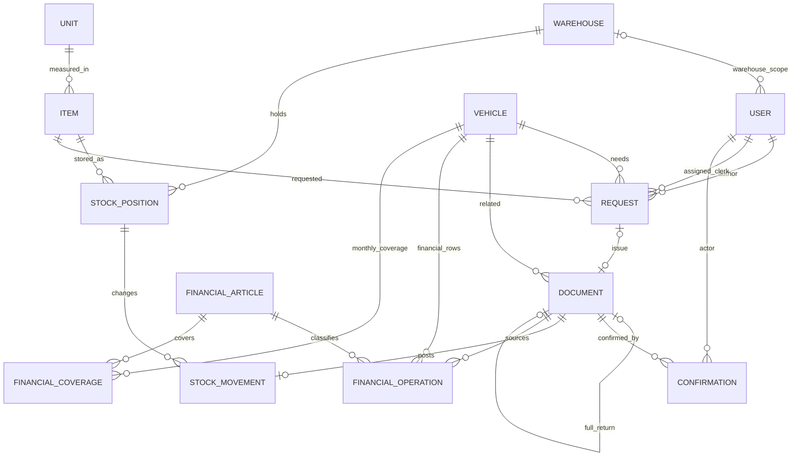

# Модель данных

Дата: 23 ноября 2026 года.

Продукт: учебный сайт «Отдел снабжения» для использования внутри компании.

Источники: [контракт MVP](../3-mvp.md), [сценарии](сценарии.md), [роли и авторизация](роли-авторизация.md), [экраны](экраны.md). Дополнительно учтены ответы автора: выбор из общей номенклатуры и сохранение заявки в очереди при нехватке остатка.

Модель содержит 13 бизнес-сущностей и один технический снимок демонстрации. Это логическая модель связанного набора данных; она не требует отдельной таблицы базы данных для каждого блока и не добавляет сервер в текущий MVP. В браузере сущности могут храниться типизированными коллекциями одного снимка.

**Граница текущей версии:** один учебный сайт, подготовленные данные, одна позиция в заявке, полная выдача и один полный возврат. Реальные пользователи, настоящая авторизация, импорт, закупки и эксплуатационная многопользовательская база остаются за пределами MVP. Сущность «Пользователь» нужна уже сейчас для авторства и двух сторон подтверждения; будущие реквизиты входа отдельно помечены.

**Типы и обязательность**

- `UUID/string` — непрозрачный устойчивый идентификатор; связи не строятся по имени, номеру машины или названию детали.
- `date` — календарная дата YYYY-MM-DD; `datetime` — момент ISO 8601 с часовым поясом. Месяц учёта определяется в едином accounting_timezone, для демо выбран Asia/Kamchatka.
- `decimal(15,3)` — точное количество с максимум тремя знаками после запятой; в JSON допустимо хранить канонической десятичной строкой. Для штучной единицы разрешены только целые значения.
- Денежные `integer` — копейки одной валюты RUB. 0 является известной нулевой суммой; null означает неизвестность. Для выдачи сумма округляется до копейки один раз по согласованному правилу half-up; возврат использует сохранённую исходную сумму.
- `required` — значение обязательно при создании допустимой записи; `nullable` — разрешён null с указанным смыслом. Условная обязательность документа дополнительно зависит от его типа и проведения.
- `derived` — вычисляемое поле; оно не сохраняется и не редактируется второй независимой копией.
- C/R/U/D означают создание, чтение, изменение и удаление. Не перечисленные разрешения отсутствуют. Автоматическое следствие выдачи не является отдельной формой ручного редактирования денег или остатков.
- В демо права ограничивают видимые поля и действия, но посетитель может сменить роль. Настоящие серверные права описаны как требования будущей рабочей версии; реквизиты настоящего входа не хранятся в браузерном демонаборе.

## Сущность 1: Пользователь

Логическое имя: `User`.

### Поля

| Поле | Тип | Обязательность | Описание |
|---|---|---|---|
| id | UUID / string | required | Идентификатор участника; выбирается при демонстрационном переключении, не меняется при смене режима. |
| display_name | string | required | Имя для заявок, документов и подтверждений. |
| role | enum | required | MECHANIC, DRIVER, WAREHOUSE, FINANCE_DIRECTOR или OWNER. Одна роль у одного демонстрационного участника. |
| warehouse_id | FK → Warehouse.id | nullable | Обязателен для кладовщика; для остальных ролей null. |
| is_default_clerk | boolean | required | Ответственный по умолчанию для склада; у остальных ролей false. |
| is_active | boolean | required | Можно ли выбирать участника; в MVP задаётся подготовленным набором. |
| created_at | datetime | required | Дата создания записи участника, без утверждения о реальной регистрации сотрудника. |
| login | string | nullable; required после MVP | Только на нашем сервере в корпоративной версии; уникальный логин учётной записи сайта. В демонабор не включается. |
| password_hash | string | nullable; required после MVP | Только серверное хранилище выбранной библиотеки входа; не пароль в открытом виде и не пароль от 1С. В демонабор и ответы клиенту не включается. |

### Связи

- Склад 1 → N пользователей-кладовщиков; пользователь-кладовщик относится к одному складу.
- Пользователь 1 → N заявок как автор; отдельно 1 → N заявок как ответственный кладовщик.
- Пользователь 1 → N документов как создатель или получатель; 1 → N подтверждений как участник.

### Права (CRUD по ролям)

- **C:** Подготовка демонстрационного набора; ни одна из пяти бизнес-ролей не создаёт пользователей через интерфейс MVP.
- **R:** Все роли видят доступные им имена и роли для выбора участника, автора, получателя и кладовщика; реквизиты настоящего входа не выдаются.
- **U:** Бизнес-роли не редактируют пользователя. Выбор другого участника меняет контекст демонстрации, а не поле role.
- **D:** Через бизнес-интерфейс запрещено; пользователь с историей документов не удаляется.

### Ограничения

- Не более одного активного is_default_clerk=true для одного склада; role=WAREHOUSE и warehouse_id должны соответствовать друг другу.
- После MVP для настоящего входа добавляются серверные поля login:string и password_hash:string, обязательные в рабочей версии и отсутствующие в демонаборе. Хеш пароля не доступен ни одной бизнес-роли, включая собственника. Пароли в открытом виде не сохраняются.
- Сессии и реквизиты входа реализуются выбранной серверной библиотекой после определения стека; текущая модель не добавляет авторизацию в MVP.

## Сущность 2: Машина

Логическое имя: `Vehicle`.

### Поля

| Поле | Тип | Обязательность | Описание |
|---|---|---|---|
| id | UUID / string | required | Устойчивая связь машины со всеми операциями. |
| display_name | string | required | Понятное обозначение машины или спецтехники. |
| registration_number | string | nullable | Госномер, если он задан в подготовленных данных. |
| vin | string | nullable | VIN. Отсутствие допустимо для показа неполного примера, но блокирует фактическую выдачу до выбора корректной машины. |
| is_active | boolean | required | Доступность машины для новой заявки. |

### Связи

- Машина 1 → N заявок, документов и финансовых операций.
- Машина 1 → N записей покрытия финансовых данных по месяцам и статьям.

### Права (CRUD по ролям)

- **C:** Только подготовленный набор, без формы добавления машины.
- **R:** Все роли — обозначение и VIN в разрешённом процессе; финансовые показатели читаются отдельно только финдиректором и собственником.
- **U:** Ни одна бизнес-роль в MVP не меняет реквизиты машины.
- **D:** Запрещено для машины с операциями; удаление через интерфейс не предусмотрено.

### Ограничения

- Известный VIN уникален в наборе. Отсутствующий VIN не подменяется значением другой машины.

## Сущность 3: Единица измерения

Логическое имя: `Unit`.

### Поля

| Поле | Тип | Обязательность | Описание |
|---|---|---|---|
| id | UUID / string | required | Идентификатор единицы. |
| code | string | required | Уникальный код, например pcs или liter. |
| name | string | required | Отображаемое обозначение, например «шт.». |
| quantity_scale | integer, 0…3 | required | Допустимое количество знаков после запятой: 0 для штучных позиций. |

### Связи

- Единица 1 → N позиций номенклатуры; используется в снимках документов и движениях.

### Права (CRUD по ролям)

- **C:** Подготовленный справочник.
- **R:** Все роли в разрешённых им формах и документах.
- **U:** Через интерфейс MVP запрещено.
- **D:** Запрещено при ссылках из номенклатуры или документов.

### Ограничения

- Значение с избыточной дробной частью отклоняется, а не округляется молча. Пересчёт между разными единицами не вводится.

## Сущность 4: Позиция общей номенклатуры

Логическое имя: `Item`.

### Поля

| Поле | Тип | Обязательность | Описание |
|---|---|---|---|
| id | UUID / string | required | Общий идентификатор позиции для всех участников. |
| article | string | required | Артикул для различения похожих названий. |
| name | string | required | Название детали. |
| unit_id | FK → Unit.id | required | Единица количества. |
| reference_unit_price_minor | integer, ≥0 | nullable | Подготовленная цена единицы в копейках; null означает неизвестную цену, 0 — известную нулевую. |
| is_active | boolean | required | Разрешено ли выбирать позицию в новой заявке. |

### Связи

- Единица 1 → N позиций.
- Позиция 1 → N заявок и документов; позиция 1 → N складских позиций по складам.

### Права (CRUD по ролям)

- **C:** Подготовка общей номенклатуры. Свободный ввод новой позиции бизнес-ролями не предусмотрен.
- **R:** Механик и водитель — название, артикул, единица и наличие без цены; кладовщик — также цена; руководство — реквизиты и суммы в финансовом разборе.
- **U:** Ручное изменение справочника и цены в MVP запрещено.
- **D:** Не удаляется при наличии ссылок; недоступность новой выдачи задаётся is_active.

### Ограничения

- Поиск выполняется в общей номенклатуре; комментарий механика не становится новой позицией.
- Для текущего демо цена одна на позицию, валюта одна — RUB. Методики складской оценки и реальные интеграции с 1С не добавляются.
- Выдача фиксирует свою цену на момент проведения; возврат использует именно её, а не текущую справочную цену.

## Сущность 5: Склад

Логическое имя: `Warehouse`.

### Поля

| Поле | Тип | Обязательность | Описание |
|---|---|---|---|
| id | UUID / string | required | Идентификатор демонстрационного склада. |
| name | string | required | Название склада. |
| is_active | boolean | required | Доступность склада для новых операций. |
| default_clerk_id | derived FK → User.id | nullable, вычисляемое | Активный пользователь этого склада с is_default_clerk=true; не хранится второй независимой копией. |

### Связи

- Склад 1 → N кладовщиков, складских позиций, заявок и складских документов.
- Для MVP достаточно одного подготовленного склада.

### Права (CRUD по ролям)

- **C:** Подготовленный набор.
- **R:** Механик и водитель — название и наличие; кладовщик — данные своего склада; руководство — склад в источнике расхода.
- **U:** Изменение склада и назначения ответственных через интерфейс не предусмотрено.
- **D:** Запрещено при наличии остатков и документов.

### Ограничения

- Если ответственный не найден, отправка заявки не объявляется успешной; выбор произвольного сотрудника вместо него запрещён.

## Сущность 6: Складская позиция и остаток

Логическое имя: `StockPosition`.

### Поля

| Поле | Тип | Обязательность | Описание |
|---|---|---|---|
| id | UUID / string | required | Идентификатор пары склада и позиции. |
| warehouse_id | FK → Warehouse.id | required | Склад учёта. |
| item_id | FK → Item.id | required | Позиция общей номенклатуры. |
| initial_quantity | decimal(15,3), ≥0 | nullable | Исходный подготовленный остаток. null — наличие неизвестно; 0 — известное отсутствие. |
| current_quantity | derived decimal(15,3) | nullable, вычисляемое | initial_quantity + сумма связанных движений; при неизвестном исходном остатке null. |

### Связи

- Склад 1 → N складских позиций; номенклатура 1 → N складских позиций.
- Складская позиция 1 → N складских движений.

### Права (CRUD по ролям)

- **C:** Подготовленный набор; поступления и создание новых складских позиций через интерфейс не входят в MVP.
- **R:** Механик и водитель — наличие; кладовщик — наличие своего склада; руководство — сведения в источниках операций.
- **U:** Текущий остаток меняется только расчётом по проведённой выдаче или возврату. Прямой ввод остатка бизнес-ролями запрещён.
- **D:** Запрещено при наличии движений.

### Ограничения

- Уникальна пара (warehouse_id,item_id). Отдельная строка для каждого запроса не создаётся.
- Неизвестное наличие блокирует выдачу; недостаточное известное наличие оставляет заявку в очереди.
- Подготовка документа, подтверждение получателя и печать не создают движения и не меняют остаток.

## Сущность 7: Заявка на запчасть

Логическое имя: `Request`.

### Поля

| Поле | Тип | Обязательность | Описание |
|---|---|---|---|
| id | UUID / string | required | Создаётся один раз на попытку отправки; повтор использует тот же идентификатор. |
| number | string | required | Уникальный номер заявки в демонстрации. |
| created_at | datetime | required | Время успешного создания. |
| author_user_id | FK → User.id | required | Механик либо водитель, создавший заявку. |
| warehouse_id | FK → Warehouse.id | required | Склад обработки. |
| assigned_clerk_id | FK → User.id | required | Определённый при отправке ответственный кладовщик этого склада. |
| vehicle_id | FK → Vehicle.id | required | Машина, для которой нужна деталь. |
| item_id | FK → Item.id | required | Одна выбранная позиция общей номенклатуры. |
| quantity | decimal(15,3), >0 | required | Полное запрошенное количество с точностью выбранной единицы. |
| comment | string | nullable | Пояснение потребности. |
| cancelled_at | datetime | nullable | Явная отмена автором до фактической выдачи. |
| status | derived enum | required, вычисляемое | NEW, PREPARED, ISSUED, CANCELLED или RETURNED из документов и cancelled_at. |
| availability | derived enum | required, вычисляемое | ENOUGH, SHORTAGE или UNKNOWN по текущему остатку; это не статус подписания. |

### Связи

- Пользователь 1 → N заявок как автор и отдельно как ответственный.
- Машина, склад и номенклатура 1 → N заявок.
- Заявка 1 → 0..1 документ типа ISSUE. Документ возврата связан через исходную выдачу.

### Права (CRUD по ролям)

- **C:** Механик и водитель от своего имени; ответственный назначается системой.
- **R:** Автор — свою заявку; кладовщик — заявки своего склада; финдиректор и собственник — связанную заявку при разборе источника расхода. Получение по чужой заявке не даёт автоматически доступ ко всей чужой карточке.
- **U:** Автор может явно отменить свою ещё не выданную заявку. Рабочие состояния меняются системой по операциям. Ручное редактирование потребности после отправки в этом MVP не добавляется; до выдачи можно отменить и создать новую.
- **D:** Физическое удаление запрещено; отменённая заявка сохраняет историю.

### Ограничения

- Позиция одна, отдельная таблица строк заявки пока не нужна.
- SHORTAGE показывается как «Недостаточно на складе»: заявку можно отправить, она остаётся в очереди, выдача заблокирована. Автоматической отмены или закупки нет.
- Новая выдача требует полного количества заявки. Повторное создание выдачи по уже выданной или возвращённой заявке запрещено.

## Сущность 8: Документ операции

Логическое имя: `Document`.

### Поля

| Поле | Тип | Обязательность | Описание |
|---|---|---|---|
| id | UUID / string | required | Идентификатор документа; повтор проведения использует тот же id. |
| kind | enum | required | ISSUE — выдача; RETURN — полный возврат; SOURCE — подготовленный источник дохода или другого расхода. |
| number | string | nullable | Обязателен для ISSUE и RETURN; у неполного SOURCE может отсутствовать с явной пометкой. |
| document_date | date | required | Дата документа. При проведении складской операции соответствует дате фактического события в часовом поясе демо. |
| created_at | datetime | required | Создание документа. |
| created_by_user_id | FK → User.id | nullable | Для ISSUE и RETURN обязателен кладовщик; для подготовленного SOURCE может быть null. |
| posting_state | enum | required | PREPARED или POSTED. Для SOURCE используется POSTED как признак включённого подготовленного источника, без складского проведения. |
| posted_at | datetime | nullable | Для проведённых ISSUE и RETURN обязателен; для PREPARED отсутствует. У SOURCE точное время может быть неизвестно. |
| request_id | FK → Request.id | nullable | Обязателен только для ISSUE; уникален среди выдач. |
| return_of_document_id | FK → Document.id | nullable | Обязателен только для RETURN, ссылается на проведённый ISSUE; уникален среди возвратов. |
| warehouse_id | FK → Warehouse.id | nullable | Обязателен для ISSUE и RETURN; SOURCE может не относиться к складу. |
| vehicle_id | FK → Vehicle.id | required | Машина операции; строки финансового источника относятся к этой же машине. |
| vehicle_vin_snapshot | string | nullable | Для проведённых ISSUE и RETURN обязателен; фиксируется при выдаче, возврат копирует исходное значение. |
| item_id | FK → Item.id | nullable | Обязателен для ISSUE и RETURN; для SOURCE детали хранятся в финансовых строках, если известны. |
| unit_id | FK → Unit.id | nullable | Обязателен для ISSUE и RETURN; фиксирует единицу документа. |
| quantity | decimal(15,3), >0 | nullable | Обязателен для ISSUE и RETURN. Выдача равна количеству заявки, полный возврат — количеству исходной выдачи. |
| recipient_user_id | FK → User.id | nullable | Обязателен для ISSUE; RETURN копирует получателя исходной выдачи. Для SOURCE null. |
| unit_price_minor | integer, ≥0 | nullable | Снимок цены выдачи в копейках; неизвестная цена остаётся null. Для RETURN копируется из исходной выдачи. |
| amount_minor | integer, ≥0 | nullable | Сумма выдачи по снимку цены и количеству. RETURN копирует исходную положительную сумму; знак финансовой корректировки задаётся финансовой операцией. Для SOURCE суммы берутся из его финансовых строк. |
| discrepancy_comment | string | nullable | Одно пояснение фактического получателя «Есть расхождение», без автоматического подтверждения или возврата. |
| discrepancy_author_id | FK → User.id | nullable | Указанный получатель, оставивший пояснение; обязателен при discrepancy_comment. |
| discrepancy_at | datetime | nullable | Время пояснения; обязательно при discrepancy_comment. |
| display_status | derived enum | required, вычисляемое | Для ISSUE: PREPARED, ISSUED_WAITING_RECEIPT, ISSUED_CONFIRMED или RETURNED; для RETURN — «Возврат», для SOURCE — «Подготовленный источник». |

### Связи

- Заявка 1 → 0..1 ISSUE. Каждый ISSUE относится ровно к одной заявке.
- ISSUE 1 → 0..1 RETURN; RETURN относится ровно к одному ISSUE.
- ISSUE 1 → 0..2 подтверждения; для SOURCE и RETURN подтверждения двух сторон не создаются.
- Документ 1 → 0..1 складское движение. SOURCE не создаёт движения.
- Документ SOURCE 1 → N финансовых строк; каждый проведённый ISSUE и RETURN имеет ровно одну финансовую строку.

### Права (CRUD по ролям)

- **C:** Кладовщик — ISSUE из заявки своего склада и RETURN по фактически возвращённой выдаче. SOURCE загружается подготовленным набором, без формы ручного ввода доходов и расходов.
- **R:** Автор заявки и получатель — связанные складские документы без денежных полей; кладовщик — документы своего склада с денежными реквизитами; финдиректор и собственник — источники финансового разбора. SOURCE доступен руководству.
- **U:** До проведения кладовщик уточняет получателя; реквизиты заявки сверяются, цена фиксируется системой при проведении. После проведения количественные и денежные поля неизменяемы. Получатель может оставить только пояснение о расхождении; подтверждения создаются отдельно.
- **D:** Проведённые документы не удаляются. Отмена незавершённой формы не проводится как выдача; подготовленный документ отменённой заявки остаётся недоступным к проведению.

### Ограничения

- Единый Document — общая модель экрана документа и печати, а не три разных набора несогласованных данных.
- Обязательность полей зависит от kind и posting_state. ISSUE/RETURN без корректных машины, VIN, позиции, единицы, количества и склада не проводятся.
- ISSUE.request_id уникален; RETURN.return_of_document_id уникален. Возврат того же документа нельзя повторить даже с новым id.
- Подготовленный документ не резервирует и не списывает запас. При отменённой заявке проведение запрещено.
- После POSTED нельзя менять машину, позицию, количество и сумму задним числом. Для исправления используется полный возврат и новая корректная заявка.
- Статус RETURNED имеет приоритет над наличием прежнего подтверждения получателя; история двух подтверждений не стирается.
- Внутренние номера ISSUE и RETURN уникальны в пределах типа. Номер SOURCE может повторяться; связи строятся по id, не по номеру.
- created_by_user_id показывает подготовившего документ; фактически выдавший кладовщик определяется подтверждением WAREHOUSE.
- SOURCE не получает складского движения или двух подтверждений даже при posting_state=POSTED. Его строки относятся к заданной машине документа.

## Сущность 9: Подтверждение участника

Логическое имя: `Confirmation`.

### Поля

| Поле | Тип | Обязательность | Описание |
|---|---|---|---|
| id | UUID / string | required | Идентификатор попытки подтверждения. |
| document_id | FK → Document.id | required | Только документ ISSUE. |
| side | enum | required | WAREHOUSE либо RECIPIENT. |
| actor_user_id | FK → User.id | required | Кладовщик этой выдачи либо фактический получатель. |
| confirmed_at | datetime | required | Момент действия; время складского подтверждения совпадает с posted_at выдачи. |

### Связи

- Выдача 1 → 0..2 подтверждения; каждое подтверждение относится к одной выдаче.
- Пользователь 1 → N своих подтверждений.

### Права (CRUD по ролям)

- **C:** Кладовщик создаёт WAREHOUSE вместе с фактической выдачей; указанный получатель создаёт RECIPIENT после неё.
- **R:** Участники доступного документа, кладовщик и руководство видят имя, сторону и время.
- **U:** Запрещено: подтверждение неизменно.
- **D:** Запрещено: возврат не удаляет прежние подтверждения.

### Ограничения

- Уникальна пара (document_id,side). Повтор подтверждения возвращает существующий результат без нового расхода.
- RECIPIENT невозможен до WAREHOUSE, после полного возврата либо от другого пользователя.
- Если получает водитель, отдельное подтверждение механика не создаётся. Руководитель не является стороной выдачи.
- Это демонстрационная фиксация действия, а не юридическая электронная подпись.

## Сущность 10: Складское движение

Логическое имя: `StockMovement`.

### Поля

| Поле | Тип | Обязательность | Описание |
|---|---|---|---|
| id | UUID / string | required | Идентификатор неизменяемого события. |
| stock_position_id | FK → StockPosition.id | required | Пара склада и номенклатуры. |
| document_id | FK → Document.id | required | Проведённая выдача либо возврат; уникален среди движений. |
| quantity_delta | decimal(15,3), ≠0 | required | Выдача — отрицательное количество, полный возврат — положительное исходное количество. |
| occurred_at | datetime | required | Момент фактической выдачи либо возврата. |

### Связи

- Складская позиция 1 → N движений.
- Проведённый ISSUE или RETURN 1 → 1 движение; SOURCE 1 → 0 движений.

### Права (CRUD по ролям)

- **C:** Система по подтверждённому действию кладовщика; ручного создания движения нет.
- **R:** Кладовщик — движения своего склада, руководство — связь с источником расхода. Механик и водитель видят разрешённый остаток и свою операцию, без общего журнала склада.
- **U:** Запрещено.
- **D:** Запрещено; исправление выполняется обратным движением по полному возврату.

### Ограничения

- Склад, позиция, единица и количество должны совпадать с документом.
- После выдачи рассчитанный известный остаток не может стать отрицательным. При неизвестном исходном наличии выдача запрещена.
- На один документ — одно движение; просмотр, печать и подтверждение получателя не создают движения.

## Сущность 11: Финансовая статья

Логическое имя: `FinancialArticle`.

### Поля

| Поле | Тип | Обязательность | Описание |
|---|---|---|---|
| id | UUID / string | required | Идентификатор статьи. |
| name | string | required | Название, например доход, запчасти или топливо. |
| direction | enum | required | INCOME либо EXPENSE; определяет участие в формуле результата. |
| included_in_result | boolean | required | Включена ли статья в согласованную методику демо. |
| description | string | nullable | Пояснение состава и границ статьи. |

### Связи

- Статья 1 → N финансовых операций.
- Статья 1 → N записей покрытия по машине и месяцу.

### Права (CRUD по ролям)

- **C:** Подготовленная методика демонстрации.
- **R:** Финдиректор и собственник — все статьи; кладовщик — только смысл складского расхода в своём документе. Механику и водителю финансовый справочник не показывается.
- **U:** Настройка методики через интерфейс не входит в MVP.
- **D:** Запрещено при финансовых операциях.

### Ограничения

- Осознанно исключённая статья отличается от статьи с неизвестными суммами; её наличие не даёт оснований называть результат полной чистой прибылью.

## Сущность 12: Финансовая операция

Логическое имя: `FinancialOperation`.

### Поля

| Поле | Тип | Обязательность | Описание |
|---|---|---|---|
| id | UUID / string | required | Идентификатор строки расчёта. |
| document_id | FK → Document.id | required | Печатный источник операции. |
| vehicle_id | FK → Vehicle.id | required | Машина, совпадающая с машиной документа. |
| article_id | FK → FinancialArticle.id | required | Ровно одна статья, без повторного учёта в нескольких статьях. |
| accounting_date | date | required | Дата учёта: для ISSUE/RETURN из времени фактического события в часовом поясе демо; для SOURCE — дата подготовленной операции. |
| amount_minor | signed integer | nullable | Сумма в копейках: обычный доход/расход — положительная; возврат — отрицательный расход. null означает неизвестную сумму. |
| description | string | nullable | Пояснение строки, особенно для исходного расхода без номенклатуры. |
| item_id | FK → Item.id | nullable | Деталь или другая позиция, если применимо; для ISSUE/RETURN обязательна. |
| quantity | decimal(15,3) | nullable | Количество, если известно и применимо. Для ISSUE/RETURN обязательно и совпадает с документом. |
| unit_id | FK → Unit.id | nullable | Единица количества; обязательна при quantity. |
| unit_price_minor | integer, ≥0 | nullable | Цена, если применима. Известная сумма SOURCE допустима без известной цены или количества. |

### Связи

- Машина и статья 1 → N финансовых операций.
- SOURCE 1 → N строк; проведённый ISSUE/RETURN 1 → ровно 1 строку.
- Каждая строка имеет доступный исходный документ, а не отдельный несвязанный текстовый номер.

### Права (CRUD по ролям)

- **C:** SOURCE — подготовленные сведения. ISSUE/RETURN — автоматическое следствие операции кладовщика; ручного ввода денежных строк нет.
- **R:** Финдиректор и собственник — все строки разбора. Кладовщик — только денежная проекция своего складского документа, без доходов, общего расхода и результата машины. Механик и водитель денежных полей не читают.
- **U:** Ручное редактирование запрещено; после создания строки сумма не меняется по подписи получателя.
- **D:** Запрещено. Обратная строка возврата сохраняет исходный расход.

### Ограничения

- Для ISSUE сумма равна Document.amount_minor, статья — расход запчастей; для RETURN сумма равна минус исходной сумме выдачи.
- У RETURN неизвестная исходная сумма остаётся неизвестной: null не заменяется нулём. Повторного расчёта по новой цене номенклатуры нет.
- Уникальность финансовой строки на document_id обязательна для ISSUE и RETURN; для SOURCE возможны несколько строк с разными id.
- Известный доход и частично известные расходы дают только явно обозначенный частичный результат. Пропуски не исчезают из расчёта молча.
- Результат = сумма включённых доходов − сумма включённых расходов. Отрицательная расходная строка возврата уменьшает расходы.

## Сущность 13: Покрытие финансовых данных

Логическое имя: `FinancialCoverage`.

### Поля

| Поле | Тип | Обязательность | Описание |
|---|---|---|---|
| id | UUID / string | required | Идентификатор сведений о полноте. |
| vehicle_id | FK → Vehicle.id | required | Машина. |
| period_start | date | required | Первый день месяца учёта. |
| article_id | FK → FinancialArticle.id | required | Статья, для которой известна полнота исходных сведений. |
| base_status | enum | required | NOT_PREPARED, PARTIAL или COMPLETE — полнота подготовленных исходных сведений, до новых действий демо. |
| note | string | nullable | Пояснение пропусков или подтверждённого отсутствия исходных операций. |
| effective_status | derived enum | required, вычисляемое | NOT_PREPARED, PARTIAL, COMPLETE или ERROR: результат base_status, известных строк, неизвестных сумм и конфликтов данных. |

### Связи

- Машина 1 → N покрытий; статья 1 → N покрытий.
- Уникальна тройка (vehicle_id,period_start,article_id). Финансовые операции относятся к покрытию через ту же машину, месяц и статью.

### Права (CRUD по ролям)

- **C:** Подготовка набора и методики; приложение может создать отсутствующую запись как NOT_PREPARED, но не как заведомо полную.
- **R:** Финдиректор и собственник — пояснение полноты и состав расчёта.
- **U:** Полнота исходного набора не объявляется полной от одного действия пользователя; effective_status пересчитывается системой. Ручного редактора покрытия нет.
- **D:** Через интерфейс запрещено.

### Ограничения

- Отсутствующая запись покрытия означает неподготовленные сведения, а не нулевые операции.
- COMPLETE и отсутствие относящихся операций позволяют показать 0. При NOT_PREPARED или PARTIAL отсутствие строк не доказывает нулевой доход либо расход.
- Новая выдача может добавить известную часть расходов в неподготовленный месяц; это не делает весь месяц полным.
- Даже COMPLETE становится эффективным частичным состоянием при неизвестной сумме либо конфликте данных.
- Полный результат по учтённым статьям возможен только при подтверждённой полноте всех включённых статей. Полная чистая прибыль этим не обещается.
- ERROR применяется при некорректных или противоречащих данных. При наличии известной части и неподготовленном источнике показывается PARTIAL; без подтверждённого полного покрытия неизвестные итоги не считаются нулём.

## Сущность 14: Состояние демонстрации

Логическое имя: `DemoState`.

### Поля

| Поле | Тип | Обязательность | Описание |
|---|---|---|---|
| id | string | required | Идентификатор единственного сохраняемого снимка в текущем браузере. |
| dataset_id | string | required | Какой подготовленный набор используется. |
| schema_version | integer, >0 | required | Версия формата для проверки совместимости сохранения. |
| revision | integer, ≥0 | required | Номер успешно сохранённой версии; устаревшая форма проверяется перед действием. |
| saved_at | datetime | required | Время последнего успешного сохранения. |
| selected_user_id | FK → User.id | nullable | Текущий демонстрационный участник; не является доказательством личности. |
| default_warehouse_id | FK → Warehouse.id | required | Склад новых заявок в учебной версии. |
| currency | enum RUB | required | Одна валюта демонстрации; все денежные значения в копейках. |
| accounting_timezone | string, IANA timezone | required | Единый часовой пояс определения даты учёта; для демо выбран Asia/Kamchatka. |
| data | typed collections | required | Коллекции остальных 13 сущностей с проверяемыми связями; это снимок состояния, не произвольные неописанные поля. |

### Связи

- Один снимок содержит коллекции всех бизнес-сущностей и ссылки на выбранного пользователя и склад.
- Несколько браузеров имеют независимые снимки; общего серверного учёта в MVP нет.

### Права (CRUD по ролям)

- **C:** Первое открытие сайта загружает подготовленный набор.
- **R:** Приложение читает снимок для работы; интерфейс показывает только поля выбранного режима. В демо это не реальная защита конфиденциальности.
- **U:** Приложение сохраняет целиком успешную бизнес-операцию или смену контекста; роли не редактируют JSON вручную через интерфейс.
- **D:** Только явный сброс демонстрации после подтверждения: удаляются учебные изменения и восстанавливается исходный набор. Отмена сброса сохраняет текущий снимок.

### Ограничения

- Выдача сохраняет вместе документ, складское подтверждение, движение и финансовую строку; возврат — документ возврата, обратное движение и обратную финансовую строку.
- При неуспешном сохранении новая версия не считается принятой; интерфейс сохраняет прежнее согласованное состояние и введённые данные для безопасного повтора.
- Перезагрузка не дописывает новые операции. Повреждённый или несовместимый снимок не сбрасывается молча.
- Будущие реквизиты настоящего входа и реальные данные компании в DemoState не включаются.

## Условия связей и запрет дублей

| Связь или уникальность | Правило |
|---|---|
| Request → ISSUE | 1 к 0..1; единственная выдача на заявку, даже если пользователь повторил действие с другим id документа. |
| ISSUE → RETURN | 1 к 0..1; единственный полный возврат по исходной выдаче. Возвращённая выдача не проводится снова. |
| ISSUE → Confirmation | 1 к 0..2; по одному WAREHOUSE и RECIPIENT. Обе стороны обязательны для состояния «Выдан и подписан». |
| ISSUE/RETURN → StockMovement | 1 к 1 после успешного проведения; 0 для неподтверждённой выдачи и SOURCE. |
| ISSUE/RETURN → FinancialOperation | 1 к 1 после успешного проведения, включая строку с неизвестной суммой. |
| SOURCE → FinancialOperation | 1 ко многим; исходный документ не создаёт складских событий. |
| Warehouse + Item → StockPosition | Одна строка на пару склада и номенклатуры. |
| Vehicle + месяц + FinancialArticle → FinancialCoverage | Одна запись покрытия; отсутствие записи не означает нулевой итог. |

Пользователи и документы связаны как многие-ко-многим через Confirmation с ограничением двух сторон. Машины и позиции связаны как многие-ко-многим через заявки и документы; отдельная таблица постоянного закрепления деталей за машиной не требуется.

## Операции, сохраняемые совместно

### Создание заявки

1. Активный механик или водитель выбирает существующую машину, позицию и допустимое количество.
2. Определяется кладовщик склада; сохраняется одна заявка с устойчивым id.
3. При нехватке заявка сохраняется с вычисляемой отметкой SHORTAGE. Движения и финансовые строки не создаются.

### Фактическая выдача

1. Сверяются заявка, отсутствие отмены, машина/VIN, позиция, единица, полное количество, достаточный известный остаток, получатель и отсутствие прежнего проведения.
2. Для одного Document.id сохраняются вместе: POSTED и время физической передачи; снимок цены и суммы; Confirmation стороны WAREHOUSE; отрицательный StockMovement; одна расходная FinancialOperation.
3. Все связанные записи согласованно входят в новый DemoState. Только успешное сохранение объявляется завершённой выдачей.
4. Количество и стоимость фиксируются на момент выдачи. Неизвестная цена допускает неизвестный расход с видимой неполнотой; неизвестный остаток не допускает выдачу.

### Подтверждение получателя

Создаётся только Confirmation стороны RECIPIENT от указанного получателя после фактической выдачи. StockMovement и FinancialOperation повторно не создаются. Если сообщает о расхождении, сохраняется пояснение в документе, а получение автоматически не подтверждается.

### Полный возврат

1. Кладовщик подтверждает физическое возвращение всей исходной позиции.
2. Вместе сохраняются: Document типа RETURN со ссылкой на исходный ISSUE; положительное StockMovement на исходное количество; отрицательная расходная FinancialOperation на исходную сумму.
3. Исходная выдача и подтверждения остаются в истории; вычисляемое состояние выдачи становится RETURNED.
4. Дата возврата определяет месяц обратной операции. Новая цена каталога не меняет сумму возврата, неизвестная исходная сумма остаётся неизвестной.

### Повтор, отмена и сбой

- Одна пользовательская попытка сохраняет идентификаторы и время фактического события для повторов; время успешного сохранения снимка отдельно хранится в saved_at.
- Двойное нажатие, обновление страницы, печать и повтор подтверждения не создают новое списание.
- При неопределённом результате сначала перечитывается сохранённый снимок; затем повторяется та же операция с проверкой бизнес-уникальности.
- Отмена неподтверждённой формы не меняет склад и финансовые строки. После фактической выдачи отмена просмотра или отказ от получения не откатывают передачу.
- При неуспешном сохранении интерфейс не показывает успешное новое состояние и не оставляет несогласованные части операции.
- Revision помогает обнаружить устаревшую форму, но не является серверной блокировкой. MVP рассчитывается на одну активную вкладку демонстрации; гарантии конкурентной работы нескольких вкладок или устройств не заявляются.

## Производные показатели

- Текущее наличие = исходный остаток + все проведённые движения по паре склада и позиции.
- Отметка SHORTAGE ставится при известном остатке меньше количества заявки; UNKNOWN — при неизвестном остатке. Обе не позволяют провести выдачу, но не удаляют заявку.
- Состояние заявки определяется отменой, подготовленным документом, фактической выдачей и полным возвратом; не редактируется произвольной строкой.
- Ожидание получателя определяется отсутствием RECIPIENT после складского подтверждения; финансовый расход уже существует.
- Доходы и расходы выбираются по машине и месяцу accounting_date; учитывается каждая строка один раз и только в одной статье.
- Результат по учтённым статьям = доходы − расходы. Возврат является отрицательным расходом, а не новым доходом.
- Неподготовленное покрытие, неизвестные суммы и конфликтующие данные не дают ложного полного результата. Сумма известной части показывается с явной пометкой.
- Печатная форма, списки, детализация и карточка машины являются представлениями этой модели; отдельные сущности «Отчёт», «Печатная форма» и «Финансовый результат» для копирования сумм не создаются.

## Поля, скрытые по ролям

| Роль | Разрешённая проекция |
|---|---|
| Механик и водитель | Свои заявки, связанные документы, машина/VIN, номенклатура, количество, наличие и подтверждения; без цен, сумм и финансового покрытия. |
| Кладовщик | Заявки и документы своего склада, количество, остатки, цена и сумма конкретной выдачи/возврата; без доходов, общего расхода и результата машины. |
| Финансовый директор и собственник | Финансовые статьи, покрытие, операции и их источники; чтение количественных и денежных реквизитов. Подтверждение чужой выдачи и ручное редактирование сумм недоступны. |
| Все бизнес-роли | Пароли, password_hash и секреты настоящих сессий не выдаются. |

Ограничения применяются также к поисковым подсказкам, сообщениям об ошибках и печати. В будущей рабочей версии сервер возвращает только разрешённые поля; скрытые элементы браузера не являются защитой. В текущем публичном демо все сведения синтетические и смена роли доступна посетителю.

## Схема связей

Схема показывает общие связи; условные ограничения по kind и posting_state уточнены в таблице уникальности и сущности Document.

## Контрольные примеры модели

1. **Обычная выдача:** исходный остаток 10 шт., заявка 2 шт., цена 50 000 коп. за штуку. После кладовщика: остаток 8 шт., одна расходная строка 100 000 коп., документ ожидает получателя. После получателя: остаток 8 шт. и та же одна строка.
2. **Полный возврат:** по той же выдаче возвращены 2 шт. Остаток снова 10 шт.; добавлена одна расходная строка −100 000 коп. Исходный расход не удалён. Если месяцы разные, выдача остаётся в своём месяце, корректировка — в месяце возврата.
3. **Неизвестная цена:** при достаточном известном остатке выдача уменьшает количество, но её денежная строка имеет amount_minor=null. Результат обозначается неполным; получение не превращает null в 0.
4. **Нехватка:** доступно 1 шт., требуется 2. Заявка существует, availability=SHORTAGE, движений и расхода по ней нет.
5. **Нет доходных строк:** при COMPLETE по соответствующей машине, месяцу и статье можно показать 0; при отсутствующем или NOT_PREPARED покрытии показывается «Нет данных».
6. **Повтор:** повторная выдача или возврат с новым техническим id всё равно отклоняется связями Request→ISSUE и ISSUE→RETURN; повтор получателя ограничен парой (document_id,side).

Примеры являются условиями будущей реализации и проверки, а не отчётом об уже работающем сайте.
