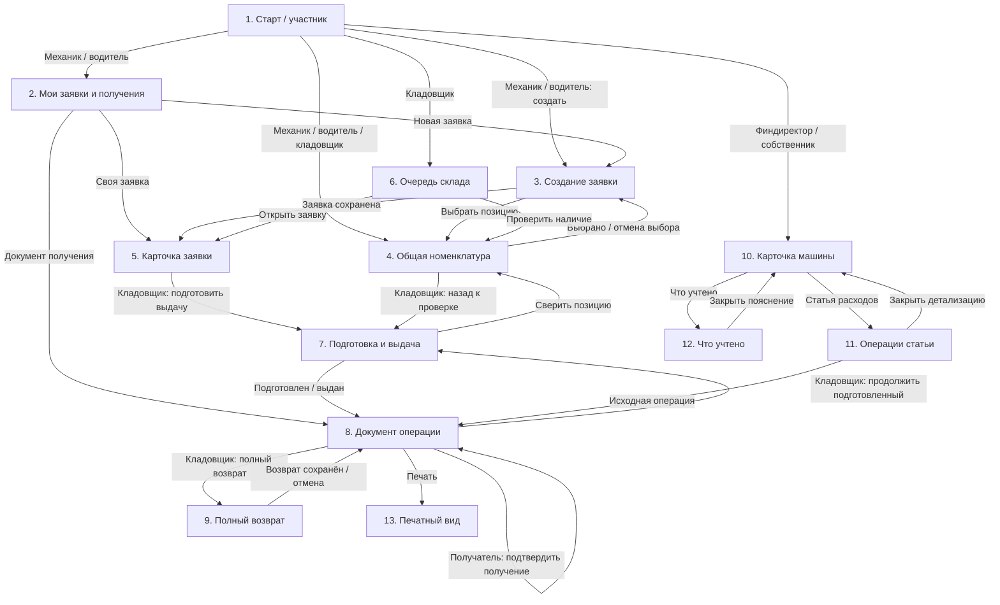
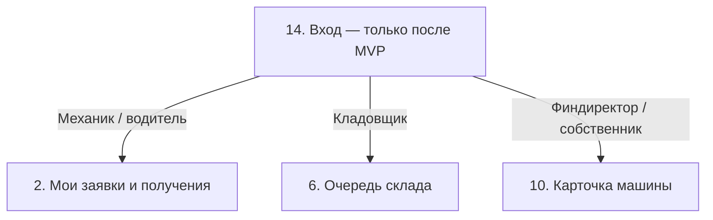

# Список экранов

Дата: 23 ноября 2026 года.

Продукт: сайт «Отдел снабжения» для использования внутри компании.

Источники: [контракт MVP](../3-mvp.md), [сценарии пользователя](сценарии.md), [роли и авторизация](роли-авторизация.md). Дополнительно учтены ответы автора от 23 ноября: выбор детали из общей номенклатуры и сохранение заявки в очереди при нехватке остатка.

Текущий MVP включает **13 экранов и представлений**: десять основных страниц, две встроенные информационные панели и печатный вид. Экран 14 описывает только будущий настоящий вход и не входит в учебный MVP. Все 35 Must-фич распределены по этим представлениям; выбор машины, фильтры, ошибки и подтверждения не превращаются в отдельные обязательные модули.

Указанный ниже доступ в демо определяет показываемые действия и поля. Любой посетитель может переключить демонстрационную роль; это не подтверждение личности и не защита рабочих сведений компании.

## Экран 1: Старт демонстрации и выбор участника

- **Тип:** Страница; переключатель участника доступен также в общей шапке.
- **Назначение:** Выбрать демонстрационного участника и перейти к его рабочей задаче.
- **Доступ:** Все пять демонстрационных ролей; до выбора участника доступен только общий старт.
- **Данные:** Имя и роль участника, пометка о синтетических данных, состояние загрузки и сохранённой сессии. После выбора — доступные действия: «Мои заявки», «Создать заявку», «Очередь склада», «Номенклатура», «Разобрать машину». Кнопка «Начать демонстрацию заново» открывает подтверждение сброса; отказ сохраняет состояние.
- **Переходы:** Механик и водитель → экран 2 либо 3, номенклатура → 4; кладовщик → 6 либо 4; финансовый директор и собственник → 10. Переключение при незавершённой форме предлагает остаться или отказаться от ввода. Само переключение не проводит операции.
- **Must-фичи:** №9, №10, №11, №13, №193.

## Экран 2: Мои заявки и получения

- **Тип:** Страница с вкладками «Мои заявки» и «Мне выдано».
- **Назначение:** Показать исполнителю его обращения и документы, ожидающие его подтверждения.
- **Доступ:** Механик и водитель: свои заявки и документы, в которых участник указан получателем.
- **Данные:** Номер и дата, машина/VIN, номенклатура, количество и единица, состояние заявки или документа, отметка наличия, необходимость подтверждения получения. Цены и суммы отсутствуют. Заявка другого автора может появиться во вкладке получения только как выдача этому получателю.
- **Переходы:** «Создать заявку» → 3; собственная заявка → 5; документ получения → 8; номенклатура → 4; старт → 1. Для пустого списка доступны создание заявки и номенклатура. Нехватка не удаляет строку.
- **Must-фичи:** №79, №82, №83, №85, №182.

## Экран 3: Создание заявки

- **Тип:** Страница с формой одной позиции.
- **Назначение:** Заявить потребность в одной позиции общей номенклатуры для конкретной машины.
- **Доступ:** Механик и водитель; механик — основной заявитель.
- **Данные:** Выбор машины с VIN, выбранная позиция общей номенклатуры, артикул, единица, количество, комментарий; наличие показывается справочно. Автор определяется выбранным участником, кладовщик — демонстрационным складом. Денежных полей нет. Нехватка не блокирует отправку, неизвестная позиция или недопустимое количество блокируют.
- **Переходы:** Выбрать позицию → 4 с возвратом в незавершённую форму; «Отправить» → 5 после успешного сохранения. При нехватке сохраняется отметка «Недостаточно на складе». «Отмена» → 2 или исходный экран без создания заявки. Сбой сохранения оставляет форму и повторяет ту же попытку.
- **Must-фичи:** №79, №81, №88, №183, №42, №43, №45, №47.

## Экран 4: Общая номенклатура и наличие

- **Тип:** Общая страница справочника; при выборе для формы используется тот же компонент с возвратом в форму.
- **Назначение:** Найти точную позицию по названию или артикулу и проверить её наличие.
- **Доступ:** Механик, водитель и кладовщик; денежные поля доступны только кладовщику.
- **Данные:** Поисковый запрос, наименование, артикул, идентификатор, единица, остаток демонстрационного склада. Выбранная строка раскрывает реквизиты в этой же странице. Кладовщик видит стоимость либо «Нет данных»; механик и водитель не видят цену. Нулевой остаток отличается от неизвестного, одинаковые названия различаются артикулом.
- **Переходы:** Выбор для заявки → 3 с заполнением позиции; сверка из выдачи → обратно в 7 без автоматической замены позиции исходной заявки; самостоятельный просмотр → возврат на 2 или 6 по контексту. При отсутствии совпадений можно изменить запрос или вернуться; новая позиция автоматически не создаётся.
- **Must-фичи:** №42, №43, №45, №47, №38.

## Экран 5: Карточка заявки

- **Тип:** Страница одной заявки.
- **Назначение:** Показать исходную потребность, наличие и ход её обработки.
- **Доступ:** Механик и водитель — автор своей заявки; кладовщик — заявки своего демонстрационного склада; финансовый директор и собственник — чтение связанной заявки при разборе исходного документа.
- **Данные:** Номер, дата, автор, ответственный кладовщик, машина/VIN, номенклатура, количество, единица, комментарий, рабочее состояние, отметка наличия и связанные документы. «Недостаточно на складе» — отдельная отметка, не отмена и не выдача. Денежные сведения механику и водителю не показываются.
- **Переходы:** Кладовщик → подготовка выдачи 7; связанный документ → 8; назад → 2, 6 или исходный документ по контексту. Автор может явно отменить ещё не выданную заявку с подтверждением; нехватка сама её не отменяет. Получатель чужой заявки работает с документом на 8 и не получает автоматически доступ к чужой карточке заявки.
- **Must-фичи:** №79, №81, №83, №53, №183, №182, №193.

## Экран 6: Очередь заявок склада

- **Тип:** Страница работы кладовщика.
- **Назначение:** Выбрать заявку для проверки и выдачи запчасти.
- **Доступ:** Кладовщик.
- **Данные:** Заявки демонстрационного склада: номер, дата, автор, машина/VIN, номенклатура, количество, единица, состояние, наличие и ожидание получателя. Заявки с нехваткой остаются в очереди с отметкой; недостаток наличия не является ошибкой сохранения.
- **Переходы:** Строка → карточка заявки 5; «Подготовить выдачу» по выбранной заявке → 7; связанный документ → 8; номенклатура → 4; старт → 1. Обновление наличия не проводит выдачу автоматически.
- **Must-фичи:** №81, №82, №83, №47, №183, №193.

## Экран 7: Подготовка и фактическая выдача

- **Тип:** Страница документа до фактического проведения.
- **Назначение:** Проверить заявку и зафиксировать передачу детали выбранному получателю.
- **Доступ:** Кладовщик.
- **Данные:** Исходная заявка, машина/VIN, точная позиция, единица, полное количество заявки, актуальный остаток, фактический получатель — механик либо водитель, цена и сумма или их неизвестность. Перед проведением проверяются деталь, машина, количество, остаток и отсутствие предыдущей выдачи. Частичная выдача и автоматическая замена аналогом не допускаются.
- **Переходы:** Сверка номенклатуры → 4; исходная заявка → 5. Подготовленный документ можно открыть на 8; подготовка не меняет запас и расход. После физической передачи кнопка «Выдать и подтвердить» одним сохранением обновляет документ, подтверждение кладовщика, склад и расход → 8. При нехватке доступен возврат на 5 или 6, заявка остаётся в очереди. Отмена неподтверждённой формы не проводит выдачу.
- **Must-фичи:** №52, №53, №54, №88, №194, №195, №196, №197, №45, №47, №183, №182, №193.

## Экран 8: Документ операции и подтверждение получения

- **Тип:** Общая страница документа выдачи, полного возврата или подготовленной исходной расходной операции.
- **Назначение:** Проверить источник операции и выполнить разрешённое действие по её состоянию.
- **Доступ:** Автор заявки и указанный получатель — связанная с ними выдача без денежных полей; кладовщик — документы склада; финансовый директор и собственник — источники финансового разбора.
- **Данные:** Тип, номер и дата, машина/VIN, номенклатура, количество, единица, участники и время подтверждений, состояние, ссылки на исходную заявку и возврат. Для доступных ролей — цена и сумма. Возможные состояния выдачи: «Подготовлен», «Выдан — ожидает подтверждения получателя», «Выдан и подписан», «Возвращён». Другие подготовленные расходы показывают доступные исходные реквизиты без складских действий.
- **Переходы:** Подготовленную выдачу кладовщик продолжает на 7. Указанный получатель нажимает «Подтвердить получение» и остаётся на 8 с новым состоянием без списания. «Есть расхождение» открывает в документе форму пояснения кладовщику, затем возвращает к 8 без подтверждения получения и автоматического возврата. Кладовщик может перейти к полному возврату на 9. Печать → 13. Связанная заявка → 5 при наличии доступа; финансовый разбор → 10 или 11 только для руководства. «Назад» возвращает в исходный список или разбор.
- **Must-фичи:** №23, №52, №53, №54, №55, №85, №182, №184, №183, №193, №197.

## Экран 9: Полный возврат по выдаче

- **Тип:** Страница обратной операции.
- **Назначение:** Зафиксировать фактический возврат всей ранее выданной позиции на склад.
- **Доступ:** Кладовщик.
- **Данные:** Исходная выдача, машина/VIN, позиция, единица, всё исходное количество, исходная стоимость либо её неизвестность, дата возврата и комментарий. Исходные реквизиты не заменяются произвольно. Частичный и повторный возврат недоступны.
- **Переходы:** После реального возвращения кнопка подтверждения одним сохранением восстанавливает остаток и создаёт связанную обратную финансовую операцию → документ возврата на 8. Из него доступна исходная выдача, также на 8. Отмена → исходная выдача без изменений. Ошибка сохранения оставляет форму для повтора той же операции.
- **Must-фичи:** №55, №47, №19, №197, №193.

## Экран 10: Карточка машины — финансовый разбор

- **Тип:** Страница одной машины с выбором периода.
- **Назначение:** Понять результат машины и найти расходы, которые его объясняют.
- **Доступ:** Финансовый директор и собственник.
- **Данные:** Выбор машины, её VIN, месяц и год, доходы, расходы по статьям, результат по учтённым статьям, предупреждения о пропусках и составе расчёта. Выдачи учитываются по фактическому подтверждению кладовщика, возвраты — по своей дате, получение не создаёт второй расход. Ноль, «Нет данных» и частичный результат различаются.
- **Переходы:** Выбор машины и периода обновляет эту же страницу. Статья расходов → встроенная детализация 11; «Что учтено» → панель 12; документ из доступной строки → 8. Возврат из детализации или документа сохраняет машину и период. Отдельный реестр всего парка для этой версии не добавляется.
- **Must-фичи:** №2, №6, №18, №19, №20, №36, №38.

## Экран 11: Операции статьи расходов

- **Тип:** Встроенная таблица или панель на экране 10, без отдельного обязательного маршрута.
- **Назначение:** Разложить сумму статьи на исходные расходы, выдачи и возвраты.
- **Доступ:** Финансовый директор и собственник.
- **Данные:** Название статьи, машина и период, дата и тип каждой операции, номенклатура и количество там, где применимо, сумма либо её неизвестность, состояние документа, подытог и связь с источником. Возврат показан обратной строкой, суммы не дублируются.
- **Переходы:** Строка операции → 8, затем назад в ту же раскрытую статью. Закрыть панель → 10 с сохранением фильтров. При расхождении итога и строк виден сбой сверки; повтор не создаёт новые операции.
- **Must-фичи:** №19, №22, №23, №38, №55.

## Экран 12: Что учтено в результате

- **Тип:** Встроенная информационная панель на экране 10.
- **Назначение:** Объяснить границы финансового показателя и причины его неполноты.
- **Доступ:** Финансовый директор и собственник.
- **Данные:** Формула, включённые статьи, неучитываемые категории, известные пропуски и пояснение учебной методики признания расходов по фактической выдаче. Выдача не представляется подтверждением установки запчасти; результат по учтённым статьям не называется полной чистой прибылью.
- **Переходы:** Закрытие → 10; при открытии из предупреждения строки — возврат в исходный контекст. Закрытие не скрывает предупреждение о неполноте рядом с результатом и не меняет расчёт.
- **Must-фичи:** №36, №38, №20.

## Экран 13: Печатное представление документа

- **Тип:** Печатный вид того же документа с вызовом стандартного диалога браузера.
- **Назначение:** Подготовить читаемый документ операции для печати.
- **Доступ:** Те же участники и документы, что на экране 8; денежные поля зависят от роли.
- **Данные:** Тип и реквизиты документа, машина/VIN, позиция, количество, единица, участники и состояния подтверждений. Для кладовщика и руководства — разрешённые цены и суммы с отметками о неполноте; для механика и водителя — без денежных колонок и итогов. У возврата есть ссылка или реквизиты исходной выдачи.
- **Переходы:** «Печать» открывает диалог браузера; отмена или закрытие возвращает к 8 либо исходной точке. При проблеме можно повторить подготовку или воспользоваться меню печати браузера. Печать не проводит выдачу, не подтверждает получение и не создаёт новую операцию.
- **Must-фичи:** №23, №182, №184, №38.

## Экран 14: Вход в корпоративную версию — после MVP

- **Тип:** Будущая страница; не входит в реализацию текущей учебной демонстрации.
- **Назначение:** Проверить личную учётную запись перед доступом к рабочим сведениям компании.
- **Доступ:** Сотрудники с заранее назначенной учётной записью; до входа рабочие данные недоступны.
- **Данные:** Логин и пароль отдельной учётной записи сайта, сообщение о результате входа. Роль назначается компанией и определяется сервером; поля выбора роли нет. Учётные записи, сессии и рабочие данные хранятся на нашем сервере; облачные auth-сервисы исключены. Пароль от 1С не запрашивается, публичная регистрация не предусматривается.
- **Переходы:** После успешного входа механик и водитель → 2, кладовщик → 6, финансовый директор и собственник → 10. Ошибка оставляет на форме с пояснением и возможностью повторить вход. Переключатель демо-роли в корпоративной версии отключён; обхода входа при сбое нет.

## Общие элементы и состояния

- **Шапка:** название сайта, активный участник, роль, пометка «Демонстрационные данные» и разрешённая навигация. Переключение участника возвращает к рабочему разделу новой роли; незавершённая форма сначала требует подтверждения отказа от ввода. Денежные поля и печать обновляются вместе с ролью.
- **Пустой список или отсутствие совпадений:** сообщение и подходящее действие — создать заявку, изменить запрос либо вернуться назад. Это состояние соответствующего экрана, а не отдельный раздел.
- **Загрузка и отсутствие связи:** индикатор, затем «Повторить» или отмена ожидания; сохранённые данные не заменяются пустыми. Уже загруженный демонстрационный набор работает в текущем браузере при доступном локальном хранении; отдельный офлайн-режим не заявляется.
- **Ошибка ввода или сохранения:** подсказка у поля либо действия, сохранение корректного ввода, безопасный повтор той же операции. В текущем MVP нет серверной базы; сообщение не изображает обращение к корпоративной БД.
- **Неизвестный адрес, заявка, документ или недоступное действие:** сообщение в общем интерфейсе с возвратом к своим заявкам, очереди либо старту. Чужой документ или другая машина не подставляются молча.
- **Подтверждения внутри страниц:** отказ от незавершённого ввода; явная отмена ещё не выданной заявки на экране 5; полный сброс демонстрации на экране 1; форма пояснения «Есть расхождение» на экране 8. Эти диалоги не требуют самостоятельных страниц.
- **Деньги:** механик и водитель не видят цены и суммы на экране, в сообщениях и печати. Кладовщик видит складские суммы, но не доходы и финансовый результат машины. Неизвестное значение не подменяется нулём; скрытие по роли не обозначается как отсутствие данных.
- **Нехватка:** заявка остаётся в списках на экранах 2 и 6 и в карточке 5 с отметкой «Недостаточно на складе». Наличие перепроверяется перед выдачей; частичное списание, автоматическая отмена и автоматическая закупка не выполняются.
- **Навигация:** возврат сохраняет выбранные машину, период, раскрытую статью либо контекст заявки; возврат из номенклатуры сохраняет введённые поля. Просмотр, печать, кнопка «Назад» и повторное открытие не проводят операции.
- **Граница демонстрации:** переключатель ролей не защищает реальные данные. Демо работает только с синтетическими сведениями. В будущей корпоративной версии используются настоящий вход и серверные права; демо-переключатель отключён.

## Карта переходов

Основная навигация учебного MVP. Подписи ролей ограничивают доступные действия; стрелка к форме выдачи не даёт механику или водителю права кладовщика. Возвраты и смена участника описаны в карточках экранов и общих правилах.

Будущая корпоративная версия: вход заменяет свободный выбор демонстрационного участника. Эта схема не добавляет авторизацию в текущий MVP.

