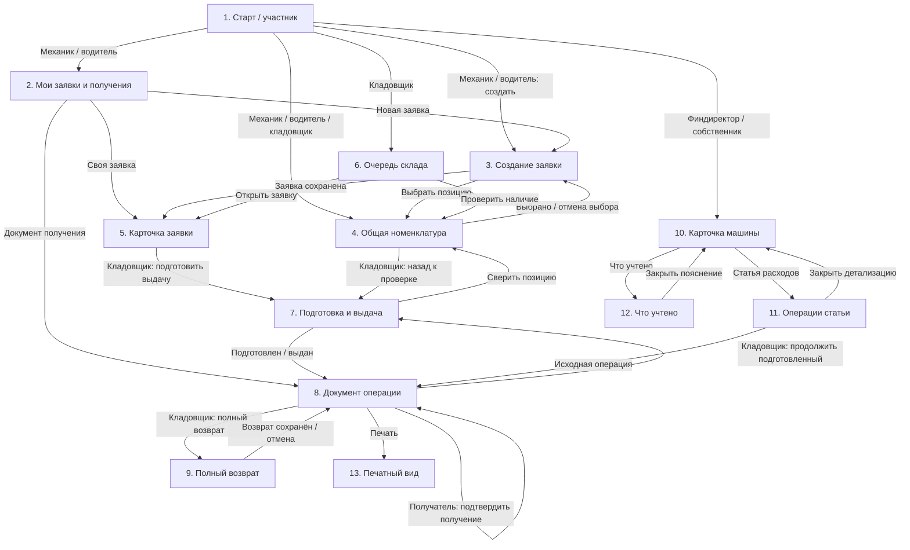
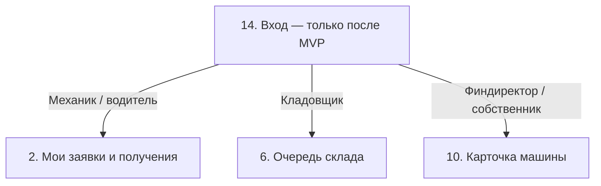
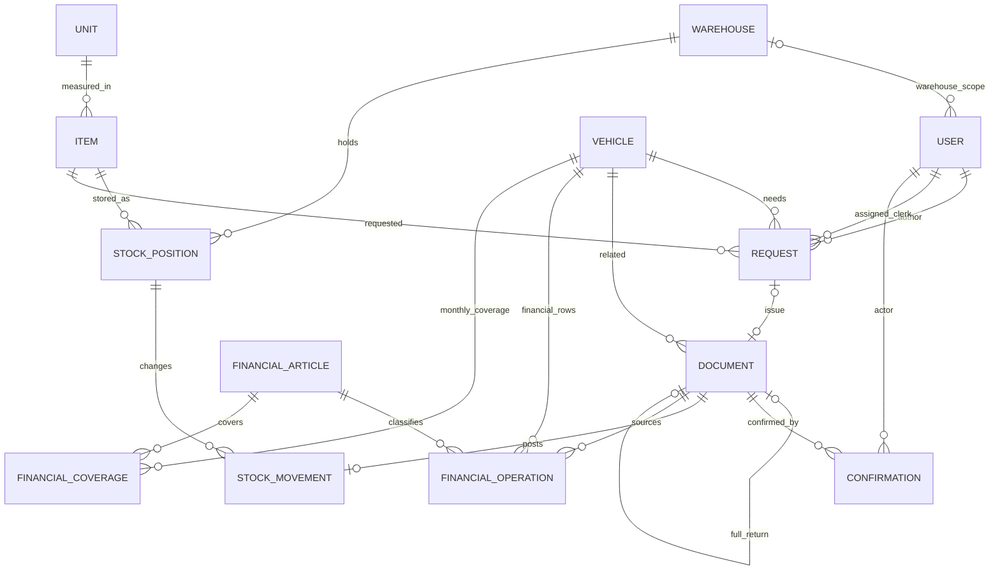

# Техническое задание — «Отдел снабжения»

Дата сборки: 24 ноября 2026 года.

Мастер-документ для реализации согласованного учебного MVP. Перечень работ, сценарии, данные и условия приёмки перенесены из материалов этапов 0–6; визуальные токены определены отдельно в [дизайн.md](дизайн.md).

ТЗ описывает целевой продукт. Наличие раздела или критерия не означает, что соответствующая функция уже реализована или проверена. По [индексу прототипа](5-визуальный-прототип/экраны.md) сейчас подготовлены два экрана.

Оглавление:

- [1. О продукте](#1-о-продукте)
- [2. Must-have фичи](#2-must-have-фичи)
- [3. Сценарии пользователя](#3-сценарии-пользователя)
- [4. Роли и авторизация](#4-роли-и-авторизация)
- [5. Экраны и карта переходов](#5-экраны-и-карта-переходов)
- [6. Модель данных](#6-модель-данных)
- [7. Стек, обоснование и альтернативы](#7-стек-обоснование-и-альтернативы)
- [8. Нагрузка и безопасность](#8-нагрузка-и-безопасность)
- [9. Критерии приёмки по фичам](#9-критерии-приёмки-по-фичам)
- [10. Что НЕ делаем (Won’t-have)](#10-что-не-делаем-wont-have)

## 1. О продукте

### Контекст и назначение

Источники: [общие выводы исследования](2-исследование/общие-выводы.md) и [позиционирование](2-исследование/позиционирование.md).

Контекст компании: грузоперевозки и работа спецтехники, около 600 машин, действующие 1С УАТ и 1С Розница 3.0.

Исследование не подтвердило превосходство нового интерфейса над качественной доработкой 1С УАТ. Сценарий финансового разбора строится на сопоставлении доходов и явно учтённых расходов за один период; неполный результат не называется полной чистой прибылью. Численные обещания экономии, сокращения простоев и работы с реальными данными в реальном времени не входят в подтверждённую концепцию.

### Фраза-визитка из этапа 1

Исходный текст и запасные формулировки сохранены полностью; встречающееся в них название отличается от названия текущего MVP.

Источник: [1-идея/визитка.md](1-идея/визитка.md).

#### Финальная версия

«Для собственников и финансовых директоров, которые видят расходы автопарка, но не понимают, сколько зарабатывает каждая машина, наш продукт „АвтоКонтроль“ сопоставляет доходы и расходы по автомобилям, в отличие от существующего отчёта только о расходах, он показывает результат каждой машины и позволяет разобраться, из чего он складывается».

#### Альтернативные варианты

**1. Короче и проще**

«Для руководителей автопарка, которым непонятно, какие машины приносят деньги, наш продукт „АвтоКонтроль“ объединяет доходы и расходы по каждой машине, в отличие от отчёта только о списаниях, он показывает, сколько машина заработала после учтённых расходов».

**2. С акцентом на причины результата**

«Для собственников и финансовых директоров, которые не видят, где автопарк зарабатывает и где теряет деньги, наш продукт „АвтоКонтроль“ связывает финансовый результат машины с её доходами и расходами, в отличие от отдельного отчёта о выдаче запчастей, он позволяет перейти от итоговой суммы к конкретным затратам».

### Аудитория

- **Механик:** создаёт свои заявки на детали для машины, видит состояние и подтверждает получение, если он получатель.
- **Водитель:** создаёт собственные заявки и подтверждает фактическое получение без дополнительной подписи механика.
- **Кладовщик:** обрабатывает очередь, проверяет наличие, оформляет фактическую выдачу и полный возврат.
- **Финансовый директор:** сопоставляет доходы и учтённые расходы машины, раскрывает затраты до операций и документов.
- **Собственник:** разбирает результат машины и получает сведения для управленческого решения.

Основание: [контракт MVP](3-mvp.md) и [роли](4-проектирование/роли-авторизация.md).

### Главная задача и описание MVP

Источник: [3-mvp.md](3-mvp.md), раздел «Описание».

Строим сайт «Отдел снабжения» для механиков, водителей, кладовщиков, финансового директора и собственника компании с автопарком и спецтехникой.
Главная задача — провести потребность в запчасти от заявки до фактической выдачи и объяснимого отражения расходов по машине.
Механик или водитель выбирает машину/VIN, одну деталь и количество; кладовщик видит заявку и проверяет наличие.
После фактической передачи кладовщик подтверждает выдачу: документ, складской остаток и расход меняются согласованно один раз.
Получатель отдельно подтверждает получение; подпись руководителя и повторное списание не добавляются.
Ошибочная выдача исправляется полным возвратом с восстановлением запаса и связанной обратной финансовой операцией.
Финансовая карточка связывает доходы и расходы за период, позволяет раскрыть операции и открыть печатный документ; неизвестные суммы не считаются нулями.
Первая версия — учебная демонстрация в браузере с подготовленными данными, переключением участников и сохранением состояния в том же браузере.
35 атомарных Must составляют один процесс; реальная интеграция с 1С и корпоративные аккаунты отложены, результат передаётся как сайт по ссылке и исходный код для диплома.

Главная задача: **провести потребность в запчасти от заявки до фактической выдачи и объяснимого отражения расходов по машине**.

### Позиционирование и финансовая задача

Источник: [2-исследование/позиционирование.md](2-исследование/позиционирование.md).

#### В чём мы объективно лучше

**Подтверждённого превосходства над качественной доработкой 1С УАТ пока нет.** Ручные испытания не проведены, а УАТ ПРОФ уже предусматривает доходы, расходы и анализ рентабельности транспорта. Поэтому наличие финансового результата машины само по себе не является нашим уникальным преимуществом. [Описание финансового учёта УАТ ПРОФ](https://solutions.1c.ru/catalog/autotransport-prof/dohras).

Наш выбранный фокус — **разбор результата конкретной машины для финансового директора и собственника**. Пользователь начинает с итоговой суммы и последовательно раскрывает статьи расходов, выдачи запчастей и документы.

| На что опираемся | Как это определяет продукт |
|---|---|
| Существующий отчёт показывает расходы и выдачи, но не даёт сопоставленного результата каждой машины | В центре сценария — доходы, учтённые расходы и разница за одинаковый период |
| Руководителю важно разобрать конкретные расходы | Из результата машины предусмотрен переход к статьям и операциям, сформировавшим сумму |
| Механик и кладовщик решают разные операционные задачи | Заявка и выдача связаны с машиной и становятся основой последующего анализа |
| Продукт создаётся для конкретной компании | Используются её понятия: машина, ответственный механик, склад, деталь, выдача, документ |

Это наша специализация. Преимущество по удобству, скорости или стоимости относительно доработки УАТ пока не измерено. Детализация помогает проверять причины плохого результата; сама по себе она не доказывает причину убытка.

Основа — [формулировка проблемы](0-подготовка/проблема.md), [выбранный вариант](1-идея/выбранный-вариант.md) и [общие выводы исследования](2-исследование/общие-выводы.md). Файл ручной проверки пока пуст.

#### Где мы осознанно слабее

1. **Полнота учёта.** Первая версия не охватывает бухгалтерию, расчёты с контрагентами и весь набор транспортных документов. Основная учётная система компании сохраняет эту роль.
2. **Готовность к эксплуатации.** Дипломная версия работает на демонстрационных данных. Реальный обмен с 1С, корпоративные права доступа и совместная работа относятся к дальнейшему развитию.
3. **Полнота финансового результата.** Показываем доходы минус явно перечисленные учтённые расходы. Если часть затрат отсутствует, не называем показатель полной чистой прибылью.
4. **Планирование и оптимизация.** Первая версия не рассчитывает оптимальные закупки, маршруты, графики ремонта или решение о продаже машины. Она предоставляет сведения для решения руководителя.

Не обещаем конкретную экономию, сокращение простоев, автоматическое обнаружение всех потерь или данные в реальном времени.

Если настройка существующей УАТ даёт сотрудникам нужный разбор с приемлемыми затратами, её доработка остаётся обоснованным выбором. Самостоятельный интерфейс имеет смысл развивать, когда его польза для пользователей подтверждена.

#### Наша ниша / угол

**Отдельный интерфейс разбора финансового результата машины для руководства компании, занимающейся грузоперевозками и работой спецтехники и уже использующей 1С.**

Ключевой пользователь — финансовый директор. Собственник получает основания для управленческого решения. Механик и кладовщик участвуют в создании сведений о потребности и выдаче деталей.

Главный сценарий:

**Выбрать проблемную машину → увидеть доходы и учтённые расходы за период → раскрыть затраты → проверить выдачи и документы → сформулировать вопросы ответственным сотрудникам.**

Узкий угол — **объяснимость результата каждой машины**. Отрицательная сумма становится отправной точкой для проверки конкретных затрат.

Основная альтернатива — доработка действующей 1С УАТ. Наш подход выделяет этот сценарий в отдельный веб-интерфейс. Для диплома достаточно продемонстрировать его на подготовленных данных; при переходе к эксплуатации потребуется определить источник доходов, состав расходов и правила обмена с учётной системой.

#### Обновлённая фраза-визитка (если меняется)

Обновление оправдано: сохраняем финансовый результат каждой машины, усиливаем разбор расходов и прямо называем выбранную альтернативу — доработку УАТ.

> Для финансового директора и собственника, которые хотят понять, из чего складывается результат каждой машины, наш продукт «АвтоКонтроль» показывает доходы, учтённые расходы и результат за период с детализацией затрат; в отличие от доработки отчётов внутри 1С УАТ, он предлагает отдельный веб-интерфейс для последовательного разбора машины — от итоговой суммы к выдачам запчастей и документам.

Фраза описывает выбранную концепцию. В дипломе этот сценарий демонстрируется на подготовленных данных.

### Согласование версий источников

| Вопрос | Формулировка в раннем источнике | Что применяется в этом ТЗ | Основание |
| --- | --- | --- | --- |
| Название | Визитка и исследование используют «АвтоКонтроль» | «Отдел снабжения»; исходные цитаты сохранены с их названием | 3-mvp.md и проектные файлы этапов 4–6 |
| Участники | Выводы исследования перечисляют четыре роли | Пять ролей, включая водителя | 3-mvp.md, роли-авторизация.md |
| Размещение | В документе ролей ещё упоминается GitHub Pages | Собственная VPS и Caddy | стек.md прямо заменяет прежнюю публикацию |
| Будущий вход | В документе ролей библиотека ещё не названа | django.contrib.auth и серверные сессии для будущей рабочей версии | стек.md |
| Дизайн | Компоненты рассмотрены в отдельном preview | Источник токенов — дизайн.md; токены не повторяются в ТЗ | дизайн.md |

Файл [0-бриф.md](0-бриф.md) существует, но пуст. Поэтому описание, аудитория и главная задача ниже взяты из заполненных материалов MVP, исследования и ролей; содержимое пустого брифа не восстанавливается предположениями.

Исходные документы при сборке не изменялись. В разделе 4 две формулировки о библиотеке и размещении согласованы с явными уточнениями файла стека.

## 2. Must-have фичи

Источник: [3-mvp.md](3-mvp.md), разделы Must-have, «Главное обоснование MVP» и «Порядок реализации».

### Границы первой версии

Дата актуализации: 19 ноября 2026 года.

Продукт: сайт «Отдел снабжения» для внутреннего процесса компании с автопарком и спецтехникой. Первая версия — функциональная учебная демонстрация в браузере.

Источник перечня: [все-фичи.md](3-mvp/все-фичи.md). Все 197 пунктов сохранены и отнесены ровно к одной категории. Правила уточнены в реальном [интервью с автором](4-проектирование/сценарии.md).

Главная задача — провести потребность от заявки механика или водителя до фактической выдачи, подтверждения получателем и объяснимого отражения расходов в результате машины.

**Подтверждённые автором правила:** заявки создают и механик, и водитель; остаток и расходы меняются сразу при подтверждении фактической выдачи кладовщиком; затем получатель подтверждает получение без второго списания. Руководитель не участвует в выдаче и её подтверждении. При получении водителем дополнительная подпись механика не требуется.

Для учебной версии используется подтверждение кнопкой с фиксацией выбранного участника. Демонстрационные участники переключаются на сайте; это не корпоративная авторизация и не одновременная работа разных устройств. Изменения учебного процесса сохраняются в текущем браузере.

Минимальный цикл: одна заявка на одну позицию → одна полная выдача → подтверждение получателя. Для исправления ошибочной передачи предусмотрен один полный возврат. Частичные выдачи и возвраты, закупочные процедуры, реальные интеграции и отдельные устанавливаемые программы отложены.

Состав из 35 атомарных пунктов образует шесть частей одного процесса: данные и участники; заявка; склад и проверки; документ и подтверждения; возврат; финансовый разбор и печать. Это не 35 самостоятельных модулей.

Ресурсы: учебный сайт для диплома, подготовленные сведения и техническая реализация с помощью ИИ при минимальном личном участии автора. Конкретный срок и бюджет не определены.

Итог: **Must — 35; Should — 23; Could — 44; Won't — 95.**

### Полный список Must-have

- **Фича 2: Карточка машины** — Показывает машину, её VIN, текущие расходы и результат связанного процесса.
- **Фича 6: Отбор по машине и периоду** — Позволяет проверить результат нужной машины за месяц фактической выдачи.
- **Фича 9: Рабочие сценарии участников** — Связывает работу заявителя, склада, получателя и руководства в одном сайте.
- **Фича 10: Демонстрационное переключение участников** — Позволяет пройти роли в учебной демонстрации без корпоративной авторизации.
- **Фича 11: Демонстрационные данные** — Даёт связанный набор и сохраняемое состояние заявок, выдач, остатков и финансов.
- **Фича 13: Веб-интерфейс снабжения и анализа** — Объединяет снабжение и финансовый разбор в общий путь на сайте.
- **Фича 18: Доходы по машине** — Доходы необходимы для расчёта результата машины.
- **Фича 19: Расходы по статьям** — Показывает подготовленные затраты и расходы от фактических выдач.
- **Фича 20: Финансовый результат машины** — Позволяет оценить результат машины после учтённых расходов.
- **Фича 22: Раскрытие состава расходов** — Даёт разобрать статью до конкретной выдачи или другой операции.
- **Фича 23: Переход к исходной операции** — Связывает расход с документом и его печатной формой.
- **Фича 36: Видимость полноты расчёта** — Объясняет учтённые статьи и неполноту расчёта, включая выбранную методику выдач.
- **Фича 38: Отсутствие данных отдельно от нуля** — Не позволяет подменять неизвестные суммы нулями.
- **Фича 42: Каталог запчастей** — Даёт однозначную позицию детали для заявки и выдачи.
- **Фича 43: Поиск запчасти** — Позволяет найти нужную позицию в подготовленном каталоге.
- **Фича 45: Единицы измерения** — Обеспечивает согласованную единицу количества в заявке, остатке и выдаче.
- **Фича 47: Остатки по складам** — Позволяет проверить наличие и увидеть изменение после выдачи или возврата.
- **Фича 52: Оформление выдачи** — Фиксирует фактическую передачу детали кладовщиком.
- **Фича 53: Выдача по заявке** — Не позволяет оторвать выдачу от исходной потребности и машины.
- **Фича 54: Обновление после выдачи** — Сразу после фактической выдачи согласованно меняет склад и расходы один раз.
- **Фича 55: Возврат детали** — Позволяет восстановить склад и расходы полным возвратом ошибочной выдачи.
- **Фича 79: Заявка механика или водителя** — Даёт механику и водителю возможность заявить потребность.
- **Фича 81: Ответственный за обращение** — Направляет новую заявку ответственному кладовщику демонстрационного склада.
- **Фича 82: Очередь заявок** — Позволяет кладовщику видеть и обрабатывать заявки.
- **Фича 83: Состояние заявки** — Показывает ход обработки и факт выдачи заявителю.
- **Фича 85: Подтверждение получения** — Фиксирует получение фактическим получателем.
- **Фича 88: Обязательные поля и проверка ввода** — Предотвращает оформление неполных и недопустимых операций.
- **Фича 182: Статусы документа** — Различает подготовку, фактическую выдачу, ожидание подтверждения и завершение.
- **Фича 183: VIN машины** — Помогает проверить, для какой именно машины оформляется выдача.
- **Фича 184: Подтверждение выдачи участниками** — Даёт две стороны подтверждения без руководителя и лишней подписи механика.
- **Фича 193: Уведомление об ошибке операции** — Объясняет отказ в действии и способ продолжить без потери корректных данных.
- **Фича 194: Проверка детали при выдаче** — Предотвращает выдачу другой детали вместо запрошенной.
- **Фича 195: Проверка машины при выдаче** — Предотвращает отнесение выдачи на другую машину.
- **Фича 196: Проверка количества при выдаче** — Проверяет количество по заявке и актуальному остатку.
- **Фича 197: Защита от повторной выдачи** — Не допускает повторного изменения склада и расходов от одной выдачи.

Все 35 пунктов обязательны. Исходные номера сохранены для связи со сценариями и критериями приёмки; нумерация не начинается с единицы.

### Главное обоснование MVP

Must замыкают один процесс: участник создаёт заявку, кладовщик проверяет и фактически выдаёт деталь, получатель подтверждает получение, а руководство видит источник расхода и результат машины. Защита от четырёх ошибок, однократное списание и полный возврат нужны, чтобы процесс можно было завершить и восстановить после ошибки. Подготовленные данные, переключение демонстрационных участников и хранение в браузере ограничивают технический объём учебного сайта.

### Метрики успеха и горизонт оценки

Источник: [3-mvp/метрики.md](3-mvp/метрики.md), на который ссылается контракт MVP. Пороги являются целями проверки, а не достигнутыми результатами.

Дата актуализации: 19 ноября 2026 года.

Продукт: сайт «Отдел снабжения», объединяющий заявки, выдачу, подтверждения и финансовый разбор. Состав — [moscow.md](3-mvp/moscow.md), правила и сценарии — [сценарии.md](4-проектирование/сценарии.md).

Все пороги ниже являются целями будущей проверки. Фактические результаты не измерены.

#### Главная метрика

**Название: самостоятельное прохождение сквозного процесса.**

**Как измеряется:** автор проекта выполняет пять подготовленных заданий на сайте, переключая демонстрационных участников. Для обычного случая: механик или водитель создаёт заявку; кладовщик подтверждает фактическую выдачу; запас и расходы меняются один раз; получатель подтверждает получение; пользователь открывает машину, проверяет сумму и документ. Для задания с нехваткой запаса или ошибкой успех означает правильную блокировку без изменения склада и расходов; для возврата — правильную обратную операцию.

Ответы сравниваются с эталоном. Подсказки помощника, неверная машина, повторное списание или необъяснённый неполный результат не считаются самостоятельным успешным выполнением.

**Порог успеха: не менее 4 из 5 заданий выполнены правильно и самостоятельно.**

Рекомендуемые задания: заявка механика; заявка водителя; недостаточный остаток; неизвестная цена с явной неполнотой; полный возврат по выдаче. Проверка одним автором в демонстрационных ролях не представляется как внедрение среди сотрудников.

#### Дополнительные метрики (2–4)

##### 1. Время одного короткого процесса

**Как измеряется:** фиксируем время по всем пяти заданиям от получения задания до его корректного завершения. Незавершённое за десять минут задание учитывается как десять минут и неуспешное.

**Порог успеха: медианное время не больше 5 минут при выполнении главной метрики.**

Порог относится к подготовленному учебному заданию на одну позицию. Сокращение времени реального отдела без отдельного сравнения не заявляется.

##### 2. Ошибки склада, документов и расчётов

**Как измеряется:** выполняются десять контрольных проверок: не та деталь; не та машина/VIN; неверное количество; повторная выдача; повторное подтверждение получателя; повторный возврат; отмена до проведения; отказ сохранения; неизвестная цена; неизвестный доход.

Критическая ошибка — неверное или двойное изменение остатка/расхода, несовместимые состояния документа и склада, проведение отменённого действия, подмена неизвестного значения нулём, неверный полный финансовый итог.

**Порог успеха: 0 критических ошибок в 10 контрольных проверках.**

##### 3. Расходы и возвраты прослеживаются до источника

**Как измеряется:** для каждой показанной расходной или возвратной строки открывается связанная операция и печатная форма. Видны машина, дата, сумма или её неизвестность, исходная выдача для возврата и состояние подтверждения. Суммы детализации сходятся с итогом по учтённым статьям.

**Порог успеха: 100% показанных строк имеют проверяемый источник; необъяснённых расхождений с итогами нет.**

#### Горизонт оценки

Первые две недели после появления рабочей демонстрационной версии. Это окно проверки, а не обещание срока разработки.

Сначала проверяем расчёты и целостность операций, затем проводим пользовательские задания. После исправлений повторяем проверку на других сопоставимых примерах и сохраняем результаты обеих попыток.

Протокол ведём вручную: участник/демороль, задание, ожидаемые и фактические остатки/суммы/состояния, время, подсказки и ошибки. Отдельная аналитическая подсистема не требуется.

Успех MVP — выполнение всех четырёх порогов. Без пользовательских заданий можно подтвердить техническую корректность, но не доказанную пользу для отдела.

#### Что НЕ измеряем (метрики тщеславия)

- Просмотры сайта, лайки, звёзды GitHub и число экранов.
- Количество искусственно созданных машин, заявок и участников.
- Число переключений демонстрационной роли как «число внедрившихся сотрудников».

Реальную экономию денег, сокращение простоев, снижение закупок и переход сотрудников с 1С оценивают отдельно при эксплуатационном пилоте.

### Порядок реализации

Источник: [3-mvp/порядок.md](3-mvp/порядок.md).

### Порядок реализации Must-have

Дата актуализации: 19 ноября 2026 года.

Продукт: сайт «Отдел снабжения». Состав MVP — [moscow.md](3-mvp/moscow.md), полный перечень — [все-фичи.md](3-mvp/все-фичи.md), проверка результата — [метрики.md](3-mvp/метрики.md).

Порядок охватывает все 35 атомарных Must единого процесса снабжения и финансового разбора. Сайт остаётся учебной демонстрацией в браузере с подготовленными данными.

Автор подтвердил два рабочих правила: заявку создаёт механик или водитель; склад и расходы обновляются сразу при подтверждении фактической выдачи кладовщиком. Подтверждение получателя — второе отдельное событие, не вызывающее нового списания.

Работы ниже запланированы; реализация и испытания ещё не выполнены.

#### Этап 1 — пугающие (1–2 фичи)

До обеих проб подготовить минимальный набор №11 и правило неизвестных значений №38: одну машину, двух получателей, кладовщика, одну деталь, исходный остаток и известные либо неизвестные суммы. Это предпосылка проб, а не готовая система.

##### 1. Фича 54 — однократное обновление склада и расходов

**Риск:** одна физическая выдача может дважды уменьшить запас, не попасть в расходы либо повторно списаться при подписи получателя.

**Проба:** на одном документе связать фактическую выдачу с остатком и расходом; проверить двойное нажатие, перезагрузку страницы, отказ сохранения и последующее подтверждение получателя. Состояние сохраняется целиком: документ, остаток и расход должны измениться совместно.

**Критерий:** подтверждение кладовщика меняет запас и расход ровно один раз; подпись получателя меняет только подтверждение документа. При неуспешном сохранении не возникает половинчатого результата.

**Зависимости:** контрольные данные №11/№38. Полное включение в сайт происходит после формы выдачи №52/№53 и защит №193–197. Для полного возврата №55 проверить обратную операцию на том же контрольном документе.

##### 2. Фича 20 — финансовый результат и неполные данные

**Риск:** выданное, подписанное и установленное могут смешаться, а неизвестная цена — превратиться в нулевой расход.

**Проба:** сопоставить доходы с подготовленными расходами, одной выдачей и её полным возвратом. Учебная методика признаёт расход по фактической выдаче; это явно указано пользователю и не означает подтверждения установки детали.

**Критерий:** результат меняется по датам выдачи и возврата; не меняется второй раз при подписи получателя. Известные суммы видны, неизвестные не заменяются нулём, неполный результат обозначен явно.

**Зависимости:** контрольные значения доходов №18 и расходов №19, правило №38. Полная версия расчёта подключается после отбора №6, проведения выдачи №54 и возврата №55; пояснение полноты даёт №36.

#### Этап 2 — логический порядок

Каждая строка завершается до зависящих от неё действий. Ранние пробы проверяют риск на контрольном наборе; реальные пользовательские действия включаются только после зависимостей.

| Шаг | Must-фичи | Результат |
|---|---|---|
| 1 | №11, №38 — Данные и состояния значений | Подготовить машины, VIN, участников, детали, единицы, начальные остатки, доходы и расходы; определить неизвестные суммы отдельно от нулей. Сохранять целое состояние демонстрации в браузере. |
| 2 | №9, №10, №13 — Участники и страницы сайта | Сделать выбор демонстрационного участника и страницы «Заявки», «Склад», «Машины», «Документ». Для руководства используется общий финансовый экран. |
| 3 | №42, №45, №43, №47 — Каталог и наличие | Показывать однозначную деталь, артикул, единицу и текущий остаток; обеспечить простой поиск по подготовленному каталогу. |
| 4 | №183, №6 — Выбор машины и периода | Использовать VIN для проверки машины; месяц и год применяются ко всем финансовым показателям. Заявка и выдача связываются с устойчивым идентификатором машины. |
| 5 | №79, №81, №88 — Создание заявки | Дать механику и водителю форму одной позиции; проверять обязательные поля и положительное количество. Назначать ответственного кладовщика демонстрационного склада. |
| 6 | №82, №83 — Очередь и состояние заявки | Показывать обращения кладовщику и заявителю; различать новую, подготовленную, выданную, отменённую и возвращённую заявку. |
| 7 | №52, №53, №194, №195, №196, №193, №197 — Подготовка и защита выдачи | Создавать документ из заявки; проверять деталь, машину/VIN, полное количество заявки и остаток. Отображать понятные ошибки; присвоить выдаче устойчивый идентификатор и исключить повторное проведение. |
| 8 | №54 — Фактическая выдача | По кнопке кладовщика «Выдать и подтвердить» одним сохранением записывать выдачу, уменьшать остаток, создавать расход машины и отмечать подтверждение кладовщика. До успешного сохранения не показывать операцию как завершённую. |
| 9 | №182, №85, №184 — Документ и получение | Показывать ожидание получателя после выдачи. Водитель либо механик подтверждает получение; документ становится подписанным обеими сторонами. Остаток и расход повторно не меняются. |
| 10 | №55 — Полный возврат | Кладовщик подтверждает физический возврат всей выдачи, создаётся связанная обратная операция, запас и расход корректируются один раз. Частичные возвраты и произвольное редактирование проведённой суммы отложены. |
| 11 | №18, №19, №20, №36, №2 — Карточка и результат машины | Объединить подготовленные доходы и расходы с выдачами и возвратами по датам операций. Показывать результат по учтённым статьям и признаки неполноты. |
| 12 | №22, №23 — Детализация и печать | Открывать статью, её операции и связанный документ. Печатная форма показывает актуальное состояние выдачи и подтверждений; печать не проводит и не подписывает документ. |

**Главная цепочка:** данные → участники и интерфейс → каталог/машина → заявка → очередь → документ и проверки → фактическая выдача → подтверждение получения → финансовый разбор → печать.

Возврат зависит от уже проведённой выдачи и должен быть готов до завершения операционного MVP. Финансовый экран получает именно проведённые события, а не повторно создаёт их при просмотре.

#### Этап 3 — финальные штрихи

1. Пройти путь за механика, затем за водителя: создать заявку, обработать её кладовщиком, подтвердить получение и открыть расходы машины.
2. Проверить все четыре ошибки: другая деталь, другая машина, неверное количество, повторная выдача.
3. Проверить состояние «выдано, ожидается получатель»: запас и расход уже изменены; повторный вход и получение не меняют их второй раз.
4. Проверить полный возврат: обратная операция связана с исходной, повторный возврат заблокирован, суммы и остатки восстановлены.
5. Проверить смену месяца: расход относится к месяцу фактической выдачи, корректировка — к месяцу фактического возврата.
6. Проверить отсутствие цены и дохода: известная часть сохраняется, полный результат не выдумывается.
7. Проверить отмену неподтверждённой формы и ошибку сохранения: незавершённое действие не должно менять склад и деньги.
8. Довести печать: реквизиты, перенос таблиц, сведения о двух подтверждениях, читаемые предупреждения о неполноте.
9. Выполнить контрольные задания и измерения из [метрик](3-mvp/метрики.md). Не выдавать плановые пороги за уже достигнутые результаты.
10. После готовности цикла передать сайт по ссылке и исходный код для диплома; публикация описана отдельно в Should №12.

#### Замечания по сложности

- **Один сайт, три рабочих режима:** заявитель (механик/водитель), кладовщик, руководство (финансовый директор/собственник). Это не отдельные программы и не бот.
- **Одна позиция и полная выдача:** частичные выдачи, многопозиционные закупочные заказы и частичные возвраты отложены.
- **Две разные операции:** фактическую выдачу подтверждает кладовщик, получение — фактический получатель. Руководитель не добавляется третьей стороной.
- **Одна печатная форма:** собственный учебный шаблон вместо копирования всех форм 1С.
- **Один браузерный контур:** переключение демонстрационных участников и сохранение состояния в текущем браузере не являются промышленной многопользовательской системой. Реальные аккаунты, сервер и интеграции остаются отложенными.
- **Неизвестная цена:** выдача известного физического количества возможна с явным предупреждением; финансовый итог по такой операции неполный.
- **Никаких молчаливых исправлений:** проведённая выдача не редактируется произвольно; восстановление выполняется связанной операцией полного возврата.
- **Защиты входят в тот же этап, что и выдача:** проверки №194–197 нельзя запускать позже пользовательской выдачи.
- **Не обещаем полную прибыль:** расчёт использует явно перечисленные статьи и учебную методику учёта выдач.

## 3. Сценарии пользователя

Источник: [4-проектирование/сценарии.md](4-проектирование/сценарии.md).

Дата актуализации: 19 ноября 2026 года.

Продукт: сайт «Отдел снабжения» для использования внутри компании, занимающейся грузоперевозками и работой спецтехники. Основной путь объединяет снабжение и финансовый разбор: заявка → проверка наличия → фактическая выдача → подтверждение получения → объяснимые расходы и результат машины.

Источники: актуальный [контракт MVP](3-mvp.md), [MoSCoW](3-mvp/moscow.md), [полный список фич](3-mvp/все-фичи.md), [порядок реализации](3-mvp/порядок.md), [метрики](3-mvp/метрики.md), доступные рабочие материалы этапов 0–1 и ответы автора ниже. На момент актуализации итоговые файлы `0-бриф.md` и `1-идея.md` пусты; сведения не приписываются их содержимому.

Все 35 атомарных Must-фич имеют отдельный сценарий с тремя уровнями. Это описание будущего поведения учебного сайта; работающий код, проведённые испытания и интервью с реальными сотрудниками этим документом не заявляются.

**Интервью с автором проекта: вопросы, ответы и принятые правила**

Первый раунд — уточнение названия и основного процесса:

1. Закрепляем окончательное название сайта «Отдел снабжения»?
2. Главный сценарий первой версии — финансовый разбор или заявка → выдача → подтверждения?

Ответ автора на оба вопроса:

> Да. Мне кажется как то вместе должно всё быть и функционально.

Принято: название «Отдел снабжения»; заявка, складская выдача и финансовый разбор входят в один функциональный путь. Прежнее ограничение первой версии только финансовой карточкой пересмотрено.

Второй раунд — участники заявки и момент списания:

1. Заявку на запчасть создаёт только механик или водитель тоже?
2. Остаток склада и расходы машины обновляются сразу после подтверждения фактической выдачи кладовщиком или после подтверждений обеих сторон?

Ответ автора:

> 1 - тоже / 2 - да первое

Принято: заявку создают и механик, и водитель. Сразу после подтверждённой кладовщиком фактической выдачи уменьшается остаток и появляется расход машины. Последующее подтверждение получателя меняет состояние документа, без повторного списания.

Ранее в диалоге автор уточнил:

- Нужны VIN машины и различимые состояния документа «выдан» / «подписан».
- Выдача означает фактическую передачу запчасти.
- Стороны подтверждения — кладовщик и фактический получатель: водитель либо механик. Если получает водитель, отдельная подпись механика не требуется; руководитель в подтверждении выдачи не участвует.
- Нужны проверки всех четырёх ошибок: не та деталь, не та машина, неверное количество, повторная выдача.
- Нужна печатная форма. При неполных данных показываем доступные сведения, не придумывая отсутствующие суммы.
- Проект остаётся сайтом, который открывается в браузере.

Эти ответы задают рабочие правила. Следующие детали — выбранное устройство учебной демонстрации, а не дополнительные ответы сотрудников или автора.

**Общие правила сценариев**

- Три рабочих режима на одном сайте: заявитель (механик или водитель), кладовщик, финансовый разбор (финансовый директор или собственник). На старте доступны действия «Создать заявку», «Обработать заявки», «Посмотреть машину».
- Используются подготовленные демонстрационные участники и данные. Переключение участника помогает показать процесс; оно не является подтверждением личности сотрудника или корпоративным разграничением доступа.
- Изменения учебного процесса сохраняются в текущем браузере. Загрузка страницы, открытие документа, печать и повторный вход не создают новые операции.
- До успешного сохранения сайт не показывает операцию завершённой. Фактическая выдача сохраняется согласованно: документ, подтверждение кладовщика, остаток и расход меняются вместе. При сбое состояние не должно измениться наполовину.
- Одна заявка — одна позиция и полная выдача. Подготовка документа не резервирует запас; наличие проверяется ещё раз перед фактической выдачей.
- Документ проходит состояния «Подготовлен» → «Выдан — ожидает подтверждения получателя» → «Выдан и подписан». Подтверждение — кнопка с участником и временем; юридическая электронная подпись не реализуется.
- После фактической выдачи нельзя произвольно менять машину, деталь, количество и сумму. Для ошибочной передачи предусмотрен один полный возврат по исходной выдаче, подтверждённый кладовщиком после физического возвращения детали. Возврат восстанавливает запас и создаёт связанную обратную операцию один раз.
- Расход относится к дате фактической выдачи; возврат — к своей дате и исходной стоимости. Подтверждение получателя не переносит дату расхода и не создаёт вторую сумму. Это учебная методика, а не подтверждение установки запчасти.
- При известном физическом остатке неизвестная цена не мешает выдаче, но оставляет расход и результат неполными. Неизвестное количество на складе не позволяет провести выдачу.
- Ноль, отсутствие данных, подтверждённое отсутствие операций и неприменимое поле обозначаются различно. Показатель называется «Результат по учтённым статьям»; полная чистая прибыль не обещается.
- Документ печатается средствами браузера. Просмотр, печать и отмена печати не проводят выдачу, не подтверждают получение и не меняют суммы.
- Реальный обмен с 1С, корпоративная база и одновременная работа разных устройств не входят в демонстрацию. Сетевые ошибки относятся к открытию сайта и загрузке ресурсов; операции загруженного набора выполняются в браузере. Бот и отдельные устанавливаемые программы не добавляются.

В каждом Error states описаны понятное сообщение, доступное действие и восстановление. Корректно заполненные поля сохраняются при исправимой ошибке; повтор операции не создаёт дубль.

### Сценарий 1: Демонстрационные данные

Исходная Must-фича: №11.

#### Happy path

1. Пользователь открывает сайт «Отдел снабжения». Сайт загружает исходный учебный набор и корректно сохранённое состояние этого браузера, если оно существует.
2. Показываются демонстрационные участники, машины/VIN, детали, остатки, доходы и расходы. Заявки, выдачи и подтверждения предыдущей учебной сессии восстанавливаются с теми же идентификаторами.
3. Пользователь может пройти весь процесс и после обновления страницы продолжить его без повторного списания.

#### Edge cases

- Если сохранённой сессии нет, используется исходный набор. Отсутствие рабочей сессии не выдаётся за ошибку компании.
- Повторная загрузка не дописывает копии операций. Состояние и версия набора проверяются перед восстановлением.
- Кнопка «Начать демонстрацию заново» требует подтверждения сброса учебных действий. Отмена сохраняет текущую сессию.
- Уже загруженные данные доступны в текущем браузере без живого обмена с 1С. Первое открытие сайта или загрузка недостающего ресурса требует связи.
- Долгая загрузка сопровождается индикатором; через 10 секунд доступны «Повторить» и отмена ожидания. Отменённая попытка не перезаписывает новую сессию поздним ответом.

#### Error states

- Ошибка загрузки: «Не удалось загрузить демонстрационные данные» и «Повторить». Ранее сохранённое корректное состояние не заменяется пустым.
- Повреждённая сессия: «Сохранённая демонстрация не читается». Предлагается повторить открытие либо явно подтвердить восстановление исходного набора; скрытого сброса нет.
- Хранилище браузера недоступно: «Не удалось сохранить изменения в этом браузере». Операционные действия не объявляются успешными; доступен просмотр и повторная проверка сохранения.
- Если данные браузера были очищены, исходный набор можно восстановить, а исчезнувшие учебные операции не выдумываются.

### Сценарий 2: Рабочие сценарии участников

Исходная Must-фича: №9.

#### Happy path

1. Участник открывает сайт и выбирает рабочую задачу: заявить деталь, обработать выдачу или разобрать расходы машины.
2. Сайт показывает соответствующий режим для механика/водителя, кладовщика или руководства. Финансовый директор и собственник используют общий финансовый экран.
3. Участник видит действия своего этапа и связанную историю заявки, документа и машины.

#### Edge cases

- Водитель и механик оба создают заявки и могут быть фактическими получателями.
- Руководитель видит финансовые сведения, но не становится третьим подписантом выдачи.
- При переходе между режимами не возникает отдельной копии склада или финансовых данных.
- Если заполнена неподтверждённая форма, сайт предлагает остаться или подтвердить отказ от черновика.

#### Error states

- Для неподходящего режима действие недоступно с подсказкой, например «Выдачу подтверждает кладовщик».
- Если режим не удалось открыть, показаны «Повторить» и переход на старт сайта; сохранённые операции не отменяются.
- Если в наборе нет нужного демонстрационного участника, сайт сообщает об этом и предлагает выбрать доступного, не подставляя чужое имя.

### Сценарий 3: Демонстрационное переключение участников

Исходная Must-фича: №10.

#### Happy path

1. Для показа процесса пользователь открывает переключатель демонстрационного участника и выбирает имя и роль.
2. Сайт ясно показывает активного участника. Созданные заявки и подтверждения получают идентификатор именно этого участника.
3. Можно последовательно пройти заявителя, кладовщика, получателя и руководство в одном браузере.

#### Edge cases

- Смена участника не подписывает документы и не меняет остатки.
- Смена участника при незавершённой форме требует выбора: сохранить текущую форму открытой или отказаться от черновика.
- Кнопка браузера «Назад» не повторяет уже совершённое подтверждение.
- Демонстрационный выбор имени не представляется как проверка личности реального сотрудника.

#### Error states

- Пустой выбор: подсветить поле и показать «Выберите участника».
- Неизвестный идентификатор: «Участник не найден в демонстрации» и возврат к доступным вариантам.
- Не удалось сохранить выбранный контекст: показать ошибку и сохранить прежнего участника до успешного переключения.

### Сценарий 4: Веб-интерфейс снабжения и анализа

Исходная Must-фича: №13.

#### Happy path

1. Пользователь открывает сайт в браузере и выбирает рабочую задачу.
2. Страницы сайта связывают заявку, склад, документ выдачи, подтверждение получателем, машину и финансовую детализацию.
3. Пользователь проходит процесс без бота и установки отдельной программы; переходы сохраняют нужную заявку, машину и период.

#### Edge cases

- Прямая ссылка открывает существующую заявку, машину или документ после загрузки набора.
- Отмена просмотра документа и отмена печати возвращают к предыдущему экрану без изменения операций.
- Уход с незавершённой формой сопровождается выбором «Остаться» или «Отменить ввод».
- Перезагрузка восстанавливает сохранённое состояние браузера; проведённые события не выполняются повторно.

#### Error states

- Неизвестный адрес: «Страница не найдена» и «К рабочим задачам».
- Ошибка экрана: «Не удалось открыть раздел» с «Повторить» и возвратом; технический стек пользователю не показывается.
- При недоступном ресурсе отображается ошибка загрузки. Сообщения об ошибке корпоративной БД не используются: серверной базы в учебной версии нет.

### Сценарий 5: Карточка машины

Исходная Must-фича: №2.

#### Happy path

1. Триггер и вход: финансовый директор или собственник открывает на сайте раздел машин либо переходит из выданного документа. Видны выбранная машина и месяц; доступны сведения о текущих выдачах и возвратах.
2. Реакция системы: карточка показывает сведения о машине/VIN, доходы, расходы по статьям и результат. Фактическая выдача уже учтена после кладовщика, даже если получатель ещё не подтвердил её.
3. Успешный итог: пользователь понимает, какую машину и период рассматривает, видит её результат и может перейти к проверке затрат.

#### Edge cases

- За период нет операций и полнота набора подтверждена — показываются нули и пояснение «За выбранный месяц операций нет». Отсутствие сведений без подтверждения полноты не считается нулём.
- Часть сумм отсутствует — известные показатели остаются видимыми, неизвестные имеют подпись «Нет данных», итог отмечен как частичный либо недоступный.
- При смене машины или месяца вся карточка меняется согласованно. Старые показатели не показываются как относящиеся к новому выбору.
- Возврат из статьи расходов или документа восстанавливает машину, месяц и раскрытую статью. Отмена изменения фильтров оставляет прежнюю карточку.
- Повторное открытие карточки не создаёт операций и не изменяет данные.
- После выдачи или возврата карточка получает согласованное сохранённое состояние. Подтверждение получателя не добавляет вторую расходную строку.

#### Error states

- Неверный идентификатор машины в адресе: «Машина не найдена». Сайт предлагает выбрать доступную машину; чужая карточка не подставляется молча.
- Начальная загрузка данных не завершилась — отображаются состояние загрузки и затем сообщение «Не удалось загрузить данные» с кнопкой «Повторить». Суммы не заменяются нулями.
- Ошибка отображения карточки — «Не удалось показать карточку машины». Пользователь может повторить открытие или перейти к выбору машины; выбранный период сохраняется, если возможно.

### Сценарий 6: VIN машины

Исходная Must-фича: №183.

#### Happy path

1. Заявитель выбирает машину в заявке, а кладовщик открывает связанную выдачу.
2. Рядом с обозначением машины сайт показывает VIN из подготовленной карточки; в документ он переносится вместе с идентификатором машины.
3. Участники могут сверить конкретную машину до фактической выдачи.

#### Edge cases

- VIN не вводится повторно при каждом действии и не копируется из произвольной другой карточки.
- Если VIN в примере отсутствует, сайт показывает «VIN не указан». Выдача с непроверенной машиной не проводится до выбора корректного подготовленного примера.
- Смена машины в ещё не отправленной заявке обновляет VIN; подготовленный документ старой машины не используется для новой заявки.

#### Error states

- Несоответствие машины и VIN: выделить блок машины, показать «Машина и VIN не соответствуют заявке».
- Нечитаемая карточка: предложить повторить загрузку или выбрать другую машину; не подставлять случайный VIN.
- Исправление требуется до подтверждения выдачи. Для уже проведённой ошибочной выдачи используется полный возврат и новая корректная заявка.

### Сценарий 7: Отбор по машине и периоду

Исходная Must-фича: №6.

#### Happy path

1. Триггер и вход: на карточке пользователь открывает выпадающий выбор машины и поля месяца и года.
2. Реакция системы: пользователь выбирает значения и нажимает «Показать». Сайт проверяет их и применяет один и тот же выбор к доходам, расходам, результату и детализации.
3. Успешный итог: заголовок, показатели и документы относятся к одной выбранной машине и месяцу; применённый выбор сохраняется при переходах по сайту.

#### Edge cases

- До нажатия «Показать» введённые значения считаются новым выбором; текущая карточка остаётся подписана прежними применёнными значениями.
- «Отменить» возвращает поля к последнему применённому выбору и не меняет карточку.
- Для корректно выбранного месяца нет подготовленных данных — «Для этого периода данные не подготовлены», с предложением выбрать другой месяц. Это отличается от подтверждённого отсутствия операций.
- Быстрые повторные нажатия или смена выбора не создают записей и не приводят к смешению результатов. Применяется последний подтверждённый корректный выбор.
- При первоначально некорректном адресе сайт не применяет случайную машину или месяц; пользователь явно выбирает их заново.

#### Error states

- Машина не выбрана: подсветить поле и показать «Выберите машину». Месяц или год не заполнен: подсветить соответствующее поле и показать «Выберите месяц» либо «Выберите год».
- Недопустимый месяц или год, в том числе в изменённом адресе: «Проверьте период». До исправления новые фильтры не применяются.
- Если набор не загружен, применение недоступно с пояснением «Сначала загрузите данные» и действием «Повторить загрузку». Сайт не делает вид, что выполнил поиск в базе данных.

### Сценарий 8: Каталог запчастей

Исходная Must-фича: №42.

#### Happy path

1. Механик, водитель или кладовщик открывает выбор детали на сайте.
2. Показываются подготовленные позиции с наименованием, артикулом, единицей и известной ценой. Выбор сохраняет устойчивый идентификатор детали.
3. Одна и та же позиция проходит через заявку, остаток, выдачу и финансовую строку.

#### Edge cases

- Одинаковые названия различаются артикулом и идентификатором.
- Неизвестная цена подписана явно и не превращается в ноль.
- Пустой каталог сопровождается сообщением «В демонстрации нет деталей»; форму нельзя отправить без позиции.

#### Error states

- Не выбрана деталь: подсветить поле «Выберите запчасть».
- Конфликтующие записи каталога: сообщить об ошибке данных и запретить использование спорной позиции.
- Невозможно открыть каталог: «Не удалось показать детали» и «Повторить»; заполненные машина и комментарий сохраняются.

### Сценарий 9: Поиск запчасти

Исходная Must-фича: №43.

#### Happy path

1. Пользователь вводит часть названия или артикула в поле выбора детали.
2. Сайт показывает совпадения из загруженного каталога с отличающими их реквизитами.
3. Пользователь выбирает точную позицию, которая заполняет заявку или сверку выдачи.

#### Edge cases

- Пустая строка показывает доступный каталог.
- Поиск без совпадений показывает «Запчасть не найдена» и предложение изменить запрос; новая несуществующая позиция автоматически не создаётся.
- Быстрое изменение запроса показывает результаты последнего значения, а не запоздалый ответ предыдущего.
- Отмена поиска не изменяет уже выбранную деталь без явного нового выбора.

#### Error states

- Ошибка поиска: «Не удалось выполнить поиск» с повтором; текст запроса сохраняется.
- Повреждённая позиция не выбирается с подсказкой «Эта запись недоступна».
- Похожее название другой детали не используется вместо точного выбора заявителя.

### Сценарий 10: Единицы измерения

Исходная Must-фича: №45.

#### Happy path

1. После выбора детали участник видит её единицу измерения рядом с количеством.
2. Та же единица отображается в остатке, заявке, выдаче и печатной форме.
3. Количество можно однозначно сопоставить с наличием и потребностью.

#### Edge cases

- Единица берётся из каталога, не меняется произвольно в документе выдачи.
- Допустимость дробного количества задаётся подготовленной единицей; для штучной детали требуется целое количество.
- Отмена формы не меняет единицу в каталоге.

#### Error states

- Единица не определена: «Для детали не задана единица измерения»; проведение заблокировано.
- Несовпадение единиц заявки и остатка выделяет количество и требует выбрать корректную позицию.
- Неверный числовой формат показывает пример допустимого количества; остальные поля формы сохраняются.

### Сценарий 11: Заявка механика или водителя

Исходная Must-фича: №79.

#### Happy path

1. Механик или водитель выбирает на сайте действие «Создать заявку».
2. Указывает машину с VIN, одну деталь, положительное количество и комментарий; проверяет данные и нажимает «Отправить». Ответственный кладовщик определяется по демонстрационному складу.
3. После успешного сохранения появляется номер заявки со статусом «Новая»; она видна заявителю и в очереди кладовщика.

#### Edge cases

- Заявку может создать и водитель, без предварительного подтверждения механика.
- Отмена до отправки не создаёт заявку и не меняет остатки или расходы.
- Повторное нажатие отправки не создаёт второй экземпляр той же попытки.
- Недостаточный остаток не запрещает сообщить потребность: заявка сохраняется с видимой нехваткой, но выдача будет заблокирована.
- После фактической выдачи заявка не редактируется произвольно; исправление передачи выполняется возвратом.

#### Error states

- Подсветить отсутствующую машину, деталь или количество с конкретной подсказкой рядом с полем.
- Ноль, отрицательное или недопустимое дробное количество не принимаются; корректные значения не стираются.
- Ошибка сохранения: «Заявка не сохранена. Повторите отправку». До успеха номер и статус не выдаются за окончательные.
- После повтора используется та же попытка отправки, чтобы не создать дубль.

### Сценарий 12: Обязательные поля и проверка ввода

Исходная Must-фича: №88.

#### Happy path

1. Пользователь заполняет заявку или подготовку выдачи и нажимает основную кнопку.
2. Сайт проверяет обязательные поля, связи идентификаторов, количество, единицу и допустимость состояния документа.
3. При корректном вводе действие продолжается; при ошибке человек понимает, что именно нужно исправить.

#### Edge cases

- Проверка выполняется до изменения склада или денег.
- Несколько ошибок видны рядом с соответствующими полями; фокус переводится к первой.
- Отмена валидации или уход с формы не проводится как успешная операция.
- Скрытые в интерфейсе идентификаторы также сверяются с исходной заявкой и текущим набором.

#### Error states

- Подсказки конкретны: «Выберите машину», «Выберите деталь», «Количество должно быть больше нуля».
- Общая непредвиденная ошибка сопровождается сообщением «Действие не выполнено» и повтором без потери введённого.
- Если исходное состояние изменилось, сайт предлагает обновить его и проверить форму ещё раз, а не проводить действие по устаревшим значениям.

### Сценарий 13: Ответственный за обращение

Исходная Must-фича: №81.

#### Happy path

1. После отправки заявки сайт определяет демонстрационный склад и ответственного кладовщика.
2. В заявке отображается, кто обрабатывает обращение; у кладовщика оно появляется в очереди.
3. Заявитель понимает, кому передана потребность, а обращение не остаётся без обработки.

#### Edge cases

- Руководитель не назначается согласующим или подписантом выдачи.
- Переключение демонстрационных участников не меняет автоматически ответственного заявки.
- Повторное открытие сохраняет назначение.

#### Error states

- Ответственный не определён: «Не удалось определить кладовщика для заявки»; отправка не объявляется завершённой.
- Неизвестный склад выделяется в контексте заявки с предложением выбрать корректный подготовленный вариант.
- При ошибке сохранения назначения черновик остаётся доступным для повторной отправки.

### Сценарий 14: Очередь заявок

Исходная Must-фича: №82.

#### Happy path

1. Кладовщик открывает на сайте очередь заявок.
2. Видит номер, заявителя, машину/VIN, деталь, количество, состояние и наличие; открывает нужное обращение.
3. Может перейти к проверке и подготовке выдачи по конкретной заявке.

#### Edge cases

- Пустая очередь: «Новых заявок нет», без выдуманных записей.
- Выданные, отменённые и возвращённые заявки различимы; открытие их карточек не запускает новую выдачу.
- Новая заявка из того же браузерного состояния появляется после сохранения; разных независимых устройств это не синхронизирует.
- Назад из документа возвращает к прежней очереди.

#### Error states

- Ошибка чтения очереди: «Не удалось показать заявки» и «Повторить».
- Неизвестная заявка: «Заявка не найдена» с возвратом к очереди.
- Если обращение уже изменилось, сайт показывает актуальное состояние перед действием, а не старую кнопку проведения.

### Сценарий 15: Состояние заявки

Исходная Must-фича: №83.

#### Happy path

1. Заявитель либо кладовщик открывает обращение.
2. Сайт показывает этап: новая, подготовленная к выдаче, выданная, отменённая или возвращённая; рядом видна необходимость подтверждения получателя, если выдача уже состоялась.
3. Пользователь понимает, что произошло и какое действие доступно дальше.

#### Edge cases

- Нехватка запаса видна как причина невозможности выдачи, не превращает обращение в выданное.
- Отмена до фактической выдачи не меняет склад и расходы.
- После выдачи нельзя отменой статуса скрыть уже совершённую передачу; требуется полный возврат.
- Подтверждение получателя не откатывает и не повторяет статус физической передачи.

#### Error states

- Недопустимый переход: «Это действие недоступно для текущего состояния заявки».
- Не удалось сохранить состояние: прежнее корректное состояние остаётся видимым, новый статус не показывается как успешный.
- Противоречивое состояние: «Не удалось подтвердить состояние обращения» и повторное чтение сохранённых данных.

### Сценарий 16: Остатки по складам

Исходная Must-фича: №47.

#### Happy path

1. Кладовщик открывает позицию детали или подготовку выдачи.
2. Сайт показывает актуальный остаток демонстрационного склада и единицу; непосредственно перед проведением сверяет наличие повторно.
3. После фактической выдачи запас уменьшается, после полного возврата восстанавливается.

#### Edge cases

- Нулевой запас отображается как ноль и блокирует выдачу положительного количества.
- Неизвестный запас подписан как «Нет данных»; физическая выдача по нему не проводится.
- Открытие или подготовка документа не уменьшает остаток и не создаёт резерв.
- Подпись получателя и печать не меняют количество.
- Если запас изменился после открытия формы, используется последнее сохранённое состояние.

#### Error states

- Недостаточно запаса: «На складе доступно X, требуется Y»; показывается возможность вернуться к заявке.
- Не удалось определить остаток: «Проверьте наличие: данные недоступны» и повторное чтение.
- Ошибка сохранения выдачи или возврата не должна оставлять половинчатое изменение остатка.

### Сценарий 17: Оформление выдачи

Исходная Must-фича: №52.

#### Happy path

1. Кладовщик открывает новую заявку и подготавливает документ выдачи.
2. Сайт переносит машину/VIN, деталь, единицу и количество, позволяет выбрать фактического получателя из водителей или механиков и показывает сумму либо её неизвестность.
3. После реальной передачи кладовщик нажимает «Выдать и подтвердить»; выдача сохраняется один раз, документ ожидает подтверждения получателя, запас и расход уже обновлены.

#### Edge cases

- В MVP одна заявка содержит одну позицию и выдаётся полностью; частичная выдача не добавляется.
- Подготовка и отмена неподтверждённой формы не меняют склад и расходы.
- При неизвестной цене количество можно выдать с явным предупреждением о неполноте суммы; неизвестный расход не становится нулевым.
- Фактический получатель может отличаться от создателя заявки; его имя выбирается явно.
- После проведения количества и машина не исправляются задним числом; ошибочная передача исправляется полным возвратом.

#### Error states

- Не выбран получатель: подсветить поле «Выберите фактического получателя».
- Ошибка детали, машины, количества или остатка блокирует проведение до исправления.
- Не удалось сохранить: «Выдача не сохранена. Остаток и расходы не изменены». Сайт сохраняет форму и предлагает повторить ту же операцию.
- Повторное проведение уже выданной заявки блокируется с переходом к существующему документу.

### Сценарий 18: Выдача по заявке

Исходная Must-фича: №53.

#### Happy path

1. Кладовщик начинает выдачу из открытой заявки.
2. Документ получает её номер и идентификатор, а машина, деталь и количество сверяются с потребностью.
3. От расхода и документа можно вернуться к исходной заявке и её автору.

#### Edge cases

- Документ не создаётся из произвольной несвязанной строки склада.
- Отменённая или уже выданная заявка не используется как новое основание для повторного списания.
- После полного возврата прежняя заявка остаётся в истории; для новой потребности создаётся новое обращение.

#### Error states

- Связь отсутствует: «Не найдена исходная заявка»; проведение недоступно.
- Несовпадение реквизитов: «Данные выдачи не соответствуют заявке» с выделением поля.
- Повторное чтение не восстанавливает отменённую заявку как новую; предлагается открыть её актуальную карточку.

### Сценарий 19: Проверка детали при выдаче

Исходная Must-фича: №194.

#### Happy path

1. Перед выдачей кладовщик сверяет название и артикул детали с заявкой.
2. Сайт сравнивает идентификатор позиции документа с позицией обращения.
3. Проводится именно запрошенная деталь.

#### Edge cases

- Похожие названия не означают одну позицию.
- Аналоги не заменяются автоматически: их согласование вне первого цикла.
- Если после фактической передачи обнаружено расхождение, получатель не подтверждает получение; кладовщик проверяет и оформляет полный возврат ошибочной выдачи.

#### Error states

- Несовпадение: подсветить поле детали и показать «Выбрана не та деталь».
- Устаревшая запись каталога: запретить проведение и предложить заново открыть заявку.
- До исправления не меняются ни количество на складе, ни расходы машины.

### Сценарий 20: Проверка машины при выдаче

Исходная Must-фича: №195.

#### Happy path

1. Кладовщик сверяет машину и VIN в документе с исходной заявкой.
2. Сайт проверяет устойчивый идентификатор и соответствующий VIN.
3. Выдача и расход относятся к правильной машине.

#### Edge cases

- Похожие обозначения машин дополнительно различаются VIN.
- Смена машины в другом разделе сайта не меняет уже открытую заявку молча.
- Ошибка, выявленная после проведения, исправляется полным возвратом и новой корректной заявкой, а не переносом расхода без истории.

#### Error states

- Несоответствие: «Машина или VIN не соответствуют заявке» рядом с реквизитами.
- Отсутствующая машина: «Выберите корректную машину»; списание недоступно.
- При сбое сверки можно повторить открытие заявки; прежние финансовые данные не меняются.

### Сценарий 21: Проверка количества при выдаче

Исходная Must-фича: №196.

#### Happy path

1. Кладовщик проверяет количество документа перед физической выдачей.
2. Сайт сверяет положительное допустимое значение, единицу, полное количество заявки и актуальный остаток.
3. Выдаётся допустимое количество без отрицательного остатка.

#### Edge cases

- Ноль и отрицательное значение недопустимы.
- Штучная деталь не получает дробное количество.
- При нехватке для полной заявки её можно отменить до выдачи и создать исправленную; частичная передача в MVP не проводится.
- Повторная проверка выполняется непосредственно перед сохранением, а не только при открытии формы.

#### Error states

- Подсказки: «Количество должно быть больше нуля», «Укажите целое количество» или «Количество не совпадает с заявкой».
- При нехватке показаны доступное и требуемое значения; проведение заблокировано.
- При недоступном остатке сайт предлагает повторить проверку, не угадывает количество и не создаёт расход.

### Сценарий 22: Защита от повторной выдачи

Исходная Must-фича: №197.

#### Happy path

1. Кладовщик подтверждает выдачу, которая имеет устойчивый идентификатор.
2. Сайт проверяет, не проведена ли она уже, и сохраняет единственное событие.
3. Один документ уменьшает склад и добавляет расход ровно один раз.

#### Edge cases

- Двойное нажатие основной кнопки не создаёт вторую операцию.
- Перезагрузка и возврат назад не повторяют проведение.
- Подтверждение получателя не считается повторной выдачей.
- После возврата исходная выдача остаётся проведённым историческим событием; повторный расход по тому же идентификатору не создаётся.

#### Error states

- Повторное действие: «Эта выдача уже проведена» и кнопка открытия документа.
- При неопределённом результате сохранения сначала читается сохранённое состояние; новая операция вслепую не отправляется.
- Если состояние не удалось подтвердить, проведение блокируется с «Повторить проверку», сохраняя введённые сведения.

### Сценарий 23: Обновление после выдачи

Исходная Must-фича: №54.

#### Happy path

1. После фактической передачи кладовщик нажимает «Выдать и подтвердить».
2. Сайт одним сохранением фиксирует выдачу, подтверждение кладовщика, уменьшение остатка и новую расходную операцию машины по дате выдачи.
3. Заявитель видит факт выдачи, а руководство уже видит соответствующий расход; подпись получателя ещё может ожидаться.

#### Edge cases

- Получение подтверждается позже и не влияет второй раз на склад и сумму.
- При неизвестной цене создаётся операция с неизвестной суммой и признаком неполноты, а не нулевой расход.
- Если финансовый экран открыт за другой месяц, сайт предлагает перейти к машине за месяц фактической выдачи.
- Полный возврат создаёт обратное событие по собственной дате; исходная выдача не исчезает.

#### Error states

- Нельзя сохранить только расход или только изменение остатка: при неуспехе сохраняется прежнее согласованное состояние.
- Сообщение: «Не удалось завершить выдачу. Проверьте состояние и повторите»; кнопка повторяет тот же идентификатор.
- При обнаруженной несовместимости документа, склада и расходов сайт не объявляет выдачу завершённой и предлагает перечитать сохранённое состояние.

### Сценарий 24: Статусы документа

Исходная Must-фича: №182.

#### Happy path

1. Участник открывает документ выдачи на сайте.
2. До проведения показан «Подготовлен»; после кладовщика — «Выдан — ожидает подтверждения получателя»; после получателя — «Выдан и подписан»; после полного возврата — «Возвращён».
3. По состоянию понятно, была ли фактическая передача и завершены ли подтверждения.

#### Edge cases

- Статус «выдан» возникает при подтверждении фактической передачи кладовщиком, а не после подписи получателя.
- Печать и просмотр сами по себе статус не меняют.
- Если получатель отмечает расхождение, документ остаётся выданным с отметкой «Есть расхождение»; склад и расход не откатываются автоматически. Кладовщик сверяет передачу и при фактическом возврате оформляет обратную операцию.
- Возвращённый документ нельзя снова подписать как актуально полученную деталь.

#### Error states

- Недопустимый переход показывает «Действие недоступно для текущего состояния документа».
- Ошибка сохранения не меняет видимый статус на успешный.
- Если подтверждения и состояние противоречат друг другу, сайт сообщает «Не удалось подтвердить состояние документа» и предлагает перечитать его.

### Сценарий 25: Подтверждение получения

Исходная Must-фича: №85.

#### Happy path

1. Фактический получатель открывает документ уже состоявшейся выдачи.
2. Видит машину/VIN, деталь, количество, кладовщика и дату передачи; проверяет их и нажимает «Подтвердить получение».
3. Получение зафиксировано этим участником; документ завершён двумя подтверждениями без нового списания.

#### Edge cases

- Получателем может быть водитель или механик.
- Если получает водитель, подтверждение механика дополнительно не требуется.
- Отмена до подтверждения оставляет документ ожидающим получателя; склад и расход после фактической выдачи не откатываются.
- При несоответствии фактической передачи получатель нажимает «Есть расхождение» и оставляет пояснение кладовщику; получение не подтверждается автоматически, склад и расход сами не откатываются.

#### Error states

- Другой активный участник видит «Этот документ ожидает другого получателя» и может открыть подходящий демонстрационный режим.
- Для ещё не выданного или возвращённого документа подтверждение недоступно.
- Ошибка сохранения: «Получение не подтверждено. Повторите попытку». Повтор не создаёт расход.

### Сценарий 26: Подтверждение выдачи участниками

Исходная Must-фича: №184.

#### Happy path

1. Первое подтверждение фиксируется от кладовщика при фактической выдаче.
2. Второе фиксируется от выбранного фактического получателя; в документе видны участники и время каждого действия.
3. Документ подтверждён двумя сторонами, руководитель в цепочку не добавляется.

#### Edge cases

- Водитель, забравший деталь, завершает вторую сторону без третьей подписи механика.
- Один участник не заполняет обе стороны автоматически; в деморежиме последовательно выбираются соответствующие участники.
- Повторное подтверждение уже заполненной стороны ничего не списывает и не создаёт нового документа.
- Если получатель ещё не подтвердил, документ честно остаётся ожидающим, а расход после выдачи уже отражён.

#### Error states

- Не та сторона: «Подтверждение ожидается от указанного участника».
- Нельзя подтвердить получение до фактической выдачи.
- При ошибке сохранения имя или время не показываются как успешно зафиксированные; доступен повтор той же стороны.

### Сценарий 27: Возврат детали

Исходная Must-фича: №55.

#### Happy path

1. Кладовщик открывает проведённую выдачу, по которой деталь фактически возвращена на склад, и выбирает полный возврат.
2. Сайт показывает исходную деталь и количество, просит подтвердить фактическое возвращение и одним событием создаёт связанный возврат, восстанавливает остаток и корректирует расход по исходной стоимости.
3. Выдача помечена возвращённой, история сохранена, финансовая детализация показывает обратную операцию.

#### Edge cases

- Возврат возможен до или после подтверждения получателя, но только для состоявшейся выдачи.
- Поддерживается вся исходная позиция; частичный возврат отложен.
- Повторный возврат того же документа заблокирован.
- Неизвестная исходная сумма не заменяется нулём; обратная финансовая строка также помечается неполной.
- Дата возврата определяет месяц обратной операции, а не переписывает дату выдачи.

#### Error states

- Неподходящий документ: «Возврат недоступен: выдача не проведена или уже возвращена».
- При несовпадении детали или количества операция блокируется с подсказкой сверить исходный документ.
- Ошибка сохранения: «Возврат не сохранён. Остаток и расходы не изменены». Повтор использует тот же идентификатор возврата.
- Возврат не удаляет историю и не разрешает молча повторно провести исходную выдачу; для новой потребности создаётся новая заявка.

### Сценарий 28: Доходы по машине

Исходная Must-фича: №18.

#### Happy path

1. Триггер и вход: пользователь открывает карточку машины и применяет месяц и год.
2. Реакция системы: сайт выбирает доходные записи именно этой машины и периода и показывает их известную сумму с подписью периода.
3. Успешный итог: пользователь видит доход, который участвует в результате данной машины, и отличает его от отсутствующих сведений.

#### Edge cases

- Известный нулевой доход показывается как «0», а не как ошибка.
- Подтверждено, что за месяц доходных операций не было, — «0» и пояснение об отсутствии операций. Если источник за месяц не подготовлен, показывается «Нет данных».
- Часть доходных сумм неизвестна — показывается сумма известных записей с пометкой о неполноте; полный результат по машине не заявляется.
- При смене периода или машины доход пересчитывается одновременно с расходами и результатом.
- Повторный просмотр не удваивает записи. Конфликтующие идентификаторы обрабатываются как ошибка данных, а не дополнительный доход.

#### Error states

- Неверный выбор машины или периода подсвечивается в фильтрах по сценарию 2. Формы ручного ввода доходов в текущем MVP нет.
- Некорректная сумма в исходном наборе: «Не удалось определить доход за выбранный период». Другие достоверные показатели остаются доступными; неизвестный доход не заменяется нулём.
- Если начальный набор не загружен, показывается действие «Повторить загрузку». После успешного восстановления доход и связанный результат обновляются согласованно.

### Сценарий 29: Расходы по статьям

Исходная Must-фича: №19.

#### Happy path

1. Триггер и вход: пользователь просматривает финансовую карточку выбранной машины и месяца.
2. Реакция системы: сайт показывает подготовленные статьи и расходы фактических выдач; полный возврат отражается обратной строкой. Возле суммы доступен документ и состояние получения.
3. Успешный итог: пользователь понимает структуру затрат и выбирает статью для подробного разбора.

#### Edge cases

- Статья с подтверждённым нулём отображается с нулём. Статья, не включённая в методику, обозначается как неучитываемая, а не как нулевая.
- Если в статье есть неизвестная сумма, известный подытог виден с подписью «Известная часть расходов»; количество или перечень пропусков доступны рядом.
- Отсутствие цены не мешает расчёту, если достоверная итоговая сумма операции уже задана и цена не является обязательной для неё. Если без цены сумма не определена, операция считается неполной.
- Возврат или корректировка, если они присутствуют в подготовленных данных, имеют явный тип и знак; операция не превращается в дополнительный обычный расход.
- Одна операция не попадает одновременно в несколько статей и не учитывается повторно после раскрытия таблицы.
- При сворачивании или закрытии детализации выбор машины и месяца сохраняется.
- Выдача учитывается после подтверждения кладовщика. Ожидание подписи получателя не исключает расход и не создаёт второй при получении.

#### Error states

- Для пустой или неизвестной статьи исходной записи: «Часть расходов не удалось отнести к статье». Такая сумма не исчезает молча из расчёта; полный итог не обозначается как проверенный.
- При некорректной сумме сайт показывает сообщение рядом со статьёй и известные достоверные значения; ложный полный итог не формируется.
- Если детализация не сходится с итогом: «Не удалось подтвердить сумму расходов». Полный финансовый результат блокируется до повторной загрузки корректных данных.
- Восстановление: повторить загрузку или выбрать другой подготовленный пример. Редактирования бухгалтерских сумм на сайте не требуется.

### Сценарий 30: Финансовый результат машины

Исходная Must-фича: №20.

#### Happy path

1. Триггер и вход: пользователь выбирает машину и месяц для разбора.
2. Реакция системы: сайт рассчитывает доходы минус учтённые расходы, включая фактические выдачи и обратные операции возврата по датам событий. Состав расчёта явно объяснён.
3. Успешный итог: пользователь видит результат именно выбранной машины за период и может объяснить его через доходы и расходы.

#### Edge cases

- Отрицательный результат сохраняется отрицательным; нулевой результат отображается как ноль.
- Если доход неизвестен, известные расходы показываются, а вместо полного результата — «Недостаточно данных для расчёта результата».
- Если доход известен, но часть расходов неизвестна, можно показать разницу по известным операциям с подписью «Частичный результат» и предупреждением о пропусках; полная прибыль не заявляется.
- Если часть категорий осознанно не учитывается, показатель называется «Результат по учтённым статьям», а перечень статей доступен пользователю.
- Быстрая смена выбора не смешивает доходы одного месяца с расходами другого. Отменённый выбор не меняет итог.
- Идентичный повтор записи с тем же идентификатором не удваивает сумму; противоречащие записи не дают корректного полного результата.
- Подтверждение получателя меняет состояние документа, а не финансовую сумму. Возврат меняет сумму только собственной связанной операцией.

#### Error states

- При ошибочных исходных суммах или конфликте данных: «Не удалось рассчитать результат: проверьте отмеченные данные». Рядом видны конкретные недоступные показатели, а не произвольный ноль.
- При ошибке вычисления сайт не показывает бесконечность, техническое значение или прежний итог как новый. Действия — «Повторить» и «Вернуться к выбору машины».
- Если исходный набор не загружен, расчёт недоступен; пользователь может повторить начальную загрузку.
- После восстановления повторно применяются те же машина и месяц, а доходы, расходы и результат обновляются вместе.

### Сценарий 31: Раскрытие состава расходов

Исходная Must-фича: №22.

#### Happy path

1. Триггер и вход: в карточке пользователь нажимает на статью расходов.
2. Реакция системы: раскрывается таблица подготовленных расходов, выданных деталей и полных возвратов с датой, суммой, состоянием документа и ссылкой на источник.
3. Успешный итог: пользователь находит операцию, которую хочет проверить, и может открыть её документ.

#### Edge cases

- Для подтверждённо пустой статьи показывается «По этой статье операций нет». Неподготовленные сведения обозначаются отдельно.
- При большом количестве строк таблица прокручивается на странице, итог и связь с выбранной статьёй сохраняются.
- Неизвестное значение в строке подписано; неприменимое поле отличается от отсутствующего обязательного значения.
- Сворачивание статьи является отменой просмотра, не удаляет данные и возвращает к прежней карточке.
- Повторное нажатие не дублирует строки. При смене машины или месяца прежняя раскрытая детализация закрывается либо заменяется согласованной новой выборкой.

#### Error states

- Если строки невозможно получить из уже загруженного набора: «Не удалось открыть операции по этой статье». Действия — «Повторить» и «Свернуть».
- Если сумма строк не соответствует подытогу, сайт сообщает «Сумма операций не совпадает с итогом статьи» и не обозначает итог как проверенный.
- Если у строки нарушена связь с документом, именно эта строка содержит «Документ недоступен»; остальные операции остаются читаемыми. Доступно возвращение к статье и повторная загрузка данных.
- Пользователю не предлагается повторно отправлять или создавать выдачу: раскрытие расходов является просмотром.

### Сценарий 32: Переход к исходной операции

Исходная Must-фича: №23.

#### Happy path

1. Триггер и вход: пользователь нажимает на документ в строке расходов.
2. Реакция системы: на странице сайта открывается связанная запись и учебная печатная форма с номером, датой, машиной/VIN, деталями, количеством, суммами, кладовщиком, получателем и состоянием двух подтверждений.
3. Успешный итог: пользователь проверяет операцию и при необходимости нажимает «Печать», открывая диалог печати браузера. Возврат к расходам сохраняет машину, месяц и статью.

#### Edge cases

- Длинная таблица переносится на страницы без обрезания колонок; управляющие кнопки и навигация в печать не попадают.
- Неизвестные обязательные суммы явно отмечаются; неполный итог печатается только с предупреждением о неполноте. Неприменимые поля помечаются соответствующим образом.
- Отмена диалога печати оставляет документ открытым и не считается ошибкой. Повторная печать не создаёт новую операцию.
- Переход к документу по прямой ссылке возможен после загрузки демонстрационного набора; обратный переход ведёт к связанной машине и периоду.
- Просмотр и печать не проводят выдачу и не подписывают документ. Эти действия выполняются отдельными подтверждениями участников.
- Сайт подтверждает подготовку печатного вида и вызов диалога браузера, но не сообщает о физически выполненной печати без достоверного подтверждения.
- Для возврата печатная форма ссылается на исходную выдачу; обратная сумма не скрывается и не дублируется.

#### Error states

- Для неизвестного идентификатора: «Документ не найден в демонстрационных данных» с кнопкой «Вернуться к расходам». Другой документ молча не подставляется.
- Если открытый документ связан с другой машиной или строкой, показывается «Не удалось подтвердить связь документа с операцией»; документ не выдаётся за правильный источник выбранной суммы.
- Если не удалось подготовить печатный вид: «Не удалось подготовить документ к печати». Обычные реквизиты остаются доступны; действия — «Повторить» и «Назад к расходам».
- Если браузер не открыл печать, показывается подсказка воспользоваться его меню «Печать». Наличие принтера и результат печати проверяются пользователем в браузере.

### Сценарий 33: Видимость полноты расчёта

Исходная Must-фича: №36.

#### Happy path

1. Триггер и вход: пользователь смотрит подпись рядом с финансовым результатом либо открывает пояснение «Что учтено».
2. Реакция системы: сайт перечисляет включённые статьи, неучитываемые категории и известные пропуски для выбранной машины и месяца. Подпись результата соответствует этим сведениям.
3. Успешный итог: пользователь понимает границы показателя и не принимает результат по части статей за полную чистую прибыль.

#### Edge cases

- Осознанно исключённая категория отличается от категории с неизвестной суммой.
- Если данные неполные, предупреждение находится рядом с результатом, даже когда пояснение свёрнуто.
- При смене месяца или машины список включённых статей и пропусков меняется вместе с показателями.
- Закрытие пояснения не изменяет расчёт и не удаляет заметную пометку о неполноте.
- Если технически все предусмотренные суммы известны, это означает полноту согласованного набора статей, а не автоматический учёт всех возможных расходов компании.
- Учебная методика относит расход на фактическую выдачу, подтверждённую кладовщиком. Это не означает подтверждения установки детали на машину.

#### Error states

- Если метаданные о составе расчёта отсутствуют: «Состав расчёта не определён». Доступные суммы остаются видимыми, но результат не обозначается как полный.
- Если пояснение не удалось открыть, постоянная предупреждающая подпись сохраняется. Действия — «Повторить» и возврат к карточке.
- Если подпись полноты противоречит наличию неизвестных сумм, сайт использует ограничивающий статус и сообщает о неполноте; благоприятная пометка не скрывает проблему.
- Восстановление: повторно загрузить согласованный набор и пересчитать карточку, сохраняя выбранную машину и период.

### Сценарий 34: Отсутствие данных отдельно от нуля

Исходная Must-фича: №38.

#### Happy path

1. Триггер и вход: пользователь открывает любой денежный показатель, строку операции или печатную форму.
2. Реакция системы: известный ноль показан как «0», неизвестная обязательная сумма — как «Нет данных», неприменимое поле — как «Не применяется». Для неизвестного значения доступно понятное пояснение причины, если она задана.
3. Успешный итог: пользователь различает отсутствие сведений и реальное нулевое значение и корректно трактует результат машины.

#### Edge cases

- Пустая строка, отсутствующее поле и неопределённое обязательное значение не преобразуются автоматически в ноль.
- Подтверждённое отсутствие операций допускает нулевой итог; отсутствие подтверждения полноты данных приводит к статусу «Нет данных».
- Неизвестное количество не влияет на известную достоверную сумму, если количество не требуется для её определения; неизвестная сумма влияет на полноту финансового результата.
- При частично известных значениях виден известный подытог с пометкой о неполноте, а не ложный полный итог.
- Правило одинаково действует в карточке, детализации и печати. Закрытие пояснения не меняет состояние значения.

#### Error states

- Некорректная строка вместо числа, недопустимое числовое значение или конфликт источников показываются как «Ошибка данных», а не как ноль.
- Рядом с показателем появляется подсказка «Значение не удалось определить; оно не включено в полный результат». Пользователь может открыть доступный источник или повторить загрузку.
- Если компонент отображения не смог показать значение, сайт сохраняет явное сообщение об ошибке; пустая ячейка не выдаётся за нормальный результат.
- После исправления и повторной загрузки набора значение и все зависящие итоги пересчитываются совместно.

### Сценарий 35: Уведомление об ошибке операции

Исходная Must-фича: №193.

#### Happy path

1. Пользователь выполняет действие формы или подтверждения.
2. При неуспехе сайт показывает сообщение рядом с затронутым действием: что не выполнено, какие данные не изменены и что можно сделать дальше.
3. Пользователь исправляет поле, повторяет проверку/сохранение либо возвращается к документу без дублей и ложного успеха.

#### Edge cases

- Сообщение об ошибке не заменяется общей успешной плашкой при частично выполненном действии.
- Закрытие сообщения не проводит операцию и не стирает корректные поля.
- Если результат сохранения неизвестен, сначала проверяется документ, затем разрешается повтор той же попытки.
- Сетевые сообщения относятся к загрузке сайта; операции текущего демонабора не изображаются как запросы к корпоративной БД.

#### Error states

- Для полей: подсветить конкретное место и дать исправимую подсказку.
- Для сохранения: «Не удалось сохранить действие» с «Повторить» и возможностью вернуться к предыдущему корректному экрану.
- Для конфликтующего состояния: «Документ уже изменился. Откройте его заново»; данные перечитываются до нового проведения.

## 4. Роли и авторизация

Документ ролей перенесён полностью с двумя согласованиями по более позднему файлу стека: размещение на VPS вместо GitHub Pages и выбор библиотеки будущего входа. Действия и ограничения пяти ролей сохранены.

Источник: [4-проектирование/роли-авторизация.md](4-проектирование/роли-авторизация.md).

Продукт: сайт «Отдел снабжения» для использования внутри компании.

Источники: [MVP](3-mvp.md), [сценарии](4-проектирование/сценарии.md) и диалог с автором. Учебная демонстрация и будущая работа с реальными сотрудниками имеют разные требования к входу и защите.

### Проведённый диалог

Сначала заданы два вопроса, после ответа — третий. Ниже кратко зафиксированы темы вопросов и дословные ответы автора.

1. **Роли и права.** Уточнялось разделение действий между механиком, водителем, кладовщиком, финансовым директором и собственником. Автор уточнил: «1 - механник как бы должен создавать заявки».
2. **Существующий корпоративный вход.** Спрашивалось о SSO/AD/LDAP либо отдельных учётных записях 1С. Ответ: «2 - нет у всех учетные записи в 1С».
3. **Способ входа для диплома.** Предложен выбор между переключением демонстрационных участников без пароля и настоящим входом по логину и паролю. Ответ: «Как убдет лучше так и делай». Выбрана демонстрация без пароля в соответствии с учебным MVP.

После замечаний к документу отдельно уточнена приватность: финдиректору и собственнику — доходы, расходы и результат; кладовщику — стоимость деталей и суммы выдач; механику и водителю — свои заявки и количество без денежных показателей. Автор ответил: «Делай». Это распределение принято ниже.

### Роли

| Роль | Права и ограничения |
|---|---|
| **Механик** | Основной заявитель: создаёт заявку с машиной/VIN, деталью, количеством и комментарием. Видит свои заявки, их состояния и наличие деталей. Подтверждает получение, только если указан получателем. Цены, суммы, доходы и результат машины недоступны. |
| **Водитель** | Может создавать свои заявки по ранее согласованному сценарию. Видит свои заявки и документы, где он получатель; подтверждает фактическое получение без дополнительной подписи механика. Денежные показатели недоступны. |
| **Кладовщик** | Видит очередь заявок и складские остатки. Проверяет машину, деталь и количество; оформляет фактическую выдачу и полный возврат. Видит стоимость деталей и суммы складских документов, но не доходы, общий расход и финансовый результат машины. |
| **Финансовый директор** | Просматривает доходы, все учтённые расходы и результат машин, выбирает период, раскрывает расходы до исходного документа и печатает его. Не проводит складские операции и не подтверждает получение за других. |
| **Собственник** | Просматривает финансовые показатели и документы для разбора причин результата. Не изменяет складские документы и не участвует в подтверждении выдачи. |

Финансовый директор и собственник используют общий финансовый экран. Роль не выбирается сотрудником самостоятельно в реальной версии.

Фактическая выдача кладовщиком меняет остаток и расход один раз. Получатель завершает подтверждение документа без повторного списания. Ошибочная передача исправляется связанным полным возвратом.

### Авторизация

#### Учебная демонстрация — текущий MVP

Регистрация и вход не требуются. Переключатель «Демонстрационный участник» выбирает имя и роль; активный участник всегда виден. Состояние учебного процесса сохраняется в текущем браузере.

**Демо-переключатель не подтверждает личность и не защищает данные.** Любой посетитель может выбрать роль собственника. Скрытие финансового экрана в режиме механика показывает будущий порядок работы, но не делает сведения конфиденциальными. Поэтому публичная демонстрация содержит только синтетические данные и не подключается к рабочей базе компании.

#### Реальная версия — до допуска настоящих пользователей

Предусматривается личный вход по логину и паролю. Учётную запись и роль назначает ответственный сотрудник компании; открытой самостоятельной регистрации нет.

Пользователи, роли, сессии и рабочие данные хранятся на нашем сервере. Приоритет — бесплатная библиотека, развёрнутая на собственном сервере и совместимая с выбранным стеком. Для будущей рабочей версии выбраны django.contrib.auth и серверные сессии согласно 4-проектирование/стек.md; облачные Supabase, Clerk и Auth0 исключены.

Единого корпоративного входа сейчас нет. Пароли от 1С сайт не запрашивает; существующие учётные записи 1С не дают автоматического доступа на сайт. Если компания позднее внедрит SSO/AD/LDAP, подключение корпоративного входа рассматривается отдельно.

Настоящая авторизация и серверная часть остаются за пределами текущего учебного MVP. Согласно 4-проектирование/стек.md, React-сайт демонстрации размещается на собственной VPS через Caddy; прежняя публикация на GitHub Pages заменена этим решением. Работа с реальными пользователями потребует серверной части.

### Что защищено

#### В демонстрации

Экранов «только после настоящего входа» нет. Отбор по выбранному участнику и ограничения кнопок служат показу процесса. Это не механизм защиты конфиденциальных сведений.

#### В реальной версии после входа

| Экран или действие | Кому доступно |
|---|---|
| Создание заявки, свои заявки и их состояния | Механику и водителю; пользователь определяется по сессии. |
| Документ получения и подтверждение | Автору заявки — связанный документ; указанному получателю — подтверждение после фактической выдачи. |
| Каталог и наличие | Механику и водителю — без стоимости; кладовщику — со стоимостью и остатками. |
| Очередь склада, подготовка и проведение выдачи, полный возврат | Кладовщику; проведение требует подходящего состояния документа. |
| Стоимость деталей и суммы выдач | Кладовщику в складских документах; финдиректору и собственнику при разборе расходов. |
| Доходы, все расходы и результат машины за период | Только финансовому директору и собственнику. |
| Детализация расходов и исходные документы | Финдиректору и собственнику — для финансового разбора; остальным — только в пределах своего процесса и разрешённых полей. |
| Печатная форма | Тем же участникам, что и исходный документ. Для механика и водителя — без цен и сумм. |

Все рабочие страницы и запросы требуют действующей сессии. Без входа доступна только страница входа и необходимые ей общедоступные ресурсы.

Сервер проверяет полномочия для каждого запроса, включая прямые ссылки, идентификатор документа и печатную форму. Запрет по умолчанию и проверка принадлежности документа не позволяют получить чужие сведения заменой адреса или скрытой кнопки. Эти требования соответствуют [OWASP Authorization Cheat Sheet](https://cheatsheetseries.owasp.org/cheatsheets/Authorization_Cheat_Sheet.html).

Скрытые денежные поля не отправляются в браузер механика или водителя. При отсутствии сессии требуется вход; при недостаточных правах показывается «Доступ запрещён», данные и изменения недоступны. Выход завершает сессию и убирает ранее показанные рабочие данные из интерфейса.

### Отключение демо-режима при переходе к реальным пользователям

1. Демонстрация остаётся отдельной средой с синтетическими сведениями и без доступа к рабочим данным.
2. В корпоративной версии переключатель участников и демонстрационный обход входа отключаются до подключения рабочих данных.
3. Сервер принимает личность и роль только из проверенной серверной сессии. Параметр адреса, значение в браузерном хранилище или отправленная клиентом роль не дают дополнительных прав.
4. Рабочие данные не включаются в публичные файлы сайта или демонстрационный набор. Учебные заявки и подтверждения не переносятся автоматически в рабочий учёт.
5. При ошибке входа, недоступности сервера или отсутствии назначенной роли система отказывает в доступе; автоматического возврата к демо-переключателю нет.
6. До допуска сотрудников проверяются вход и выход, запрет чужих заявок, запрет финансовых данных для исполнителей, прямые ссылки и печать. Данные не выдаются даже при попытке изменить выбранную роль на клиенте.

Это требования к будущей реальной версии; документ не утверждает, что серверная авторизация уже реализована.

## 5. Экраны и карта переходов

### Дизайн и материалы прототипа

- Источник палитры, шрифта, размеров, отступов, кнопок, форм, иконок, анимаций и тона — [дизайн.md](дизайн.md). Значения токенов в этом ТЗ не повторяются.
- [Открыть локальный живой прототип](5-визуальный-прототип/прототип/index.html).
- [Открыть список заявок под механиком](5-визуальный-прототип/прототип/index.html#/requests?participant=mechanic).
- [Индекс сгенерированных экранов](5-визуальный-прототип/экраны.md).
- Путь к папке материалов прототипа и скриншотов: [5-визуальный-прототип/прототип/](5-визуальный-прототип/прототип/).
- По состоянию файлов в папке находится код `index.html`; PNG/JPG/WebP-скриншотов нет. Внешняя публичная ссылка в источниках не указана.
- Целевой MVP предусматривает 13 экранов и представлений. В текущем прототипе готовы только экраны 01–02; будущий экран корпоративного входа не включается в текущий MVP.

Файлы прототипа:

- [index.html](5-визуальный-прототип/прототип/index.html)

Маршруты готового прототипа:
- `/#/` — старт демонстрации и выбор участника.
- `/#/requests` — мои заявки и получения.

### Индекс фактически подготовленных экранов

Источник: [5-визуальный-прототип/экраны.md](5-визуальный-прототип/экраны.md).

Продукт: сайт «Отдел снабжения» для использования внутри компании.
Инструмент: Codex (локально).
Код: `5-визуальный-прототип/прототип/index.html`.
Навигация внутри одного HTML-файла использует hash-роуты; для открытия достаточно браузера, установка зависимостей и сервер не нужны.
Подготовлены два экрана из 13 экранов и представлений учебного MVP. Будущий корпоративный вход в этот объём не включён.

#### Экран 01: Старт демонстрации и выбор участника

— Цель: Выбрать демонстрационного участника и увидеть доступные ему рабочие действия.
— Роли: Механик, водитель, кладовщик, финансовый директор, собственник.
— Данные: Вымышленные имя и роль участника; описание его задач; границы видимости; отметка о демонстрационных данных и состоянии сохранения.
— Состояния: С данными / пусто / ошибка. Переключаются контролом «Предпросмотр состояния экрана».
— Действия: Выбор участника меняет рабочую область; выбор сохраняется в текущем браузере. Повторная загрузка восстанавливает данные после показанного сбоя. «Начать демонстрацию заново» требует подтверждения; «Отмена» сохраняет текущий выбор.
— Переходы: «Мои заявки» у механика или водителя открывает экран 02. Создание заявки, номенклатура, очередь склада и финансовая карточка пока показывают описание следующего экрана.
— Где найти: Код в `5-визуальный-прототип/прототип/index.html`; роут `/#/`.
— Пример участника: Андрей Соколов — механик; Илья Волков — водитель; Марина Белова — кладовщик; Елена Морозова — финансовый директор; Дмитрий Орлов — собственник.

#### Экран 02: Мои заявки и получения

— Цель: Показать исполнителю его обращения и документы, ожидающие подтверждения получения.
— Роли: Механик и водитель. Во вкладке «Мои заявки» показаны обращения выбранного автора; во вкладке «Мне выдано» — документы, где участник указан получателем, включая заявки другого автора.
— Данные: Номер и дата заявки или документа, машина, VIN, номенклатура и артикул, количество и единица измерения, состояние, наличие и необходимость подтверждения. Денежных значений нет.
— Состояния: С данными / пусто / ошибка. Переключаются контролом «Предпросмотр состояния списка»; после ошибки доступно «Повторить». В пустом списке доступны создание заявки и номенклатура.
— Действия: Переключение вкладок и демонстрационного участника меняет список; нехватка детали сохраняет заявку в очереди; открытие строки показывает назначение будущей карточки заявки или документа и позволяет вернуться к списку.
— Переходы: «К выбору участника» возвращает на экран 01. Создание заявки, номенклатура, карточка заявки и документ выдачи пока представлены описаниями переходов; соответствующие экраны ещё не созданы.
— Где найти: Код в `5-визуальный-прототип/прототип/index.html`; роут `/#/requests`.
— Быстрый вход в предпросмотр: `index.html#/requests?participant=mechanic`; это выбор демонстрационного участника, не авторизация.
— Примеры: З-0264 — масляный фильтр Fleetguard LF9009, 2 шт., КамАЗ 5490, А743КХ41; З-0261 — рукав высокого давления 332/C8360, 1 шт., JCB 3CX, отметка о нехватке; З-0257 — тормозные колодки WVA 29131, 1 комплект, MAN TGS 33.440; В-0188 — выдача по З-0257, ожидающая подтверждения получения.

#### Состояние навигации

Реально связан путь: экран 01 → экран 02 → экран 01.
Остальные переходы обозначены понятными описаниями будущих экранов. Они не создают заявки, не проводят выдачу и не подтверждают получение.
Полный сценарий заявки, выдачи, подтверждения, финансового разбора и печати ещё не собран.
Демо-переключение участников не защищает реальные данные; все примеры вымышлены.

### Полный список проектируемых экранов и карта переходов

Источник: [4-проектирование/экраны.md](4-проектирование/экраны.md).

Дата: 23 ноября 2026 года.

Продукт: сайт «Отдел снабжения» для использования внутри компании.

Источники: [контракт MVP](3-mvp.md), [сценарии пользователя](4-проектирование/сценарии.md), [роли и авторизация](4-проектирование/роли-авторизация.md). Дополнительно учтены ответы автора от 23 ноября: выбор детали из общей номенклатуры и сохранение заявки в очереди при нехватке остатка.

Текущий MVP включает **13 экранов и представлений**: десять основных страниц, две встроенные информационные панели и печатный вид. Экран 14 описывает только будущий настоящий вход и не входит в учебный MVP. Все 35 Must-фич распределены по этим представлениям; выбор машины, фильтры, ошибки и подтверждения не превращаются в отдельные обязательные модули.

Указанный ниже доступ в демо определяет показываемые действия и поля. Любой посетитель может переключить демонстрационную роль; это не подтверждение личности и не защита рабочих сведений компании.

### Экран 1: Старт демонстрации и выбор участника

- **Тип:** Страница; переключатель участника доступен также в общей шапке.
- **Назначение:** Выбрать демонстрационного участника и перейти к его рабочей задаче.
- **Доступ:** Все пять демонстрационных ролей; до выбора участника доступен только общий старт.
- **Данные:** Имя и роль участника, пометка о синтетических данных, состояние загрузки и сохранённой сессии. После выбора — доступные действия: «Мои заявки», «Создать заявку», «Очередь склада», «Номенклатура», «Разобрать машину». Кнопка «Начать демонстрацию заново» открывает подтверждение сброса; отказ сохраняет состояние.
- **Переходы:** Механик и водитель → экран 2 либо 3, номенклатура → 4; кладовщик → 6 либо 4; финансовый директор и собственник → 10. Переключение при незавершённой форме предлагает остаться или отказаться от ввода. Само переключение не проводит операции.
- **Must-фичи:** №9, №10, №11, №13, №193.

### Экран 2: Мои заявки и получения

- **Тип:** Страница с вкладками «Мои заявки» и «Мне выдано».
- **Назначение:** Показать исполнителю его обращения и документы, ожидающие его подтверждения.
- **Доступ:** Механик и водитель: свои заявки и документы, в которых участник указан получателем.
- **Данные:** Номер и дата, машина/VIN, номенклатура, количество и единица, состояние заявки или документа, отметка наличия, необходимость подтверждения получения. Цены и суммы отсутствуют. Заявка другого автора может появиться во вкладке получения только как выдача этому получателю.
- **Переходы:** «Создать заявку» → 3; собственная заявка → 5; документ получения → 8; номенклатура → 4; старт → 1. Для пустого списка доступны создание заявки и номенклатура. Нехватка не удаляет строку.
- **Must-фичи:** №79, №82, №83, №85, №182.

### Экран 3: Создание заявки

- **Тип:** Страница с формой одной позиции.
- **Назначение:** Заявить потребность в одной позиции общей номенклатуры для конкретной машины.
- **Доступ:** Механик и водитель; механик — основной заявитель.
- **Данные:** Выбор машины с VIN, выбранная позиция общей номенклатуры, артикул, единица, количество, комментарий; наличие показывается справочно. Автор определяется выбранным участником, кладовщик — демонстрационным складом. Денежных полей нет. Нехватка не блокирует отправку, неизвестная позиция или недопустимое количество блокируют.
- **Переходы:** Выбрать позицию → 4 с возвратом в незавершённую форму; «Отправить» → 5 после успешного сохранения. При нехватке сохраняется отметка «Недостаточно на складе». «Отмена» → 2 или исходный экран без создания заявки. Сбой сохранения оставляет форму и повторяет ту же попытку.
- **Must-фичи:** №79, №81, №88, №183, №42, №43, №45, №47.

### Экран 4: Общая номенклатура и наличие

- **Тип:** Общая страница справочника; при выборе для формы используется тот же компонент с возвратом в форму.
- **Назначение:** Найти точную позицию по названию или артикулу и проверить её наличие.
- **Доступ:** Механик, водитель и кладовщик; денежные поля доступны только кладовщику.
- **Данные:** Поисковый запрос, наименование, артикул, идентификатор, единица, остаток демонстрационного склада. Выбранная строка раскрывает реквизиты в этой же странице. Кладовщик видит стоимость либо «Нет данных»; механик и водитель не видят цену. Нулевой остаток отличается от неизвестного, одинаковые названия различаются артикулом.
- **Переходы:** Выбор для заявки → 3 с заполнением позиции; сверка из выдачи → обратно в 7 без автоматической замены позиции исходной заявки; самостоятельный просмотр → возврат на 2 или 6 по контексту. При отсутствии совпадений можно изменить запрос или вернуться; новая позиция автоматически не создаётся.
- **Must-фичи:** №42, №43, №45, №47, №38.

### Экран 5: Карточка заявки

- **Тип:** Страница одной заявки.
- **Назначение:** Показать исходную потребность, наличие и ход её обработки.
- **Доступ:** Механик и водитель — автор своей заявки; кладовщик — заявки своего демонстрационного склада; финансовый директор и собственник — чтение связанной заявки при разборе исходного документа.
- **Данные:** Номер, дата, автор, ответственный кладовщик, машина/VIN, номенклатура, количество, единица, комментарий, рабочее состояние, отметка наличия и связанные документы. «Недостаточно на складе» — отдельная отметка, не отмена и не выдача. Денежные сведения механику и водителю не показываются.
- **Переходы:** Кладовщик → подготовка выдачи 7; связанный документ → 8; назад → 2, 6 или исходный документ по контексту. Автор может явно отменить ещё не выданную заявку с подтверждением; нехватка сама её не отменяет. Получатель чужой заявки работает с документом на 8 и не получает автоматически доступ к чужой карточке заявки.
- **Must-фичи:** №79, №81, №83, №53, №183, №182, №193.

### Экран 6: Очередь заявок склада

- **Тип:** Страница работы кладовщика.
- **Назначение:** Выбрать заявку для проверки и выдачи запчасти.
- **Доступ:** Кладовщик.
- **Данные:** Заявки демонстрационного склада: номер, дата, автор, машина/VIN, номенклатура, количество, единица, состояние, наличие и ожидание получателя. Заявки с нехваткой остаются в очереди с отметкой; недостаток наличия не является ошибкой сохранения.
- **Переходы:** Строка → карточка заявки 5; «Подготовить выдачу» по выбранной заявке → 7; связанный документ → 8; номенклатура → 4; старт → 1. Обновление наличия не проводит выдачу автоматически.
- **Must-фичи:** №81, №82, №83, №47, №183, №193.

### Экран 7: Подготовка и фактическая выдача

- **Тип:** Страница документа до фактического проведения.
- **Назначение:** Проверить заявку и зафиксировать передачу детали выбранному получателю.
- **Доступ:** Кладовщик.
- **Данные:** Исходная заявка, машина/VIN, точная позиция, единица, полное количество заявки, актуальный остаток, фактический получатель — механик либо водитель, цена и сумма или их неизвестность. Перед проведением проверяются деталь, машина, количество, остаток и отсутствие предыдущей выдачи. Частичная выдача и автоматическая замена аналогом не допускаются.
- **Переходы:** Сверка номенклатуры → 4; исходная заявка → 5. Подготовленный документ можно открыть на 8; подготовка не меняет запас и расход. После физической передачи кнопка «Выдать и подтвердить» одним сохранением обновляет документ, подтверждение кладовщика, склад и расход → 8. При нехватке доступен возврат на 5 или 6, заявка остаётся в очереди. Отмена неподтверждённой формы не проводит выдачу.
- **Must-фичи:** №52, №53, №54, №88, №194, №195, №196, №197, №45, №47, №183, №182, №193.

### Экран 8: Документ операции и подтверждение получения

- **Тип:** Общая страница документа выдачи, полного возврата или подготовленной исходной расходной операции.
- **Назначение:** Проверить источник операции и выполнить разрешённое действие по её состоянию.
- **Доступ:** Автор заявки и указанный получатель — связанная с ними выдача без денежных полей; кладовщик — документы склада; финансовый директор и собственник — источники финансового разбора.
- **Данные:** Тип, номер и дата, машина/VIN, номенклатура, количество, единица, участники и время подтверждений, состояние, ссылки на исходную заявку и возврат. Для доступных ролей — цена и сумма. Возможные состояния выдачи: «Подготовлен», «Выдан — ожидает подтверждения получателя», «Выдан и подписан», «Возвращён». Другие подготовленные расходы показывают доступные исходные реквизиты без складских действий.
- **Переходы:** Подготовленную выдачу кладовщик продолжает на 7. Указанный получатель нажимает «Подтвердить получение» и остаётся на 8 с новым состоянием без списания. «Есть расхождение» открывает в документе форму пояснения кладовщику, затем возвращает к 8 без подтверждения получения и автоматического возврата. Кладовщик может перейти к полному возврату на 9. Печать → 13. Связанная заявка → 5 при наличии доступа; финансовый разбор → 10 или 11 только для руководства. «Назад» возвращает в исходный список или разбор.
- **Must-фичи:** №23, №52, №53, №54, №55, №85, №182, №184, №183, №193, №197.

### Экран 9: Полный возврат по выдаче

- **Тип:** Страница обратной операции.
- **Назначение:** Зафиксировать фактический возврат всей ранее выданной позиции на склад.
- **Доступ:** Кладовщик.
- **Данные:** Исходная выдача, машина/VIN, позиция, единица, всё исходное количество, исходная стоимость либо её неизвестность, дата возврата и комментарий. Исходные реквизиты не заменяются произвольно. Частичный и повторный возврат недоступны.
- **Переходы:** После реального возвращения кнопка подтверждения одним сохранением восстанавливает остаток и создаёт связанную обратную финансовую операцию → документ возврата на 8. Из него доступна исходная выдача, также на 8. Отмена → исходная выдача без изменений. Ошибка сохранения оставляет форму для повтора той же операции.
- **Must-фичи:** №55, №47, №19, №197, №193.

### Экран 10: Карточка машины — финансовый разбор

- **Тип:** Страница одной машины с выбором периода.
- **Назначение:** Понять результат машины и найти расходы, которые его объясняют.
- **Доступ:** Финансовый директор и собственник.
- **Данные:** Выбор машины, её VIN, месяц и год, доходы, расходы по статьям, результат по учтённым статьям, предупреждения о пропусках и составе расчёта. Выдачи учитываются по фактическому подтверждению кладовщика, возвраты — по своей дате, получение не создаёт второй расход. Ноль, «Нет данных» и частичный результат различаются.
- **Переходы:** Выбор машины и периода обновляет эту же страницу. Статья расходов → встроенная детализация 11; «Что учтено» → панель 12; документ из доступной строки → 8. Возврат из детализации или документа сохраняет машину и период. Отдельный реестр всего парка для этой версии не добавляется.
- **Must-фичи:** №2, №6, №18, №19, №20, №36, №38.

### Экран 11: Операции статьи расходов

- **Тип:** Встроенная таблица или панель на экране 10, без отдельного обязательного маршрута.
- **Назначение:** Разложить сумму статьи на исходные расходы, выдачи и возвраты.
- **Доступ:** Финансовый директор и собственник.
- **Данные:** Название статьи, машина и период, дата и тип каждой операции, номенклатура и количество там, где применимо, сумма либо её неизвестность, состояние документа, подытог и связь с источником. Возврат показан обратной строкой, суммы не дублируются.
- **Переходы:** Строка операции → 8, затем назад в ту же раскрытую статью. Закрыть панель → 10 с сохранением фильтров. При расхождении итога и строк виден сбой сверки; повтор не создаёт новые операции.
- **Must-фичи:** №19, №22, №23, №38, №55.

### Экран 12: Что учтено в результате

- **Тип:** Встроенная информационная панель на экране 10.
- **Назначение:** Объяснить границы финансового показателя и причины его неполноты.
- **Доступ:** Финансовый директор и собственник.
- **Данные:** Формула, включённые статьи, неучитываемые категории, известные пропуски и пояснение учебной методики признания расходов по фактической выдаче. Выдача не представляется подтверждением установки запчасти; результат по учтённым статьям не называется полной чистой прибылью.
- **Переходы:** Закрытие → 10; при открытии из предупреждения строки — возврат в исходный контекст. Закрытие не скрывает предупреждение о неполноте рядом с результатом и не меняет расчёт.
- **Must-фичи:** №36, №38, №20.

### Экран 13: Печатное представление документа

- **Тип:** Печатный вид того же документа с вызовом стандартного диалога браузера.
- **Назначение:** Подготовить читаемый документ операции для печати.
- **Доступ:** Те же участники и документы, что на экране 8; денежные поля зависят от роли.
- **Данные:** Тип и реквизиты документа, машина/VIN, позиция, количество, единица, участники и состояния подтверждений. Для кладовщика и руководства — разрешённые цены и суммы с отметками о неполноте; для механика и водителя — без денежных колонок и итогов. У возврата есть ссылка или реквизиты исходной выдачи.
- **Переходы:** «Печать» открывает диалог браузера; отмена или закрытие возвращает к 8 либо исходной точке. При проблеме можно повторить подготовку или воспользоваться меню печати браузера. Печать не проводит выдачу, не подтверждает получение и не создаёт новую операцию.
- **Must-фичи:** №23, №182, №184, №38.

### Экран 14: Вход в корпоративную версию — после MVP

- **Тип:** Будущая страница; не входит в реализацию текущей учебной демонстрации.
- **Назначение:** Проверить личную учётную запись перед доступом к рабочим сведениям компании.
- **Доступ:** Сотрудники с заранее назначенной учётной записью; до входа рабочие данные недоступны.
- **Данные:** Логин и пароль отдельной учётной записи сайта, сообщение о результате входа. Роль назначается компанией и определяется сервером; поля выбора роли нет. Учётные записи, сессии и рабочие данные хранятся на нашем сервере; облачные auth-сервисы исключены. Пароль от 1С не запрашивается, публичная регистрация не предусматривается.
- **Переходы:** После успешного входа механик и водитель → 2, кладовщик → 6, финансовый директор и собственник → 10. Ошибка оставляет на форме с пояснением и возможностью повторить вход. Переключатель демо-роли в корпоративной версии отключён; обхода входа при сбое нет.

### Общие элементы и состояния

- **Шапка:** название сайта, активный участник, роль, пометка «Демонстрационные данные» и разрешённая навигация. Переключение участника возвращает к рабочему разделу новой роли; незавершённая форма сначала требует подтверждения отказа от ввода. Денежные поля и печать обновляются вместе с ролью.
- **Пустой список или отсутствие совпадений:** сообщение и подходящее действие — создать заявку, изменить запрос либо вернуться назад. Это состояние соответствующего экрана, а не отдельный раздел.
- **Загрузка и отсутствие связи:** индикатор, затем «Повторить» или отмена ожидания; сохранённые данные не заменяются пустыми. Уже загруженный демонстрационный набор работает в текущем браузере при доступном локальном хранении; отдельный офлайн-режим не заявляется.
- **Ошибка ввода или сохранения:** подсказка у поля либо действия, сохранение корректного ввода, безопасный повтор той же операции. В текущем MVP нет серверной базы; сообщение не изображает обращение к корпоративной БД.
- **Неизвестный адрес, заявка, документ или недоступное действие:** сообщение в общем интерфейсе с возвратом к своим заявкам, очереди либо старту. Чужой документ или другая машина не подставляются молча.
- **Подтверждения внутри страниц:** отказ от незавершённого ввода; явная отмена ещё не выданной заявки на экране 5; полный сброс демонстрации на экране 1; форма пояснения «Есть расхождение» на экране 8. Эти диалоги не требуют самостоятельных страниц.
- **Деньги:** механик и водитель не видят цены и суммы на экране, в сообщениях и печати. Кладовщик видит складские суммы, но не доходы и финансовый результат машины. Неизвестное значение не подменяется нулём; скрытие по роли не обозначается как отсутствие данных.
- **Нехватка:** заявка остаётся в списках на экранах 2 и 6 и в карточке 5 с отметкой «Недостаточно на складе». Наличие перепроверяется перед выдачей; частичное списание, автоматическая отмена и автоматическая закупка не выполняются.
- **Навигация:** возврат сохраняет выбранные машину, период, раскрытую статью либо контекст заявки; возврат из номенклатуры сохраняет введённые поля. Просмотр, печать, кнопка «Назад» и повторное открытие не проводят операции.
- **Граница демонстрации:** переключатель ролей не защищает реальные данные. Демо работает только с синтетическими сведениями. В будущей корпоративной версии используются настоящий вход и серверные права; демо-переключатель отключён.

### Карта переходов

Основная навигация учебного MVP. Подписи ролей ограничивают доступные действия; стрелка к форме выдачи не даёт механику или водителю права кладовщика. Возвраты и смена участника описаны в карточках экранов и общих правилах.

Будущая корпоративная версия: вход заменяет свободный выбор демонстрационного участника. Эта схема не добавляет авторизацию в текущий MVP.

## 6. Модель данных

Источник: [4-проектирование/модель-данных.md](4-проектирование/модель-данных.md).

Дата: 23 ноября 2026 года.

Продукт: учебный сайт «Отдел снабжения» для использования внутри компании.

Источники: [контракт MVP](3-mvp.md), [сценарии](4-проектирование/сценарии.md), [роли и авторизация](4-проектирование/роли-авторизация.md), [экраны](4-проектирование/экраны.md). Дополнительно учтены ответы автора: выбор из общей номенклатуры и сохранение заявки в очереди при нехватке остатка.

Модель содержит 13 бизнес-сущностей и один технический снимок демонстрации. Это логическая модель связанного набора данных; она не требует отдельной таблицы базы данных для каждого блока и не добавляет сервер в текущий MVP. В браузере сущности могут храниться типизированными коллекциями одного снимка.

**Граница текущей версии:** один учебный сайт, подготовленные данные, одна позиция в заявке, полная выдача и один полный возврат. Реальные пользователи, настоящая авторизация, импорт, закупки и эксплуатационная многопользовательская база остаются за пределами MVP. Сущность «Пользователь» нужна уже сейчас для авторства и двух сторон подтверждения; будущие реквизиты входа отдельно помечены.

**Типы и обязательность**

- `UUID/string` — непрозрачный устойчивый идентификатор; связи не строятся по имени, номеру машины или названию детали.
- `date` — календарная дата YYYY-MM-DD; `datetime` — момент ISO 8601 с часовым поясом. Месяц учёта определяется в едином accounting_timezone, для демо выбран Asia/Kamchatka.
- `decimal(15,3)` — точное количество с максимум тремя знаками после запятой; в JSON допустимо хранить канонической десятичной строкой. Для штучной единицы разрешены только целые значения.
- Денежные `integer` — копейки одной валюты RUB. 0 является известной нулевой суммой; null означает неизвестность. Для выдачи сумма округляется до копейки один раз по согласованному правилу half-up; возврат использует сохранённую исходную сумму.
- `required` — значение обязательно при создании допустимой записи; `nullable` — разрешён null с указанным смыслом. Условная обязательность документа дополнительно зависит от его типа и проведения.
- `derived` — вычисляемое поле; оно не сохраняется и не редактируется второй независимой копией.
- C/R/U/D означают создание, чтение, изменение и удаление. Не перечисленные разрешения отсутствуют. Автоматическое следствие выдачи не является отдельной формой ручного редактирования денег или остатков.
- В демо права ограничивают видимые поля и действия, но посетитель может сменить роль. Настоящие серверные права описаны как требования будущей рабочей версии; реквизиты настоящего входа не хранятся в браузерном демонаборе.

### Сущность 1: Пользователь

Логическое имя: `User`.

#### Поля

| Поле | Тип | Обязательность | Описание |
|---|---|---|---|
| id | UUID / string | required | Идентификатор участника; выбирается при демонстрационном переключении, не меняется при смене режима. |
| display_name | string | required | Имя для заявок, документов и подтверждений. |
| role | enum | required | MECHANIC, DRIVER, WAREHOUSE, FINANCE_DIRECTOR или OWNER. Одна роль у одного демонстрационного участника. |
| warehouse_id | FK → Warehouse.id | nullable | Обязателен для кладовщика; для остальных ролей null. |
| is_default_clerk | boolean | required | Ответственный по умолчанию для склада; у остальных ролей false. |
| is_active | boolean | required | Можно ли выбирать участника; в MVP задаётся подготовленным набором. |
| created_at | datetime | required | Дата создания записи участника, без утверждения о реальной регистрации сотрудника. |
| login | string | nullable; required после MVP | Только на нашем сервере в корпоративной версии; уникальный логин учётной записи сайта. В демонабор не включается. |
| password_hash | string | nullable; required после MVP | Только серверное хранилище выбранной библиотеки входа; не пароль в открытом виде и не пароль от 1С. В демонабор и ответы клиенту не включается. |

#### Связи

- Склад 1 → N пользователей-кладовщиков; пользователь-кладовщик относится к одному складу.
- Пользователь 1 → N заявок как автор; отдельно 1 → N заявок как ответственный кладовщик.
- Пользователь 1 → N документов как создатель или получатель; 1 → N подтверждений как участник.

#### Права (CRUD по ролям)

- **C:** Подготовка демонстрационного набора; ни одна из пяти бизнес-ролей не создаёт пользователей через интерфейс MVP.
- **R:** Все роли видят доступные им имена и роли для выбора участника, автора, получателя и кладовщика; реквизиты настоящего входа не выдаются.
- **U:** Бизнес-роли не редактируют пользователя. Выбор другого участника меняет контекст демонстрации, а не поле role.
- **D:** Через бизнес-интерфейс запрещено; пользователь с историей документов не удаляется.

#### Ограничения

- Не более одного активного is_default_clerk=true для одного склада; role=WAREHOUSE и warehouse_id должны соответствовать друг другу.
- После MVP для настоящего входа добавляются серверные поля login:string и password_hash:string, обязательные в рабочей версии и отсутствующие в демонаборе. Хеш пароля не доступен ни одной бизнес-роли, включая собственника. Пароли в открытом виде не сохраняются.
- Сессии и реквизиты входа реализуются выбранной серверной библиотекой после определения стека; текущая модель не добавляет авторизацию в MVP.

### Сущность 2: Машина

Логическое имя: `Vehicle`.

#### Поля

| Поле | Тип | Обязательность | Описание |
|---|---|---|---|
| id | UUID / string | required | Устойчивая связь машины со всеми операциями. |
| display_name | string | required | Понятное обозначение машины или спецтехники. |
| registration_number | string | nullable | Госномер, если он задан в подготовленных данных. |
| vin | string | nullable | VIN. Отсутствие допустимо для показа неполного примера, но блокирует фактическую выдачу до выбора корректной машины. |
| is_active | boolean | required | Доступность машины для новой заявки. |

#### Связи

- Машина 1 → N заявок, документов и финансовых операций.
- Машина 1 → N записей покрытия финансовых данных по месяцам и статьям.

#### Права (CRUD по ролям)

- **C:** Только подготовленный набор, без формы добавления машины.
- **R:** Все роли — обозначение и VIN в разрешённом процессе; финансовые показатели читаются отдельно только финдиректором и собственником.
- **U:** Ни одна бизнес-роль в MVP не меняет реквизиты машины.
- **D:** Запрещено для машины с операциями; удаление через интерфейс не предусмотрено.

#### Ограничения

- Известный VIN уникален в наборе. Отсутствующий VIN не подменяется значением другой машины.

### Сущность 3: Единица измерения

Логическое имя: `Unit`.

#### Поля

| Поле | Тип | Обязательность | Описание |
|---|---|---|---|
| id | UUID / string | required | Идентификатор единицы. |
| code | string | required | Уникальный код, например pcs или liter. |
| name | string | required | Отображаемое обозначение, например «шт.». |
| quantity_scale | integer, 0…3 | required | Допустимое количество знаков после запятой: 0 для штучных позиций. |

#### Связи

- Единица 1 → N позиций номенклатуры; используется в снимках документов и движениях.

#### Права (CRUD по ролям)

- **C:** Подготовленный справочник.
- **R:** Все роли в разрешённых им формах и документах.
- **U:** Через интерфейс MVP запрещено.
- **D:** Запрещено при ссылках из номенклатуры или документов.

#### Ограничения

- Значение с избыточной дробной частью отклоняется, а не округляется молча. Пересчёт между разными единицами не вводится.

### Сущность 4: Позиция общей номенклатуры

Логическое имя: `Item`.

#### Поля

| Поле | Тип | Обязательность | Описание |
|---|---|---|---|
| id | UUID / string | required | Общий идентификатор позиции для всех участников. |
| article | string | required | Артикул для различения похожих названий. |
| name | string | required | Название детали. |
| unit_id | FK → Unit.id | required | Единица количества. |
| reference_unit_price_minor | integer, ≥0 | nullable | Подготовленная цена единицы в копейках; null означает неизвестную цену, 0 — известную нулевую. |
| is_active | boolean | required | Разрешено ли выбирать позицию в новой заявке. |

#### Связи

- Единица 1 → N позиций.
- Позиция 1 → N заявок и документов; позиция 1 → N складских позиций по складам.

#### Права (CRUD по ролям)

- **C:** Подготовка общей номенклатуры. Свободный ввод новой позиции бизнес-ролями не предусмотрен.
- **R:** Механик и водитель — название, артикул, единица и наличие без цены; кладовщик — также цена; руководство — реквизиты и суммы в финансовом разборе.
- **U:** Ручное изменение справочника и цены в MVP запрещено.
- **D:** Не удаляется при наличии ссылок; недоступность новой выдачи задаётся is_active.

#### Ограничения

- Поиск выполняется в общей номенклатуре; комментарий механика не становится новой позицией.
- Для текущего демо цена одна на позицию, валюта одна — RUB. Методики складской оценки и реальные интеграции с 1С не добавляются.
- Выдача фиксирует свою цену на момент проведения; возврат использует именно её, а не текущую справочную цену.

### Сущность 5: Склад

Логическое имя: `Warehouse`.

#### Поля

| Поле | Тип | Обязательность | Описание |
|---|---|---|---|
| id | UUID / string | required | Идентификатор демонстрационного склада. |
| name | string | required | Название склада. |
| is_active | boolean | required | Доступность склада для новых операций. |
| default_clerk_id | derived FK → User.id | nullable, вычисляемое | Активный пользователь этого склада с is_default_clerk=true; не хранится второй независимой копией. |

#### Связи

- Склад 1 → N кладовщиков, складских позиций, заявок и складских документов.
- Для MVP достаточно одного подготовленного склада.

#### Права (CRUD по ролям)

- **C:** Подготовленный набор.
- **R:** Механик и водитель — название и наличие; кладовщик — данные своего склада; руководство — склад в источнике расхода.
- **U:** Изменение склада и назначения ответственных через интерфейс не предусмотрено.
- **D:** Запрещено при наличии остатков и документов.

#### Ограничения

- Если ответственный не найден, отправка заявки не объявляется успешной; выбор произвольного сотрудника вместо него запрещён.

### Сущность 6: Складская позиция и остаток

Логическое имя: `StockPosition`.

#### Поля

| Поле | Тип | Обязательность | Описание |
|---|---|---|---|
| id | UUID / string | required | Идентификатор пары склада и позиции. |
| warehouse_id | FK → Warehouse.id | required | Склад учёта. |
| item_id | FK → Item.id | required | Позиция общей номенклатуры. |
| initial_quantity | decimal(15,3), ≥0 | nullable | Исходный подготовленный остаток. null — наличие неизвестно; 0 — известное отсутствие. |
| current_quantity | derived decimal(15,3) | nullable, вычисляемое | initial_quantity + сумма связанных движений; при неизвестном исходном остатке null. |

#### Связи

- Склад 1 → N складских позиций; номенклатура 1 → N складских позиций.
- Складская позиция 1 → N складских движений.

#### Права (CRUD по ролям)

- **C:** Подготовленный набор; поступления и создание новых складских позиций через интерфейс не входят в MVP.
- **R:** Механик и водитель — наличие; кладовщик — наличие своего склада; руководство — сведения в источниках операций.
- **U:** Текущий остаток меняется только расчётом по проведённой выдаче или возврату. Прямой ввод остатка бизнес-ролями запрещён.
- **D:** Запрещено при наличии движений.

#### Ограничения

- Уникальна пара (warehouse_id,item_id). Отдельная строка для каждого запроса не создаётся.
- Неизвестное наличие блокирует выдачу; недостаточное известное наличие оставляет заявку в очереди.
- Подготовка документа, подтверждение получателя и печать не создают движения и не меняют остаток.

### Сущность 7: Заявка на запчасть

Логическое имя: `Request`.

#### Поля

| Поле | Тип | Обязательность | Описание |
|---|---|---|---|
| id | UUID / string | required | Создаётся один раз на попытку отправки; повтор использует тот же идентификатор. |
| number | string | required | Уникальный номер заявки в демонстрации. |
| created_at | datetime | required | Время успешного создания. |
| author_user_id | FK → User.id | required | Механик либо водитель, создавший заявку. |
| warehouse_id | FK → Warehouse.id | required | Склад обработки. |
| assigned_clerk_id | FK → User.id | required | Определённый при отправке ответственный кладовщик этого склада. |
| vehicle_id | FK → Vehicle.id | required | Машина, для которой нужна деталь. |
| item_id | FK → Item.id | required | Одна выбранная позиция общей номенклатуры. |
| quantity | decimal(15,3), >0 | required | Полное запрошенное количество с точностью выбранной единицы. |
| comment | string | nullable | Пояснение потребности. |
| cancelled_at | datetime | nullable | Явная отмена автором до фактической выдачи. |
| status | derived enum | required, вычисляемое | NEW, PREPARED, ISSUED, CANCELLED или RETURNED из документов и cancelled_at. |
| availability | derived enum | required, вычисляемое | ENOUGH, SHORTAGE или UNKNOWN по текущему остатку; это не статус подписания. |

#### Связи

- Пользователь 1 → N заявок как автор и отдельно как ответственный.
- Машина, склад и номенклатура 1 → N заявок.
- Заявка 1 → 0..1 документ типа ISSUE. Документ возврата связан через исходную выдачу.

#### Права (CRUD по ролям)

- **C:** Механик и водитель от своего имени; ответственный назначается системой.
- **R:** Автор — свою заявку; кладовщик — заявки своего склада; финдиректор и собственник — связанную заявку при разборе источника расхода. Получение по чужой заявке не даёт автоматически доступ ко всей чужой карточке.
- **U:** Автор может явно отменить свою ещё не выданную заявку. Рабочие состояния меняются системой по операциям. Ручное редактирование потребности после отправки в этом MVP не добавляется; до выдачи можно отменить и создать новую.
- **D:** Физическое удаление запрещено; отменённая заявка сохраняет историю.

#### Ограничения

- Позиция одна, отдельная таблица строк заявки пока не нужна.
- SHORTAGE показывается как «Недостаточно на складе»: заявку можно отправить, она остаётся в очереди, выдача заблокирована. Автоматической отмены или закупки нет.
- Новая выдача требует полного количества заявки. Повторное создание выдачи по уже выданной или возвращённой заявке запрещено.

### Сущность 8: Документ операции

Логическое имя: `Document`.

#### Поля

| Поле | Тип | Обязательность | Описание |
|---|---|---|---|
| id | UUID / string | required | Идентификатор документа; повтор проведения использует тот же id. |
| kind | enum | required | ISSUE — выдача; RETURN — полный возврат; SOURCE — подготовленный источник дохода или другого расхода. |
| number | string | nullable | Обязателен для ISSUE и RETURN; у неполного SOURCE может отсутствовать с явной пометкой. |
| document_date | date | required | Дата документа. При проведении складской операции соответствует дате фактического события в часовом поясе демо. |
| created_at | datetime | required | Создание документа. |
| created_by_user_id | FK → User.id | nullable | Для ISSUE и RETURN обязателен кладовщик; для подготовленного SOURCE может быть null. |
| posting_state | enum | required | PREPARED или POSTED. Для SOURCE используется POSTED как признак включённого подготовленного источника, без складского проведения. |
| posted_at | datetime | nullable | Для проведённых ISSUE и RETURN обязателен; для PREPARED отсутствует. У SOURCE точное время может быть неизвестно. |
| request_id | FK → Request.id | nullable | Обязателен только для ISSUE; уникален среди выдач. |
| return_of_document_id | FK → Document.id | nullable | Обязателен только для RETURN, ссылается на проведённый ISSUE; уникален среди возвратов. |
| warehouse_id | FK → Warehouse.id | nullable | Обязателен для ISSUE и RETURN; SOURCE может не относиться к складу. |
| vehicle_id | FK → Vehicle.id | required | Машина операции; строки финансового источника относятся к этой же машине. |
| vehicle_vin_snapshot | string | nullable | Для проведённых ISSUE и RETURN обязателен; фиксируется при выдаче, возврат копирует исходное значение. |
| item_id | FK → Item.id | nullable | Обязателен для ISSUE и RETURN; для SOURCE детали хранятся в финансовых строках, если известны. |
| unit_id | FK → Unit.id | nullable | Обязателен для ISSUE и RETURN; фиксирует единицу документа. |
| quantity | decimal(15,3), >0 | nullable | Обязателен для ISSUE и RETURN. Выдача равна количеству заявки, полный возврат — количеству исходной выдачи. |
| recipient_user_id | FK → User.id | nullable | Обязателен для ISSUE; RETURN копирует получателя исходной выдачи. Для SOURCE null. |
| unit_price_minor | integer, ≥0 | nullable | Снимок цены выдачи в копейках; неизвестная цена остаётся null. Для RETURN копируется из исходной выдачи. |
| amount_minor | integer, ≥0 | nullable | Сумма выдачи по снимку цены и количеству. RETURN копирует исходную положительную сумму; знак финансовой корректировки задаётся финансовой операцией. Для SOURCE суммы берутся из его финансовых строк. |
| discrepancy_comment | string | nullable | Одно пояснение фактического получателя «Есть расхождение», без автоматического подтверждения или возврата. |
| discrepancy_author_id | FK → User.id | nullable | Указанный получатель, оставивший пояснение; обязателен при discrepancy_comment. |
| discrepancy_at | datetime | nullable | Время пояснения; обязательно при discrepancy_comment. |
| display_status | derived enum | required, вычисляемое | Для ISSUE: PREPARED, ISSUED_WAITING_RECEIPT, ISSUED_CONFIRMED или RETURNED; для RETURN — «Возврат», для SOURCE — «Подготовленный источник». |

#### Связи

- Заявка 1 → 0..1 ISSUE. Каждый ISSUE относится ровно к одной заявке.
- ISSUE 1 → 0..1 RETURN; RETURN относится ровно к одному ISSUE.
- ISSUE 1 → 0..2 подтверждения; для SOURCE и RETURN подтверждения двух сторон не создаются.
- Документ 1 → 0..1 складское движение. SOURCE не создаёт движения.
- Документ SOURCE 1 → N финансовых строк; каждый проведённый ISSUE и RETURN имеет ровно одну финансовую строку.

#### Права (CRUD по ролям)

- **C:** Кладовщик — ISSUE из заявки своего склада и RETURN по фактически возвращённой выдаче. SOURCE загружается подготовленным набором, без формы ручного ввода доходов и расходов.
- **R:** Автор заявки и получатель — связанные складские документы без денежных полей; кладовщик — документы своего склада с денежными реквизитами; финдиректор и собственник — источники финансового разбора. SOURCE доступен руководству.
- **U:** До проведения кладовщик уточняет получателя; реквизиты заявки сверяются, цена фиксируется системой при проведении. После проведения количественные и денежные поля неизменяемы. Получатель может оставить только пояснение о расхождении; подтверждения создаются отдельно.
- **D:** Проведённые документы не удаляются. Отмена незавершённой формы не проводится как выдача; подготовленный документ отменённой заявки остаётся недоступным к проведению.

#### Ограничения

- Единый Document — общая модель экрана документа и печати, а не три разных набора несогласованных данных.
- Обязательность полей зависит от kind и posting_state. ISSUE/RETURN без корректных машины, VIN, позиции, единицы, количества и склада не проводятся.
- ISSUE.request_id уникален; RETURN.return_of_document_id уникален. Возврат того же документа нельзя повторить даже с новым id.
- Подготовленный документ не резервирует и не списывает запас. При отменённой заявке проведение запрещено.
- После POSTED нельзя менять машину, позицию, количество и сумму задним числом. Для исправления используется полный возврат и новая корректная заявка.
- Статус RETURNED имеет приоритет над наличием прежнего подтверждения получателя; история двух подтверждений не стирается.
- Внутренние номера ISSUE и RETURN уникальны в пределах типа. Номер SOURCE может повторяться; связи строятся по id, не по номеру.
- created_by_user_id показывает подготовившего документ; фактически выдавший кладовщик определяется подтверждением WAREHOUSE.
- SOURCE не получает складского движения или двух подтверждений даже при posting_state=POSTED. Его строки относятся к заданной машине документа.

### Сущность 9: Подтверждение участника

Логическое имя: `Confirmation`.

#### Поля

| Поле | Тип | Обязательность | Описание |
|---|---|---|---|
| id | UUID / string | required | Идентификатор попытки подтверждения. |
| document_id | FK → Document.id | required | Только документ ISSUE. |
| side | enum | required | WAREHOUSE либо RECIPIENT. |
| actor_user_id | FK → User.id | required | Кладовщик этой выдачи либо фактический получатель. |
| confirmed_at | datetime | required | Момент действия; время складского подтверждения совпадает с posted_at выдачи. |

#### Связи

- Выдача 1 → 0..2 подтверждения; каждое подтверждение относится к одной выдаче.
- Пользователь 1 → N своих подтверждений.

#### Права (CRUD по ролям)

- **C:** Кладовщик создаёт WAREHOUSE вместе с фактической выдачей; указанный получатель создаёт RECIPIENT после неё.
- **R:** Участники доступного документа, кладовщик и руководство видят имя, сторону и время.
- **U:** Запрещено: подтверждение неизменно.
- **D:** Запрещено: возврат не удаляет прежние подтверждения.

#### Ограничения

- Уникальна пара (document_id,side). Повтор подтверждения возвращает существующий результат без нового расхода.
- RECIPIENT невозможен до WAREHOUSE, после полного возврата либо от другого пользователя.
- Если получает водитель, отдельное подтверждение механика не создаётся. Руководитель не является стороной выдачи.
- Это демонстрационная фиксация действия, а не юридическая электронная подпись.

### Сущность 10: Складское движение

Логическое имя: `StockMovement`.

#### Поля

| Поле | Тип | Обязательность | Описание |
|---|---|---|---|
| id | UUID / string | required | Идентификатор неизменяемого события. |
| stock_position_id | FK → StockPosition.id | required | Пара склада и номенклатуры. |
| document_id | FK → Document.id | required | Проведённая выдача либо возврат; уникален среди движений. |
| quantity_delta | decimal(15,3), ≠0 | required | Выдача — отрицательное количество, полный возврат — положительное исходное количество. |
| occurred_at | datetime | required | Момент фактической выдачи либо возврата. |

#### Связи

- Складская позиция 1 → N движений.
- Проведённый ISSUE или RETURN 1 → 1 движение; SOURCE 1 → 0 движений.

#### Права (CRUD по ролям)

- **C:** Система по подтверждённому действию кладовщика; ручного создания движения нет.
- **R:** Кладовщик — движения своего склада, руководство — связь с источником расхода. Механик и водитель видят разрешённый остаток и свою операцию, без общего журнала склада.
- **U:** Запрещено.
- **D:** Запрещено; исправление выполняется обратным движением по полному возврату.

#### Ограничения

- Склад, позиция, единица и количество должны совпадать с документом.
- После выдачи рассчитанный известный остаток не может стать отрицательным. При неизвестном исходном наличии выдача запрещена.
- На один документ — одно движение; просмотр, печать и подтверждение получателя не создают движения.

### Сущность 11: Финансовая статья

Логическое имя: `FinancialArticle`.

#### Поля

| Поле | Тип | Обязательность | Описание |
|---|---|---|---|
| id | UUID / string | required | Идентификатор статьи. |
| name | string | required | Название, например доход, запчасти или топливо. |
| direction | enum | required | INCOME либо EXPENSE; определяет участие в формуле результата. |
| included_in_result | boolean | required | Включена ли статья в согласованную методику демо. |
| description | string | nullable | Пояснение состава и границ статьи. |

#### Связи

- Статья 1 → N финансовых операций.
- Статья 1 → N записей покрытия по машине и месяцу.

#### Права (CRUD по ролям)

- **C:** Подготовленная методика демонстрации.
- **R:** Финдиректор и собственник — все статьи; кладовщик — только смысл складского расхода в своём документе. Механику и водителю финансовый справочник не показывается.
- **U:** Настройка методики через интерфейс не входит в MVP.
- **D:** Запрещено при финансовых операциях.

#### Ограничения

- Осознанно исключённая статья отличается от статьи с неизвестными суммами; её наличие не даёт оснований называть результат полной чистой прибылью.

### Сущность 12: Финансовая операция

Логическое имя: `FinancialOperation`.

#### Поля

| Поле | Тип | Обязательность | Описание |
|---|---|---|---|
| id | UUID / string | required | Идентификатор строки расчёта. |
| document_id | FK → Document.id | required | Печатный источник операции. |
| vehicle_id | FK → Vehicle.id | required | Машина, совпадающая с машиной документа. |
| article_id | FK → FinancialArticle.id | required | Ровно одна статья, без повторного учёта в нескольких статьях. |
| accounting_date | date | required | Дата учёта: для ISSUE/RETURN из времени фактического события в часовом поясе демо; для SOURCE — дата подготовленной операции. |
| amount_minor | signed integer | nullable | Сумма в копейках: обычный доход/расход — положительная; возврат — отрицательный расход. null означает неизвестную сумму. |
| description | string | nullable | Пояснение строки, особенно для исходного расхода без номенклатуры. |
| item_id | FK → Item.id | nullable | Деталь или другая позиция, если применимо; для ISSUE/RETURN обязательна. |
| quantity | decimal(15,3) | nullable | Количество, если известно и применимо. Для ISSUE/RETURN обязательно и совпадает с документом. |
| unit_id | FK → Unit.id | nullable | Единица количества; обязательна при quantity. |
| unit_price_minor | integer, ≥0 | nullable | Цена, если применима. Известная сумма SOURCE допустима без известной цены или количества. |

#### Связи

- Машина и статья 1 → N финансовых операций.
- SOURCE 1 → N строк; проведённый ISSUE/RETURN 1 → ровно 1 строку.
- Каждая строка имеет доступный исходный документ, а не отдельный несвязанный текстовый номер.

#### Права (CRUD по ролям)

- **C:** SOURCE — подготовленные сведения. ISSUE/RETURN — автоматическое следствие операции кладовщика; ручного ввода денежных строк нет.
- **R:** Финдиректор и собственник — все строки разбора. Кладовщик — только денежная проекция своего складского документа, без доходов, общего расхода и результата машины. Механик и водитель денежных полей не читают.
- **U:** Ручное редактирование запрещено; после создания строки сумма не меняется по подписи получателя.
- **D:** Запрещено. Обратная строка возврата сохраняет исходный расход.

#### Ограничения

- Для ISSUE сумма равна Document.amount_minor, статья — расход запчастей; для RETURN сумма равна минус исходной сумме выдачи.
- У RETURN неизвестная исходная сумма остаётся неизвестной: null не заменяется нулём. Повторного расчёта по новой цене номенклатуры нет.
- Уникальность финансовой строки на document_id обязательна для ISSUE и RETURN; для SOURCE возможны несколько строк с разными id.
- Известный доход и частично известные расходы дают только явно обозначенный частичный результат. Пропуски не исчезают из расчёта молча.
- Результат = сумма включённых доходов − сумма включённых расходов. Отрицательная расходная строка возврата уменьшает расходы.

### Сущность 13: Покрытие финансовых данных

Логическое имя: `FinancialCoverage`.

#### Поля

| Поле | Тип | Обязательность | Описание |
|---|---|---|---|
| id | UUID / string | required | Идентификатор сведений о полноте. |
| vehicle_id | FK → Vehicle.id | required | Машина. |
| period_start | date | required | Первый день месяца учёта. |
| article_id | FK → FinancialArticle.id | required | Статья, для которой известна полнота исходных сведений. |
| base_status | enum | required | NOT_PREPARED, PARTIAL или COMPLETE — полнота подготовленных исходных сведений, до новых действий демо. |
| note | string | nullable | Пояснение пропусков или подтверждённого отсутствия исходных операций. |
| effective_status | derived enum | required, вычисляемое | NOT_PREPARED, PARTIAL, COMPLETE или ERROR: результат base_status, известных строк, неизвестных сумм и конфликтов данных. |

#### Связи

- Машина 1 → N покрытий; статья 1 → N покрытий.
- Уникальна тройка (vehicle_id,period_start,article_id). Финансовые операции относятся к покрытию через ту же машину, месяц и статью.

#### Права (CRUD по ролям)

- **C:** Подготовка набора и методики; приложение может создать отсутствующую запись как NOT_PREPARED, но не как заведомо полную.
- **R:** Финдиректор и собственник — пояснение полноты и состав расчёта.
- **U:** Полнота исходного набора не объявляется полной от одного действия пользователя; effective_status пересчитывается системой. Ручного редактора покрытия нет.
- **D:** Через интерфейс запрещено.

#### Ограничения

- Отсутствующая запись покрытия означает неподготовленные сведения, а не нулевые операции.
- COMPLETE и отсутствие относящихся операций позволяют показать 0. При NOT_PREPARED или PARTIAL отсутствие строк не доказывает нулевой доход либо расход.
- Новая выдача может добавить известную часть расходов в неподготовленный месяц; это не делает весь месяц полным.
- Даже COMPLETE становится эффективным частичным состоянием при неизвестной сумме либо конфликте данных.
- Полный результат по учтённым статьям возможен только при подтверждённой полноте всех включённых статей. Полная чистая прибыль этим не обещается.
- ERROR применяется при некорректных или противоречащих данных. При наличии известной части и неподготовленном источнике показывается PARTIAL; без подтверждённого полного покрытия неизвестные итоги не считаются нулём.

### Сущность 14: Состояние демонстрации

Логическое имя: `DemoState`.

#### Поля

| Поле | Тип | Обязательность | Описание |
|---|---|---|---|
| id | string | required | Идентификатор единственного сохраняемого снимка в текущем браузере. |
| dataset_id | string | required | Какой подготовленный набор используется. |
| schema_version | integer, >0 | required | Версия формата для проверки совместимости сохранения. |
| revision | integer, ≥0 | required | Номер успешно сохранённой версии; устаревшая форма проверяется перед действием. |
| saved_at | datetime | required | Время последнего успешного сохранения. |
| selected_user_id | FK → User.id | nullable | Текущий демонстрационный участник; не является доказательством личности. |
| default_warehouse_id | FK → Warehouse.id | required | Склад новых заявок в учебной версии. |
| currency | enum RUB | required | Одна валюта демонстрации; все денежные значения в копейках. |
| accounting_timezone | string, IANA timezone | required | Единый часовой пояс определения даты учёта; для демо выбран Asia/Kamchatka. |
| data | typed collections | required | Коллекции остальных 13 сущностей с проверяемыми связями; это снимок состояния, не произвольные неописанные поля. |

#### Связи

- Один снимок содержит коллекции всех бизнес-сущностей и ссылки на выбранного пользователя и склад.
- Несколько браузеров имеют независимые снимки; общего серверного учёта в MVP нет.

#### Права (CRUD по ролям)

- **C:** Первое открытие сайта загружает подготовленный набор.
- **R:** Приложение читает снимок для работы; интерфейс показывает только поля выбранного режима. В демо это не реальная защита конфиденциальности.
- **U:** Приложение сохраняет целиком успешную бизнес-операцию или смену контекста; роли не редактируют JSON вручную через интерфейс.
- **D:** Только явный сброс демонстрации после подтверждения: удаляются учебные изменения и восстанавливается исходный набор. Отмена сброса сохраняет текущий снимок.

#### Ограничения

- Выдача сохраняет вместе документ, складское подтверждение, движение и финансовую строку; возврат — документ возврата, обратное движение и обратную финансовую строку.
- При неуспешном сохранении новая версия не считается принятой; интерфейс сохраняет прежнее согласованное состояние и введённые данные для безопасного повтора.
- Перезагрузка не дописывает новые операции. Повреждённый или несовместимый снимок не сбрасывается молча.
- Будущие реквизиты настоящего входа и реальные данные компании в DemoState не включаются.

### Условия связей и запрет дублей

| Связь или уникальность | Правило |
|---|---|
| Request → ISSUE | 1 к 0..1; единственная выдача на заявку, даже если пользователь повторил действие с другим id документа. |
| ISSUE → RETURN | 1 к 0..1; единственный полный возврат по исходной выдаче. Возвращённая выдача не проводится снова. |
| ISSUE → Confirmation | 1 к 0..2; по одному WAREHOUSE и RECIPIENT. Обе стороны обязательны для состояния «Выдан и подписан». |
| ISSUE/RETURN → StockMovement | 1 к 1 после успешного проведения; 0 для неподтверждённой выдачи и SOURCE. |
| ISSUE/RETURN → FinancialOperation | 1 к 1 после успешного проведения, включая строку с неизвестной суммой. |
| SOURCE → FinancialOperation | 1 ко многим; исходный документ не создаёт складских событий. |
| Warehouse + Item → StockPosition | Одна строка на пару склада и номенклатуры. |
| Vehicle + месяц + FinancialArticle → FinancialCoverage | Одна запись покрытия; отсутствие записи не означает нулевой итог. |

Пользователи и документы связаны как многие-ко-многим через Confirmation с ограничением двух сторон. Машины и позиции связаны как многие-ко-многим через заявки и документы; отдельная таблица постоянного закрепления деталей за машиной не требуется.

### Операции, сохраняемые совместно

#### Создание заявки

1. Активный механик или водитель выбирает существующую машину, позицию и допустимое количество.
2. Определяется кладовщик склада; сохраняется одна заявка с устойчивым id.
3. При нехватке заявка сохраняется с вычисляемой отметкой SHORTAGE. Движения и финансовые строки не создаются.

#### Фактическая выдача

1. Сверяются заявка, отсутствие отмены, машина/VIN, позиция, единица, полное количество, достаточный известный остаток, получатель и отсутствие прежнего проведения.
2. Для одного Document.id сохраняются вместе: POSTED и время физической передачи; снимок цены и суммы; Confirmation стороны WAREHOUSE; отрицательный StockMovement; одна расходная FinancialOperation.
3. Все связанные записи согласованно входят в новый DemoState. Только успешное сохранение объявляется завершённой выдачей.
4. Количество и стоимость фиксируются на момент выдачи. Неизвестная цена допускает неизвестный расход с видимой неполнотой; неизвестный остаток не допускает выдачу.

#### Подтверждение получателя

Создаётся только Confirmation стороны RECIPIENT от указанного получателя после фактической выдачи. StockMovement и FinancialOperation повторно не создаются. Если сообщает о расхождении, сохраняется пояснение в документе, а получение автоматически не подтверждается.

#### Полный возврат

1. Кладовщик подтверждает физическое возвращение всей исходной позиции.
2. Вместе сохраняются: Document типа RETURN со ссылкой на исходный ISSUE; положительное StockMovement на исходное количество; отрицательная расходная FinancialOperation на исходную сумму.
3. Исходная выдача и подтверждения остаются в истории; вычисляемое состояние выдачи становится RETURNED.
4. Дата возврата определяет месяц обратной операции. Новая цена каталога не меняет сумму возврата, неизвестная исходная сумма остаётся неизвестной.

#### Повтор, отмена и сбой

- Одна пользовательская попытка сохраняет идентификаторы и время фактического события для повторов; время успешного сохранения снимка отдельно хранится в saved_at.
- Двойное нажатие, обновление страницы, печать и повтор подтверждения не создают новое списание.
- При неопределённом результате сначала перечитывается сохранённый снимок; затем повторяется та же операция с проверкой бизнес-уникальности.
- Отмена неподтверждённой формы не меняет склад и финансовые строки. После фактической выдачи отмена просмотра или отказ от получения не откатывают передачу.
- При неуспешном сохранении интерфейс не показывает успешное новое состояние и не оставляет несогласованные части операции.
- Revision помогает обнаружить устаревшую форму, но не является серверной блокировкой. MVP рассчитывается на одну активную вкладку демонстрации; гарантии конкурентной работы нескольких вкладок или устройств не заявляются.

### Производные показатели

- Текущее наличие = исходный остаток + все проведённые движения по паре склада и позиции.
- Отметка SHORTAGE ставится при известном остатке меньше количества заявки; UNKNOWN — при неизвестном остатке. Обе не позволяют провести выдачу, но не удаляют заявку.
- Состояние заявки определяется отменой, подготовленным документом, фактической выдачей и полным возвратом; не редактируется произвольной строкой.
- Ожидание получателя определяется отсутствием RECIPIENT после складского подтверждения; финансовый расход уже существует.
- Доходы и расходы выбираются по машине и месяцу accounting_date; учитывается каждая строка один раз и только в одной статье.
- Результат по учтённым статьям = доходы − расходы. Возврат является отрицательным расходом, а не новым доходом.
- Неподготовленное покрытие, неизвестные суммы и конфликтующие данные не дают ложного полного результата. Сумма известной части показывается с явной пометкой.
- Печатная форма, списки, детализация и карточка машины являются представлениями этой модели; отдельные сущности «Отчёт», «Печатная форма» и «Финансовый результат» для копирования сумм не создаются.

### Поля, скрытые по ролям

| Роль | Разрешённая проекция |
|---|---|
| Механик и водитель | Свои заявки, связанные документы, машина/VIN, номенклатура, количество, наличие и подтверждения; без цен, сумм и финансового покрытия. |
| Кладовщик | Заявки и документы своего склада, количество, остатки, цена и сумма конкретной выдачи/возврата; без доходов, общего расхода и результата машины. |
| Финансовый директор и собственник | Финансовые статьи, покрытие, операции и их источники; чтение количественных и денежных реквизитов. Подтверждение чужой выдачи и ручное редактирование сумм недоступны. |
| Все бизнес-роли | Пароли, password_hash и секреты настоящих сессий не выдаются. |

Ограничения применяются также к поисковым подсказкам, сообщениям об ошибках и печати. В будущей рабочей версии сервер возвращает только разрешённые поля; скрытые элементы браузера не являются защитой. В текущем публичном демо все сведения синтетические и смена роли доступна посетителю.

### Схема связей

Схема показывает общие связи; условные ограничения по kind и posting_state уточнены в таблице уникальности и сущности Document.

### Контрольные примеры модели

1. **Обычная выдача:** исходный остаток 10 шт., заявка 2 шт., цена 50 000 коп. за штуку. После кладовщика: остаток 8 шт., одна расходная строка 100 000 коп., документ ожидает получателя. После получателя: остаток 8 шт. и та же одна строка.
2. **Полный возврат:** по той же выдаче возвращены 2 шт. Остаток снова 10 шт.; добавлена одна расходная строка −100 000 коп. Исходный расход не удалён. Если месяцы разные, выдача остаётся в своём месяце, корректировка — в месяце возврата.
3. **Неизвестная цена:** при достаточном известном остатке выдача уменьшает количество, но её денежная строка имеет amount_minor=null. Результат обозначается неполным; получение не превращает null в 0.
4. **Нехватка:** доступно 1 шт., требуется 2. Заявка существует, availability=SHORTAGE, движений и расхода по ней нет.
5. **Нет доходных строк:** при COMPLETE по соответствующей машине, месяцу и статье можно показать 0; при отсутствующем или NOT_PREPARED покрытии показывается «Нет данных».
6. **Повтор:** повторная выдача или возврат с новым техническим id всё равно отклоняется связями Request→ISSUE и ISSUE→RETURN; повтор получателя ограничен парой (document_id,side).

Примеры являются условиями будущей реализации и проверки, а не отчётом об уже работающем сайте.

## 7. Стек, обоснование и альтернативы

Выбор технологий и версии сохранены из проектного документа стека. Текущая учебная демонстрация отделена в нём от будущей серверной версии; выбор backend, БД или auth не расширяет Must-have автоматически.

Источник: [4-проектирование/стек.md](4-проектирование/стек.md).

Дата выбора и проверки официальных источников: 23 ноября 2026 года.

Продукт: сайт «Отдел снабжения» для использования внутри компании. Размещение — своя VPS; компоненты приложения, данные, репозиторий автоматической сборки и мониторинг размещаются на собственных серверах.

Источники проекта: [MVP](3-mvp.md), [сценарии](4-проектирование/сценарии.md), [роли и авторизация](4-проектирование/роли-авторизация.md), [экраны](4-проектирование/экраны.md), [модель данных](4-проектирование/модель-данных.md). Файлы `0-бриф.md` и `1-идея.md` существуют, но пусты; `2-исследование.md` отсутствует. Решение опирается на заполненные материалы этапов 3–4 и последние инструкции автора.

**Принятое решение:** React для интерактивных экранов, Django для серверной бизнес-логики и PostgreSQL для будущего общего учёта. Это один проект с одним backend, без микросервисов.

**Размещение и границы MVP:** новое требование о VPS заменяет прежнюю публикацию на GitHub Pages. Оно не добавляет реальные учётные записи, интеграцию с 1С или совместную работу сотрудников в согласованную учебную демонстрацию. Сначала публикуется React-сайт с синтетическими данными и состоянием текущего браузера. Backend, общая БД и настоящий вход выбраны для перехода к рабочей версии, но автоматически в MVP не подключаются.

### Итоговый стек

| Блок | Основной | Альтернатива |
| --- | --- | --- |
| Frontend | React 19.3 + TypeScript 6.0 + Vite 8.3 + Tailwind CSS 4.3 | Vue 3 + TypeScript 6.0 + Vite 8.3 + Tailwind CSS 4.3 |
| Backend | Python 3.13 + Django 5.2 LTS + Django REST Framework 3.18 | Node.js 24 LTS + NestJS 12 |
| БД | PostgreSQL 18; без отдельного кэша и очереди | SQLite 3 для небольшой серверной демонстрации |
| DevOps | Docker Engine + Compose, Caddy 2; self-hosted Gitea Actions + Runner; Uptime Kuma 2 | Тот же Compose, CI/CD и мониторинг; NGINX + Certbot вместо Caddy |
| Auth | Для текущего демо не подключается; для рабочей версии — django.contrib.auth + серверные сессии | При выборе NestJS — Passport + серверные сессии |

Выбирается основной столбец. Альтернативы показывают условия замены отдельных блоков и не включаются одновременно с основными компонентами того же назначения.

### Frontend

#### Основной: React 19.3 + TypeScript 6.0 + Vite 8.3 + Tailwind CSS 4.3

- **Плюсы:** компонентный интерфейс подходит для связанных заявок, складской очереди, документов и финансовой карточки; типы помогают согласовать 14 сущностей модели, состояния и разрешённые денежные поля. Tailwind позволяет оформить единый стиль таблиц, форм и печати.
- **Минусы:** потребуется сборка и зависимые пакеты; проверки в браузере не заменяют серверные правила будущей рабочей версии.
- **Для какого случая:** основной вариант для текущих 13 экранов и представлений с переключением участников, поиском, фильтрами и подтверждениями.
- **Развёртывание:** Node.js 24 LTS используется для сборки. Готовые HTML/CSS/JS обслуживает Caddy на VPS. Файлы стилей, шрифты и скрипты размещаются локально, без CDN.
- **Состояние:** в демо используется описанный DemoState с синтетическими сведениями; при появлении серверного режима источник операций переключается на API. Одновременное независимое создание одной выдачи в localStorage и серверной БД не допускается.

Выбранные версии подтверждаются [версиями React](https://react.dev/versions), [документацией TypeScript 6.0](https://www.typescriptlang.org/docs/handbook/release-notes/typescript-6-0.html), [поддерживаемыми версиями Vite](https://vite.dev/releases) и [интеграцией Tailwind с Vite](https://tailwindcss.com/docs/installation/using-vite). Node.js 24 находится в LTS согласно [таблице Node.js](https://nodejs.org/en/about/previous-releases).

#### Альтернатива: Vue 3 + TypeScript 6.0 + Vite 8.3 + Tailwind CSS 4.3

- **Плюсы:** компоненты с HTML-подобными шаблонами удобны для форм и таблиц; backend и размещение можно сохранить.
- **Минусы:** React-компоненты придётся заменить на Vue-компоненты; смешивать оба UI-фреймворка в одном небольшом проекте не нужно.
- **Когда выбрать вместо основного:** если приоритетом станет поддержка интерфейса в формате Vue Single-File Components. Для этого проекта основания менять React нет.

Формат компонентов описан в [официальном руководстве Vue](https://vuejs.org/guide/introduction.html).

### Backend

#### Основной: Python 3.13 + Django 5.2 LTS + Django REST Framework 3.18

- **Плюсы:** Django даёт ORM, миграции, валидацию моделей, средства входа и администрирования; DRF — API для React. Для заявок, двух подтверждений и возвратов используется общая серверная бизнес-логика.
- **Минусы:** в полной версии будут два языка — TypeScript и Python; нужно поддерживать совместимость API и frontend.
- **Для какого случая:** серверная версия внутреннего инструмента с общей историей документов, несколькими сотрудниками и настоящим разграничением доступа.
- **Применение модели:** бизнес-сущности переходят в Django ORM; технический DemoState остаётся учебным снимком, а не основной таблицей производственного учёта.
- **Точность:** деньги сохраняются целыми копейками, количества — точными десятичными значениями; неизвестность остаётся NULL. Денежная модель не заменяется обычным двоичным округлением дробных значений.
- **Операции:** в серверной версии выдача и возврат выполняются в транзакции; складская позиция блокируется на время проверки и записи, уникальные связи запрещают повторную выдачу, возврат и подтверждение. Подпись получателя не создаёт вторую финансовую строку.
- **Запуск:** Django обслуживается через Gunicorn; Caddy направляет запросы /api/ к backend. Пользователь открывает один сайт в браузере.
- **Ориентир для фиксации зависимостей:** Django 5.2.19 и DRF 3.18.3, Python — поддерживаемый патч ветки 3.13. Сборка всей связки проверяется при реализации; пакеты этим документом не устанавливаются.

Django 5.2 LTS получает расширенную поддержку до апреля 2028 года согласно [официальной таблице Django](https://www.djangoproject.com/download/). Python 3.13 входит в [поддерживаемые Django версии](https://docs.djangoproject.com/en/5.2/faq/install/); стабильная ветка DRF 3.18 и её изменения описаны в [официальных release notes](https://www.django-rest-framework.org/community/release-notes/).

#### Альтернатива: Node.js 24 LTS + NestJS 12

- **Плюсы:** TypeScript и на клиенте, и на сервере; структурированные модули, проверки входных данных и обработка запросов.
- **Минусы:** хранилище данных, миграции, сессии и правила предметной области придётся собрать из отдельных компонентов; смена Django потребует переработки серверной части.
- **Когда выбрать вместо основного:** если единый язык TypeScript станет важнее готовых средств Django. Используется поддерживаемый патч Node.js 24, удовлетворяющий требованиям NestJS 12; старый системный Node не предполагается подходящим автоматически.

Ветка NestJS 12 подтверждается [официальными релизами](https://github.com/nestjs/nest/releases/tag/v12.6.0); требования к среде указаны в [руководстве миграции](https://docs.nestjs.com/migration-guide).

### БД

#### Основной: PostgreSQL 18

- **Плюсы:** подходит для связанной модели с внешними ключами, ограничениями уникальности и транзакциями. Количества хранятся точно как NUMERIC, деньги — целыми копейками, неизвестные значения — NULL.
- **Минусы:** нужен отдельный процесс БД, постоянное хранилище, обновления и резервные копии.
- **Для какого случая:** общая серверная база сотрудников; особенно важна для согласованной записи документа, складского движения и финансовой операции.
- **Подключение:** штатный backend PostgreSQL в Django и psycopg 3.
- **Версия:** ветка 18.x с поддерживаемыми исправлениями; на дату проверки официально опубликована 18.7. Ветка поддерживается до ноября 2030 года.
- **Кэш и очередь:** для текущих сценариев отдельные Redis, брокер задач и фоновые обработчики не требуются. Их отсутствие не мешает обычным заявкам, выдаче, фильтрам и печати.

Поддержка ветки опубликована в [политике PostgreSQL](https://www.postgresql.org/support/versioning/); совместимость и драйвер описаны в [документации Django о БД](https://docs.djangoproject.com/en/5.2/ref/databases/).

#### Альтернатива: SQLite 3

- **Плюсы:** одна локальная база в файле, простой запуск без отдельного сервера БД.
- **Минусы:** одновременно пишет один процесс; нет равнозначной замены блокировкам строк PostgreSQL. В Django/SQLite десятичные значения не дают тех же гарантий точной арифметики: для альтернативной реализации количества пришлось бы хранить целыми тысячными единицы или точными строками.
- **Когда выбрать вместо основного:** для отдельного небольшого серверного прототипа с последовательными записями. Для текущего браузерного демо SQLite также не обязателен; для рабочего склада оставляем PostgreSQL.

Ограничение записи разъясняет [SQLite](https://sqlite.org/whentouse.html), особенности Decimal — [Django](https://docs.djangoproject.com/en/5.2/ref/databases/#decimal-handling).

### DevOps

#### Основной: Docker Engine + Compose, Caddy 2, Gitea Actions + Runner, Uptime Kuma 2

- **Плюсы:** воспроизводимый запуск на своей VPS, удобное обслуживание домена и HTTPS, самостоятельное хранение кода и автоматическая сборка. Компоненты можно включать по мере появления соответствующей части продукта.
- **Минусы:** контейнеры, резервирование и обновления обслуживаем сами; CI и мониторинг также расходуют ресурсы сервера. Одна VPS остаётся общей точкой отказа.
- **Для какого случая:** основной путь размещения учебной демонстрации и дальнейшей серверной версии на собственных машинах.

**Состав:**

1. **Docker Engine + Compose plugin:** описывают сервисы и постоянные тома. Для первого демо нужен Caddy с готовой frontend-сборкой; Django и PostgreSQL подключаются при переходе к серверному режиму.
2. **Caddy 2:** отдаёт сайт, обслуживает HTTPS и позже направляет /api/ к Django. Vite dev-сервер не используется для публичного размещения.
3. **Gitea Community + Gitea Actions и собственный Runner:** self-hosted репозиторий и CI/CD. Проверка TypeScript, сборка интерфейса и проверки бизнес-операций выполняются на наших машинах; после успеха запускается обновление приложения на VPS. Облачные GitHub Actions и Gitea Cloud не используются.
4. **Uptime Kuma 2:** проверяет доступность сайта и health endpoint, когда тот появляется. Для ветки 2 на дату проверки есть стабильная 2.5.11; предварительная ветка 3 не выбирается. Логи приложения остаются в собственной инфраструктуре. Монитор на той же VPS не заменяет проверку полного отказа хоста с другой собственной машины.
5. **Постоянные тома и резервирование:** после подключения PostgreSQL — регулярный pg_dump и проверяемое восстановление. Вторую копию размещают на другом собственном носителе или сервере.
6. **Версии:** конкретные образы и пакеты фиксируются после успешной сборки; автоматическое использование плавающего latest для рабочего обновления не предусматривается.

Инструменты описаны в [Docker Compose](https://docs.docker.com/compose/), [Caddy HTTPS](https://caddyserver.com/docs/automatic-https), [Gitea Actions](https://docs.gitea.com/usage/actions/overview/) и [официальных релизах Uptime Kuma](https://github.com/louislam/uptime-kuma/releases).

#### Альтернатива: тот же Compose и собственные CI/CD и мониторинг, NGINX + Certbot вместо Caddy

- **Плюсы:** привычная конфигурация reverse proxy; удобно использовать готовые настройки NGINX, если они уже приняты в инфраструктуре.
- **Минусы:** конфигурация HTTPS и продление сертификатов настраиваются отдельным инструментом; для этого проекта больше отдельных настроек.
- **Когда выбрать вместо основного:** если на выбранной VPS уже обслуживаются сайты через NGINX и сохранение общего порядка важнее простоты отдельной установки Caddy.

Проксирование описано в [NGINX](https://nginx.org/en/docs/http/ngx_http_proxy_module.html), получение и продление сертификатов — в [Certbot](https://eff-certbot.readthedocs.io/en/stable/using.html).

### Auth

В текущем учебном MVP настоящий вход не требуется: работает только переключение демонстрационных участников. В файле ролей описан будущий корпоративный вход, поэтому библиотека ниже выбрана для этого перехода и не включается автоматически в дипломную демонстрацию.

#### Основной для рабочей версии: django.contrib.auth и django.contrib.sessions из Django 5.2

- **Плюсы:** бесплатные встроенные средства под выбранный backend: пользователи, проверка паролей, группы, базовые разрешения и сессии. Учётные записи и сессии хранятся в нашей PostgreSQL.
- **Минусы:** правила «только свои заявки», разграничение складов и скрытие финансовых полей всё равно реализуются в приложении; стандартные разрешения Django сами по себе не описывают весь процесс.
- **Для какого случая:** реальные сотрудники и конфиденциальные финансовые сведения.
- **Применение:** логин и пароль отдельной учётной записи сайта, закрытая регистрация, роль назначается компанией. Для React API — серверная cookie-сессия с CSRF-защитой и проверкой прав на сервере; frontend и API обслуживаются одним доменом.
- **Соответствие модели:** создаётся свой класс пользователя на базе AbstractUser с полями роли и склада. Логическое password_hash соответствует штатному хешированному паролю Django; параллельная самописная таблица открытых паролей не создаётся.
- **Ограничения:** Supabase, Clerk, Auth0 и внешние социальные входы не используются. Пароли 1С не запрашиваются. Перед допуском настоящих пользователей демо-переключатель отключается.

Возможности подтверждены [Django Auth](https://docs.djangoproject.com/en/5.2/topics/auth/), [серверными сессиями](https://docs.djangoproject.com/en/5.2/topics/http/sessions/) и [SessionAuthentication в DRF](https://www.django-rest-framework.org/api-guide/authentication/#sessionauthentication).

#### Альтернатива для NestJS: Passport + серверные сессии

- **Плюсы:** бесплатная библиотека с официальной интеграцией в NestJS; можно использовать локальные учётные записи без внешнего провайдера.
- **Минусы:** потребуется подключить постоянное хранилище сессий на собственном сервере, проверку паролей и правила доступа. Эта альтернатива предназначена для backend на NestJS, а не подключается вместо Django Auth внутри Django.
- **Когда выбрать вместо основного:** только вместе с альтернативным backend NestJS, если решено вести frontend и backend на TypeScript.

Интеграция и отличие сессий от других схем описаны в [официальной документации NestJS о Passport](https://docs.nestjs.com/recipes/passport).

### Как применять выбор

1. **Дипломная демонстрация:** React + TypeScript + Tailwind, готовая сборка через Caddy на собственной VPS, синтетический DemoState в браузере. Это сохраняет согласованный объём MVP.
2. **Рабочая версия:** React обращается к Django API; документы, движения, суммы, пользователи и сессии становятся серверными данными PostgreSQL. Демо-снимок не используется как параллельный источник рабочего учёта.
3. **Подключение компонентов:** CI/CD и мониторинг — отдельные сервисы нашей инфраструктуры. Выбор стека не означает, что все сервисы уже установлены или приложение прошло совместную сборку.
4. **Локальные ресурсы:** готовая сборка, встроенные скрипты, стили и шрифты выдаются нашей VPS; сборочный Runner тоже собственный. Зависимости загружаются при подготовке сборки и упаковываются в приложение; во время работы сайт не опирается на внешний CDN или SaaS для хранения пользователей, данных, CI/CD и мониторинга.
5. **Следующие документы:** настоящий серверный режим отдельно согласуется с контрактом MVP и сценариями. Этим файлом предыдущие артефакты не перезаписываются и реальные интеграции не добавляются.

### Когда выбрать альтернативы

Vue имеет смысл при предпочтении его шаблонов, а NestJS вместе с Passport — если решающим станет единый TypeScript; SQLite подходит только небольшому последовательному прототипу. NGINX выбираем при уже существующей конфигурации VPS — для текущего проекта оставляем основной столбец таблицы.

## 8. Нагрузка и безопасность

Источник: [4-проектирование/нагрузка-безопасность.md](4-проектирование/нагрузка-безопасность.md).

### Нагрузка

Рассчитываем на **10 одновременных пользователей**, включая пик действий всех десяти; перед запуском проверяем этот сценарий.  
Кэшируем статические файлы; в серверной БД нужны индексы по машине и дате операции, складу и дате заявки.  
Отдельные Redis и очередь задач не подключаем.  
В демо данные посетителей независимы; общий склад требует серверных Django и PostgreSQL.

### Безопасность

В публичном демо — только вымышленные сведения; реальные данные сотрудников и финансы доступны после серверного входа, по ролям.  
Используем HTTPS, хеширование паролей и ограничение попыток входа; секреты в журналы не записываем.  
Защищаемся от XSS, CSRF и SQL-injection средствами приложения и параметризованными запросами. [Документация Django](https://docs.djangoproject.com/en/5.2/topics/security/).  
Для рабочей версии предусматриваем firewall и журнал критических действий; VPN — по политике компании. Действующие меры пока не подтверждены.  
Для настоящих персональных данных выполняем применимые требования [152-ФЗ](https://mintrud.gov.ru/docs/laws/130).

## 9. Критерии приёмки по фичам

Ниже полностью приведены контрольные данные, порядок ручной проверки и критерии для всех 35 Must-have фич. Условия приёмки не являются отчётом о пройденных испытаниях.

Источник: [4-проектирование/критерии-приёмки.md](4-проектирование/критерии-приёмки.md).

Дата: 23 ноября 2026 года.

Продукт: учебный сайт «Отдел снабжения».

Источники: [контракт MVP](3-mvp.md), [сценарии пользователя](4-проектирование/сценарии.md), [роли и авторизация](4-проектирование/роли-авторизация.md), [экраны](4-проектирование/экраны.md). Видимость денежных полей определяется согласованным документом ролей; выбор из общей номенклатуры и ожидание при нехватке учтены по экранам и ответам автора.

Все 35 Must-фич покрыты: для каждой приведены 3–5 наблюдаемых условий, включая Happy path и Error state. Номера фич сохранены из контракта MVP и поэтому не образуют сплошную последовательность.

**Как проверять**

- Проверка выполняется в браузере через экраны и действия сайта. В текущем MVP нет общей серверной БД: сохранение проверяется повторным открытием страницы в том же браузере. Настоящий корпоративный вход и будущий экран входа не входят в эту приёмку.
- Критерии ниже являются условиями будущей реализации, а не отчётом об уже пройденных испытаниях.
- Для денежных и количественных проверок разработчик готовит указанные ниже искусственные примеры. Перед независимой проверкой восстанавливается соответствующее контрольное состояние; шаги одного сквозного цикла используют его последовательные состояния.
- Для редких сбоев разработчик заранее предоставляет воспроизводимый контрольный пример и короткую инструкцию, выполняемую в браузере. Пользователь не меняет код, базу или хранилище вручную. Это подготовка тестового стенда, а не дополнительный пользовательский модуль MVP.
- Если нужный Error state не был воспроизведён, он остаётся непроверенным; объяснение разработчика без наблюдаемого результата не считается прохождением.
- Один и тот же сквозной пример используется в нескольких фичах, но каждая группа проверяет свой результат: выбор позиции, связь с заявкой, акт передачи, обновление данных, подтверждение, классификацию расходов либо защиту от повторного действия.

**Контрольные данные — исключительно вымышленные**

| Пример | Подготовленное состояние |
|---|---|
| Участники | М1 — механик; Д1 и Д2 — разные водители; К1 — кладовщик; Ф1 — финдиректор; С1 — собственник. |
| Машина А | VIN XTEST000000000001, период — ноябрь 2026 года. |
| Машина Б | VIN XTEST000000000002; отдельные данные для проверки отрицательного результата. Ещё один пример машины имеет отсутствующий VIN. |
| Номенклатура | П-001 — штучная позиция по 500 ₽, исходный остаток 10 шт.; П-002 — похожее название с другим артикулом. |
| Дополнительные позиции | Одна позиция с неизвестной ценой, одна с нулевым остатком, одна с неизвестным остатком, одна с дробной единицей «м»; для ошибок — примеры пустого справочника и отсутствующей единицы. |
| Доходы А до новой выдачи | 3 000 ₽ + 2 000 ₽ = 5 000 ₽. |
| Расходы А до новой выдачи | Топливо: 200 ₽ + 500 ₽ = 700 ₽; прочее: 300 ₽. Всего 1 000 ₽, результат 4 000 ₽. |
| Новая выдача А | 2 шт. П-001 × 500 ₽ = 1 000 ₽. После выдачи: остаток 8 шт., общие расходы 2 000 ₽, результат 3 000 ₽. |
| Получение и возврат | Получение не меняет суммы и остаток; полный возврат в том же периоде восстанавливает 10 шт. и результат 4 000 ₽. |
| Отдельные граничные примеры | Доход 600 ₽ при расходе 1 000 ₽; неизвестные суммы; 20 строк детализации; цена каталога, отличная от цены прежней выдачи; выдача и возврат в разных месяцах. |

Сохранение или скрытие полей в демо не доказывает защиту реальных сведений: посетитель может переключить демонстрационную роль. Здесь проверяются выбранные действия и представления на синтетическом наборе.

### Фича 2: Карточка машины

1. **Happy path:** В режиме финдиректора или собственника открыть карточку машины А: в одном месте видны её обозначение, VIN, выбранный месяц, доходы, расходы и результат.
2. **Проверка:** По карточке можно определить, какая машина и какой месяц показаны, не открывая другие страницы; нет формы ручной правки финансовых сумм.
3. **Граничный случай:** Для машины с частично подготовленными сведениями известные показатели остаются видны рядом с недоступными, а не заменяются пустой карточкой.
4. **Error state:** Открыть подготовленную ссылку на несуществующую машину: появляется «Машина не найдена» и выбор доступной машины; карточка другой машины не подставляется.

### Фича 6: Отбор по машине и периоду

1. **Happy path:** Выбрать машину А, ноябрь 2026 и нажать «Показать»: заголовок, показатели и открытая детализация относятся к одному выбору.
2. **Проверка:** Изменить поля, затем нажать «Отменить»: восстанавливается последний применённый выбор и прежняя карточка.
3. **Граничный случай:** Выбрать корректный месяц, для которого нет подготовленного набора: показано «Для этого периода данные не подготовлены», а не подтверждённый нулевой оборот.
4. **Error state:** Открыть подготовленный пример с незаполненными или недопустимыми машиной/периодом: соответствующее поле подсвечено с понятной подсказкой, неправильный выбор не применяется.

### Фича 9: Рабочие сценарии участников

1. **Happy path:** В режиме механика и в режиме водителя доступны создание своей заявки и работа со своим получением; в режиме кладовщика — очередь, выдача и возврат.
2. **Проверка:** В режимах финдиректора и собственника доступен финансовый разбор, но нет действия подтвердить складскую выдачу или получение за другого участника.
3. **Проверка:** В обычных экранах механика и водителя отсутствуют цены и суммы; кладовщик видит суммы складских документов, но не доходы и финансовый результат машины.
4. **Error state:** Попытаться открыть финансовый раздел в режиме исполнителя: появляется сообщение о недоступности этого раздела и возврат к разрешённому экрану.

### Фича 10: Демонстрационное переключение участников

1. **Happy path:** Выбрать участника М1, затем Д1: в шапке каждый раз показаны именно выбранные имя и роль; активный участник не остаётся прежним.
2. **Граничный случай:** Начать заполнять форму и сменить участника: сайт предлагает остаться или отказаться от ввода; выбор «Остаться» сохраняет прежнего участника и форму.
3. **Проверка:** Перейти между доступными страницами после выбора участника: выбранный контекст не теряется и имя в шапке не заменяется другим человеком.
4. **Error state:** На старте попытаться продолжить без выбранного участника: видно «Выберите участника»; сайт не назначает случайного человека.

### Фича 11: Демонстрационные данные

1. **Happy path:** Открыть сайт впервые: загружается подготовленный набор и явно видна пометка «Демонстрационные данные».
2. **Проверка:** Создать контрольную заявку, обновить страницу и открыть список: сохраняются тот же номер, автор и содержание, второй экземпляр не появляется.
3. **Граничный случай:** Вызвать «Начать демонстрацию заново», но отказаться от подтверждения: учебные действия остаются. После явного подтверждения восстанавливается исходный набор.
4. **Error state:** Открыть контрольный пример с недоступным или повреждённым сохранённым набором: видна ошибка загрузки и действие восстановления; текущие сведения не сбрасываются молча.

### Фича 13: Веб-интерфейс снабжения и анализа

1. **Happy path:** Пройти создание заявки, складскую выдачу, получение и финансовый просмотр через страницы одного сайта в браузере; отдельная программа для этого не требуется.
2. **Проверка:** Из документа вернуться к исходному списку либо финансовой статье: восстановлены прежние машина, месяц и раскрытая статья или контекст заявки.
3. **Граничный случай:** Уйти с незавершённой формы: «Остаться» оставляет на форме, «Отменить ввод» возвращает без выполнения действия.
4. **Error state:** Открыть неизвестный адрес сайта: появляется понятное сообщение и переход на старт или в рабочий раздел, а не пустая страница.

### Фича 18: Доходы по машине

1. **Happy path:** Для машины А за ноябрь показан доход 5 000 ₽, соответствующий двум подготовленным доходным строкам 3 000 ₽ и 2 000 ₽.
2. **Проверка:** Доход доступен для чтения и проверки источника; на сайте нет формы добавления или ручной правки дохода в текущем MVP.
3. **Error state:** В примере с недоступными доходными записями показано, что доход загрузить не удалось, и доступен повтор; остальные уже доступные сведения не исчезают.

### Фича 19: Расходы по статьям

1. **Happy path:** До новой выдачи у машины А показаны статьи «Топливо — 700 ₽» и «Прочее — 300 ₽», общий расход — 1 000 ₽.
2. **Проверка:** Каждая контрольная расходная операция относится к одной статье: при сложении показанных статей получается общий расход без двойного учёта строки.
3. **Граничный случай:** Возврат в контрольном наборе отображается как обратный расход по своей статье, а не как новая статья дохода.
4. **Error state:** В примере с неизвестной статьёй есть сообщение «Часть расходов не удалось отнести к статье»; проблемная сумма не исчезает без пояснения.

### Фича 20: Финансовый результат машины

1. **Happy path:** При доходе 5 000 ₽ и учтённых расходах 1 000 ₽ результат машины А равен 4 000 ₽.
2. **Граничный случай:** На контрольной машине Б с доходом 600 ₽ и расходами 1 000 ₽ результат показан как −400 ₽, без потери знака.
3. **Граничный случай:** Если доход неизвестен, вместо полного результата написано «Недостаточно данных для расчёта результата»; известные расходы доступны.
4. **Error state:** В контрольном сбое вычисления показана ошибка расчёта и действие повтора; вместо нового результата нет NaN, Infinity или старого числа под новым выбором.

### Фича 22: Раскрытие состава расходов

1. **Happy path:** Нажать статью «Топливо»: раскрываются две контрольные операции 200 ₽ и 500 ₽ с датами и типами.
2. **Проверка:** Каждая строка имеет видимый источник, который можно выбрать; выдачи и возвраты различимы по типу операции.
3. **Граничный случай:** В подготовленной статье из 20 строк доступны все 20: таблицу можно прокрутить или последовательно просмотреть без обрезанных недоступных строк.
4. **Error state:** Если детализация не открылась, видны «Не удалось открыть операции по этой статье», «Повторить» и возможность свернуть её; остальные статьи остаются читаемыми.

### Фича 23: Переход к исходной операции

1. **Happy path:** Открыть документ из контрольной строки расходов: его номер, дата, машина и сумма соответствуют именно выбранной операции.
2. **Проверка:** Печатный вид содержит реквизиты и строки без обрезанных колонок; навигация и управляющие кнопки сайта не печатаются.
3. **Граничный случай:** В режиме механика или водителя печатный документ не содержит цен, сумм и денежных итогов. Отмена и повтор печати не создают новый документ.
4. **Error state:** Открыть контрольную ссылку на отсутствующий документ: показано «Документ не найден» и возврат к источнику; другой документ не подставляется.

### Фича 36: Видимость полноты расчёта

1. **Happy path:** Открыть «Что учтено»: видны формула результата, включённые статьи, исключённые категории и признание расхода по фактической выдаче.
2. **Граничный случай:** При неизвестной части расходов предупреждение о неполноте видно рядом с результатом даже при закрытой панели пояснения.
3. **Проверка:** Показатель назван результатом по учтённым статьям; сайт не называет его полной чистой прибылью и не представляет выдачу подтверждением установки детали.
4. **Error state:** Если в контрольном наборе не определён состав расчёта, видно «Состав расчёта не определён»; результат не помечен как полный.

### Фича 38: Отсутствие данных отдельно от нуля

1. **Happy path:** В контрольном денежном поле с известным нулём показано 0 ₽, а не пустота и не ошибка.
2. **Граничный случай:** В таком же поле с неизвестной суммой показано «Нет данных»; известная часть суммы обозначена отдельно, если она есть.
3. **Граничный случай:** В неприменимом поле показано «Не применяется»; скрытая по роли цена не выдаётся за отсутствующие данные.
4. **Error state:** В контрольном денежном значении с недопустимым форматом показано «Ошибка данных»; оно не преобразуется в ноль.

### Фича 42: Каталог запчастей

1. **Happy path:** Открыть общую номенклатуру механиком и кладовщиком: позиция П-001 имеет одинаковые название, артикул и единицу у обоих участников.
2. **Проверка:** Две позиции с одинаковым названием различимы по артикулу; выбранная позиция явно указана в форме заявки.
3. **Граничный случай:** Наличие позиции с неизвестной ценой не удаляет её из справочника и не препятствует выбору для заявки.
4. **Error state:** В примере с пустой номенклатурой видно пояснение об отсутствии позиций; нельзя отправить заявку с несуществующей автоматически созданной деталью.

### Фича 43: Поиск запчасти

1. **Happy path:** Найти П-001 по части названия, затем по её артикулу: в обоих случаях можно выбрать одну и ту же точную позицию.
2. **Граничный случай:** Пустой запрос возвращает доступный справочник; запрос без совпадений показывает «Запчасть не найдена» и возможность изменить поиск.
3. **Проверка:** Быстро изменить запрос с артикула П-001 на П-002: показаны результаты последнего запроса, старый результат не выбирается вместо нового.
4. **Error state:** В контрольном сбое поиска есть «Не удалось выполнить поиск» и повтор; введённый текст запроса остаётся в поле.

### Фича 45: Единицы измерения

1. **Happy path:** Для П-001 единица «шт.» одинакова в номенклатуре, заявке, остатке и документе.
2. **Граничный случай:** Для штучной позиции дробное количество не принимается; для контрольной позиции в метрах допустимое значение 1,5 сохраняется без изменения смысла.
3. **Проверка:** Нельзя самостоятельно заменить единицу исходной заявки другой единицей в документе выдачи.
4. **Error state:** У контрольной позиции без единицы видно «Для детали не задана единица измерения»; её выдача недоступна.

### Фича 47: Остатки по складам

1. **Happy path:** Перед выдачей для П-001 на демонстрационном складе виден исходный остаток 10 шт.
2. **Проверка:** Открытие заявки и подготовленного документа не уменьшает этот остаток и не создаёт резерв.
3. **Граничный случай:** Позиция с известным нулевым остатком показывается с 0 и остаётся доступна для заявки.
4. **Error state:** Если наличие неизвестно, показано «Нет данных» и недоступность выдачи; сайт не подставляет ноль или предполагаемое количество.

### Фича 52: Оформление выдачи

1. **Happy path:** Кладовщик выбирает фактического получателя Д1 и после передачи нажимает «Выдать и подтвердить»: открывается документ с номером, временем, кладовщиком и выбранным получателем.
2. **Граничный случай:** Получатель может отличаться от автора заявки: заявка М1 с получателем Д1 не переписывается на имя Д1 как автора.
3. **Граничный случай:** Для позиции с неизвестной ценой, но достаточным известным остатком, фактическая выдача разрешена; в денежной части документа явно указана неизвестность суммы.
4. **Error state:** Не выбрать получателя: поле подсвечено с «Выберите фактического получателя», выдача не проводится.

### Фича 53: Выдача по заявке

1. **Happy path:** Начать выдачу из конкретной заявки: в документе видны её номер и ссылка, по которой открывается именно исходная заявка с тем же автором.
2. **Граничный случай:** Поочерёдно открыть подготовку двух заявок: документ второй связан со второй заявкой, реквизиты предыдущего обращения не остаются незаметно в форме.
3. **Error state:** В контрольном примере с недоступной исходной заявкой проведение выдачи заблокировано; есть пояснение и возврат к очереди.

### Фича 54: Обновление после выдачи

1. **Happy path:** Выдать П-001 в количестве 2 шт. по 500 ₽: до подтверждения получателя остаток уже равен 8 шт., а в расходах машины А есть одна новая строка 1 000 ₽.
2. **Проверка:** После подтверждения получателя та же расходная строка остаётся одной, её сумма 1 000 ₽ и остаток 8 шт. не меняются второй раз.
3. **Граничный случай:** Отказаться от подтверждения получения, закрыв форму: состоявшаяся выдача и её расход не откатываются автоматически.
4. **Error state:** В контрольном отказе сохранения выдачи остаётся прежний согласованный набор: нет состояния, где изменился только склад или только расход; успешное проведение не показывается.

### Фича 55: Возврат детали

1. **Happy path:** После фактического возврата всех 2 шт. кладовщик подтверждает возврат: остаток снова 10 шт., есть новый документ возврата со ссылкой на исходную выдачу и обратная расходная строка −1 000 ₽.
2. **Проверка:** Исходная выдача и сведения о её подтверждениях остаются доступны в истории, а не удаляются или заменяются возвратом.
3. **Граничный случай:** В примере, где цена выдачи была 500 ₽, а текущая цена каталога уже 700 ₽, полный возврат 2 шт. корректирует 1 000 ₽, а не 1 400 ₽.
4. **Граничный случай:** Если выдача в ноябре, а возврат в декабре, исходный расход остаётся в ноябре, обратная операция находится в декабре.
5. **Error state:** Попытаться вернуть тот же документ повторно: возврат недоступен с пояснением, второй документ и второе увеличение остатка не появляются.

### Фича 79: Заявка механика или водителя

1. **Happy path:** Механик М1 выбирает машину А, П-001 и 2 шт., отправляет заявку: в «Моих заявках» есть одна строка с номером, автором М1 и выбранными реквизитами.
2. **Проверка:** Водитель Д1 может отправить собственную заявку; её автором остаётся Д1, предварительное подтверждение механика не требуется.
3. **Граничный случай:** Отправить заявку на 2 шт. при доступном 1 шт.: заявка сохраняется, показывает «Недостаточно на складе» и не превращается в закупку.
4. **Error state:** В контрольном сбое сохранения новой заявки появляется сообщение «Заявка не сохранена»; в списке нет выдуманного успешного номера или новой строки.

### Фича 81: Ответственный за обращение

1. **Happy path:** После отправки заявки показан заранее определённый кладовщик демонстрационного склада, без ручного ввода ответственного заявителем.
2. **Проверка:** Имя ответственного видно в карточке этой же заявки и при её открытии кладовщиком.
3. **Граничный случай:** Смена демонстрационного участника на другого человека не меняет назначенного ответственного уже отправленной заявки.
4. **Error state:** В примере без доступного ответственного видно «Не удалось определить кладовщика для заявки»; отправка не выдаётся за завершённую.

### Фича 82: Очередь заявок

1. **Happy path:** Войти в режим кладовщика: очередь показывает контрольные обращения механика и водителя с номерами, авторами, машинами, деталями и количеством.
2. **Граничный случай:** Заявка с нехваткой остаётся видна после повторного открытия очереди; рядом есть отметка «Недостаточно на складе».
3. **Проверка:** Выбор строки открывает карточку соответствующего обращения; открытие выданной или отменённой заявки само не начинает новую выдачу.
4. **Error state:** В контрольном сбое чтения очереди показано «Не удалось показать заявки» с повтором; сообщение не подменяется ложным «Новых заявок нет».

### Фича 83: Состояние заявки

1. **Happy path:** Новая заявка показана как новая; после подготовки документа — как подготовленная, но ещё не выданная.
2. **Проверка:** После фактической передачи заявка показывает факт выдачи, даже если документ ещё ожидает подтверждения получателя.
3. **Граничный случай:** Нехватка отражается отдельной отметкой: рабочее состояние заявки не превращается из-за неё в отменённое или возвращённое.
4. **Error state:** После фактической выдачи нельзя отменой заявки скрыть состоявшуюся передачу: отмена недоступна, есть пояснение о необходимости оформить фактический возврат.

### Фича 85: Подтверждение получения

1. **Happy path:** В режиме указанного получателя Д1 открыть выдачу ему, сверить деталь и количество, подтвердить получение: на документе зафиксировано получение этим участником.
2. **Граничный случай:** Выйти из формы получения без подтверждения: документ остаётся ожидающим получателя, его имя и время не показываются как уже подписанные.
3. **Error state:** Открыть документ Д1 в режиме другого получателя Д2: вместо подтверждения видно, что документ ожидает другого участника; Д2 не может подтвердить получение.

### Фича 88: Обязательные поля и проверка ввода

1. **Happy path:** Заполнить корректную машину, позицию и положительное допустимое количество: проверка формы не препятствует продолжению действия.
2. **Error state:** Отправить форму заявки без машины, детали и количества: у всех трёх полей показаны конкретные подсказки, фокус находится у первой ошибки.
3. **Error state:** Ввести 0, отрицательное или нечисловое количество в заявку: поле не принимается с объяснением допустимого значения.
4. **Проверка:** Исправить одно из нескольких ошибочных полей: его подсказка исчезает, а подсказки ещё не исправленных полей остаются у соответствующих мест.

### Фича 182: Статусы документа

1. **Happy path:** До фактической передачи документ явно показывает «Подготовлен».
2. **Проверка:** На контрольном цикле последовательно видны «Выдан — ожидает подтверждения получателя», «Выдан и подписан», после полного возврата — «Возвращён».
3. **Граничный случай:** Статус документа нельзя выбрать произвольно из редактируемого списка; он соответствует совершённым действиям.
4. **Error state:** В контрольном примере с противоречащими сведениями о подтверждениях показана ошибка состояния; сайт не представляет такой документ как корректно завершённый.

### Фича 183: VIN машины

1. **Happy path:** При выборе машины А показан её подготовленный VIN XTEST000000000001; тот же VIN виден в связанной заявке.
2. **Проверка:** Машины А и Б с похожими обозначениями различимы по VIN; выбор машины Б не оставляет VIN машины А.
3. **Граничный случай:** В примере машины без VIN показано «VIN не указан», а не случайное или пустое значение без пояснения.
4. **Error state:** Попытка оформить фактическую выдачу с непроверенной машиной без VIN заблокирована; есть предложение выбрать корректную машину.

### Фича 184: Подтверждение выдачи участниками

1. **Happy path:** После выдачи в документе видна сторона кладовщика с именем и временем; после получения видна отдельная сторона фактического получателя с именем и временем.
2. **Проверка:** Для завершения выдачи водителю достаточно двух сторон: кладовщик и водитель. Дополнительная подпись механика не запрашивается.
3. **Граничный случай:** Собственник и финансовый директор не добавляются третьей стороной подтверждения: в документе нет обязательного согласования руководителем.
4. **Error state:** До складского подтверждения нельзя поставить подтверждение получателя: действие недоступно и объясняет, что сначала должна состояться выдача.

### Фича 193: Уведомление об ошибке операции

1. **Happy path:** В подготовленном примере отказа действия сообщение называет, что не выполнено, и предлагает конкретное продолжение: исправить поле, повторить или вернуться.
2. **Проверка:** Закрыть сообщение об ошибке сохранения: корректно заполненная форма остаётся доступна, её содержание не исчезает вместе с сообщением.
3. **Граничный случай:** Сообщения, показанные механику или водителю, не раскрывают цены, суммы, пароли или технические секреты через подробности ошибки.
4. **Error state:** Если повтор действия снова не удался, остаётся понятное сообщение об ошибке; его не заменяет успешная плашка и пользователь может вернуться к предыдущему корректному экрану.

### Фича 194: Проверка детали при выдаче

1. **Happy path:** Для заявки на П-001 в выдаче показаны именно её название и артикул; кладовщик может сверить их с исходной потребностью.
2. **Граничный случай:** Позиция П-002 с таким же названием, но другим артикулом не считается той же запрошенной деталью.
3. **Проверка:** Просмотр другой позиции в номенклатуре не заменяет деталь заявки в выдаче автоматически и не подставляет аналог без нового согласованного обращения.
4. **Error state:** В подготовленном примере выдачи с несовпадающей позицией видно «Выбрана не та деталь» у соответствующего поля; проведение недоступно.

### Фича 195: Проверка машины при выдаче

1. **Happy path:** Для заявки машины А подготовленная выдача относится к машине А и её VIN; расход не направляется на другую машину.
2. **Граничный случай:** Сменить машину в отдельном финансовом просмотре, затем вернуться в подготовку выдачи: исходная машина заявки не меняется.
3. **Проверка:** После проведения выдачи нельзя сменить машину в её шапке и молча перенести расход; реквизиты проведённой передачи доступны только для чтения.
4. **Error state:** В подготовленной выдаче с машиной Б при исходной заявке А показано «Машина или VIN не соответствуют заявке»; проведение заблокировано.

### Фича 196: Проверка количества при выдаче

1. **Happy path:** При заявке на 2 шт. и достаточном остатке выдаётся полное количество 2 шт. в единице исходной заявки.
2. **Проверка:** Если остаток изменился после открытия формы, перед проведением используется новое сохранённое наличие, а не старое число с открытой страницы.
3. **Граничный случай:** При доступном 1 шт. и потребности 2 шт. выдача блокируется целиком: частичная передача 1 шт. не проводится.
4. **Error state:** В контрольном документе с количеством 3 шт. при заявке 2 шт. видно «Количество не совпадает с заявкой»; необходимо вернуться к корректным реквизитам.

### Фича 197: Защита от повторной выдачи

1. **Happy path:** Дважды быстро нажать подтверждение одной выдачи: итогом является один проведённый документ, одно списание и один расход.
2. **Проверка:** Обновить страницу либо вернуться назад после выдачи: уже проведённая операция остаётся одной, действие не выполняется заново.
3. **Граничный случай:** Повторно начать выдачу по уже выданной заявке: сайт открывает существующий документ либо сообщает, что выдача уже проведена; новый документ по той же потребности не появляется.
4. **Error state:** В контрольном сбое интерфейса после успешного сохранения повтор сначала находит уже сохранённую выдачу; сообщение об ошибке не приводит к повторному списанию.

## 10. Что НЕ делаем (Won’t-have)

Источник: [3-mvp.md](3-mvp.md), секция Won't-have.

Сохранены все 95 отложенных пунктов с исходными номерами. Они не входят в текущую реализацию. Should-have и Could-have также не добавляются к Must-have при сборке ТЗ; их списки остаются в [контракте MVP](3-mvp.md).

Отложено для текущей учебной версии; это не запрет на последующее развитие.

- **Фича 8: Текущая финансовая картина** — Живой обмен с рабочими системами отложен; изменения внутри учебного сайта отражаются сразу после действий.
- **Фича 15: Бот с кнопками** — Создаёт второй интерфейс взаимодействия сверх выбранного сайта.
- **Фича 16: Таблица с формами и автоматизациями** — Это альтернативный формат продукта вместо согласованного веб-приложения.
- **Фича 17: Обработка выгрузок скриптом** — Отдельный конвейер обработки выгрузок не нужен для готового демонстрационного набора.
- **Фича 30: Бюджет ремонтов** — Требует отдельного процесса планирования ремонтов.
- **Фича 31: Прогноз затрат на запчасти** — Прогноз зависит от планов, цен и истории, которых пока недостаточно.
- **Фича 32: Распределение доходов и расходов** — В демоданных суммы уже относятся к машине; настраиваемый механизм распределения отложен.
- **Фича 33: Результаты по заказам** — Переводит фокус с машины на экономику транспортных заказов.
- **Фича 34: Расчёт амортизации** — Готовую сумму можно включить в расходы; собственный расчёт амортизации отложен.
- **Фича 56: Перемещение между складами** — Добавляет межскладскую логистику вне узкого сценария.
- **Фича 57: Инвентаризация** — Требует самостоятельного процесса сверки фактических запасов.
- **Фича 59: Минимальные и максимальные запасы** — Настройка нормативов пополнения относится к планированию запасов.
- **Фича 61: Оборачиваемость запасов** — Требует полноценной истории движения и отдельной методики анализа запасов.
- **Фича 63: Поиск и объединение дублей** — В подготовленном наборе справочники согласованы; автоматизация очистки отложена.
- **Фича 65: История замены агрегатов** — Добавляет отдельный жизненный цикл агрегатов.
- **Фича 69: Согласование до заказа или оплаты** — Создаёт отдельный маршрут согласования закупок.
- **Фича 71: Заказы поставщикам** — Открывает самостоятельный процесс работы с поставщиками.
- **Фича 72: Сведения о поставщиках** — Полноценный каталог поставщиков нужен закупкам, а не финансовому ядру.
- **Фича 73: Запросы коммерческих предложений** — Относится к выбору поставщика и закупочным процедурам.
- **Фича 74: Ожидаемые поступления** — Зависит от ведения закупочных заказов и сроков поставок.
- **Фича 75: Объединение потребностей** — Нужно для консолидированного планирования закупок.
- **Фича 76: План закупок на период** — Добавляет отдельный плановый контур.
- **Фича 77: Календарь ремонтов и потребностей** — Требует достоверных планов ремонтных работ.
- **Фича 86: Согласование заявки** — Одобрение руководителем не требуется для согласованной выдачи.
- **Фича 89: Заявка на ремонт** — Добавляет самостоятельный процесс ремонта сверх потребности в детали.
- **Фича 90: Ремонтный лист** — Требует регистрации фактических ремонтных работ.
- **Фича 91: Заказ-наряд и материалы работ** — Расширяет продукт до управления ремонтными нарядами.
- **Фича 92: Чек-листы выполнения** — Относится к контролю выполнения работ.
- **Фича 93: Назначение исполнителей** — Добавляет управление ремонтными исполнителями.
- **Фича 94: Трудозатраты** — Готовые затраты на труд можно показать без собственного табеля времени.
- **Фича 95: Неисправности** — Создаёт отдельный реестр технических неисправностей.
- **Фича 96: Осмотры техники** — Добавляет процессы технических осмотров.
- **Фича 97: Плановое обслуживание** — Расширяет продукт до планирования обслуживания.
- **Фича 98: ТО по выработке** — Зависит от выработки и правил периодического ТО.
- **Фича 100: Учёт топлива и газа** — Готовые расходы на топливо входят в аналитику без отдельного процесса его выдачи.
- **Фича 101: Нормы расхода топлива** — Требует нормирования и достоверных показателей эксплуатации.
- **Фича 102: Нормы расхода запчастей** — Требует самостоятельной методики нормативного потребления деталей.
- **Фича 103: ДТП** — Учёт ДТП не нужен для выбранного финансового разбора.
- **Фича 104: Штрафы** — Готовую статью затрат можно отразить без отдельного модуля штрафов.
- **Фича 105: Путевые листы** — Добавляет транспортный документооборот.
- **Фича 106: Электронные транспортные накладные** — Относится к оформлению перевозок и внешнему обмену.
- **Фича 107: Диспетчеризация** — Добавляет операционное управление перевозками.
- **Фича 108: Маршруты** — Относится к транспортному планированию.
- **Фича 109: GPS/ГЛОНАСС-мониторинг** — Требует устройств и живых интеграций.
- **Фича 110: Альтернативное позиционирование** — Не нужен без задачи мониторинга местоположения.
- **Фича 111: Топливные карты** — Требует подключения внешних операторов топлива.
- **Фича 113: Транспортные заказы** — Вводит самостоятельный контур транспортных заказов.
- **Фича 114: Согласование внешних ремонтов** — Создаёт маршрут согласования сторонних ремонтных работ.
- **Фича 115: Продажи товаров** — Розничные продажи относятся к другому процессу.
- **Фича 116: Кассовые операции** — Кассовые операции не закрывают выбранную задачу автопарка.
- **Фича 117: Программы лояльности** — Программа лояльности относится к розничному бизнесу.
- **Фича 118: Кадровый учёт** — Кадровый учёт остаётся отдельной системой.
- **Фича 119: Расчёт зарплаты** — Сумму затрат можно получить готовой без разработки расчёта зарплаты.
- **Фича 120: Взаиморасчёты с контрагентами** — Расчёты с контрагентами расширяют финансовый учёт за пределы разбора машины.
- **Фича 121: Казначейские заявки** — Добавляет согласование и исполнение платежей.
- **Фича 122: Модуль Asset Intelligence** — Функциональность модуля не описана; определённой задачи для него пока нет.
- **Фича 123: Оптимизация закупок** — Оптимизация требует данных и модели сверх проверки наличия.
- **Фича 124: Оптимизация графика ремонтов** — Подбор оптимального графика ремонта выходит за выбранный сценарий.
- **Фича 125: Оптимизация маршрутов** — Оптимизация маршрутов относится к другой задаче.
- **Фича 135: Обмен с 1С УАТ** — Живой обмен с УАТ не требуется для согласованной учебной версии.
- **Фича 136: Обмен с 1С Розница 3.0** — Роль Розницы в этом процессе ещё не определена.
- **Фича 137: Обмен с 1С Бухгалтерией** — Подключение бухгалтерского контура относится к эксплуатации.
- **Фича 138: Обмен с 1С ЗУП** — Обмен расчётами с сотрудниками не нужен для демонстрационного набора.
- **Фича 139: Обмен с ERP** — Корпоративная ERP-интеграция расширяет объём проекта.
- **Фича 140: Подключение BI** — Собственный экран уже показывает выбранную финансовую задачу.
- **Фича 141: Открытый API** — Для первого самостоятельного демосайта внешние потребители API не нужны.
- **Фича 142: Обмен через OData** — Способ связи с 1С выбирается при проектировании реального обмена.
- **Фича 143: Собственные HTTP-сервисы** — Разработка сервисов нужна промышленной интеграции.
- **Фича 144: Другие способы связи с 1С** — Альтернативные протоколы не нужны без задачи обмена.
- **Фича 145: Планы обмена и EnterpriseData** — Зависит от выбранной схемы корпоративной синхронизации.
- **Фича 146: Вебхуки** — Внешние подписчики событий в учебной версии не определены.
- **Фича 147: Двусторонняя интеграция** — Запись в реальный учёт требует отдельной проверки и ответственности.
- **Фича 148: Ошибки обмена** — Мониторинг обмена потребуется при добавлении реальной интеграции.
- **Фича 149: Периодичность синхронизации** — У готового демонабора нет расписания синхронизации.
- **Фича 150: Корпоративная авторизация** — Реальные персональные аккаунты отложены для эксплуатационной версии.
- **Фича 151: Единый вход SSO** — Корпоративный единый вход не нужен для публичной демонстрации.
- **Фича 152: Подключение AD** — Инфраструктура AD не требуется учебному сайту.
- **Фича 153: Права по ролям** — Настоящее разграничение доступа нужно перед использованием реальных данных.
- **Фича 154: Права по подразделениям** — Изоляция подразделений относится к корпоративной эксплуатации.
- **Фича 155: Отдельный доступ к финансам** — Защита реальных финансов понадобится при подключении рабочих данных.
- **Фича 157: Отключение доступа сотрудника** — Отключение сотрудников необходимо при появлении настоящих учётных записей.
- **Фича 158: Защита ключей интеграции** — Ключи внешних интеграций не используются в демонстрационной версии.
- **Фича 159: Резервное копирование** — Постоянные корпоративные данные и их резервирование относятся к эксплуатации.
- **Фича 160: Восстановление из копии** — Восстановление корпоративной базы не входит в самостоятельное демо.
- **Фича 161: Шифрование резервных копий** — Определяется вместе с производственным резервным копированием.
- **Фича 163: Удаление данных** — Жизненный цикл рабочих данных проектируется перед эксплуатацией.
- **Фича 165: Мониторинг работы системы** — Промышленный мониторинг не нужен для учебного сценария.
- **Фича 166: Облачное размещение** — Промышленное облако с общей базой отложено; публикация учебного сайта сохраняется.
- **Фича 167: Размещение внутри компании** — Собственный корпоративный сервер не требуется выбранному формату.
- **Фича 168: Гибридное размещение** — Гибридная архитектура нужна при реальном разделении учётных контуров.
- **Фича 169: Обновление установленной системы** — Отдельный механизм обновления установок нужен при эксплуатации у пользователей.
- **Фича 171: Совместная работа** — Настоящая совместная работа разных устройств требует сервера; учебные участники переключаются в одном браузере.
- **Фича 173: Настройки обработки персональных данных** — Настройки обработки персональных данных нужны при появлении реальных сотрудников в системе.
- **Фича 179: Сроки оформления документов** — Зависит от ведения путевых и ремонтных документов.
- **Фича 181: Бухгалтерский контур** — Полноценная бухгалтерия находится вне выбранной задачи.

## Дополнение: визуальные дашборды машин

Прямой запрос автора от 24 ноября 2026 года, после закрытия ревью базового MVP. Это согласованное дополнение к финансовому экрану; прежние критерии Must сохраняются.

- Дашборд доступен только финансовому директору и собственнику в существующем разделе «Финансовый разбор», для выбранных машины и месяца. Веб-формат, роли и способ хранения не меняются.
- Круговая диаграмма показывает результат по учтённым статьям: при прибыли — расходы и остаток дохода; при убытке — доходное покрытие и непокрытый расход. Секторы не содержат отрицательных сумм. Нулевые значения, неполные данные и отрицательные корректировки имеют отдельное представление.
- Источники дохода сгруппированы по описаниям учебных операций: перевозки/доставка, аренда, работы спецтехники, прочее. Есть переход к тем же операциям и документам-источникам. Группировка не объявляется интеграцией с классификатором 1С.
- Динамика доходов, расходов и результата показана за три месяца выбранной машины. Отсутствующие месяцы не заменяются нулями.
- Отдельный набор «Дашборд: перевозки, автокран и экскаватор» содержит три машины и данные сентября–ноября 2026. Ноябрь: самосвал — доход 660 000 ₽, расходы 465 000 ₽, результат +195 000 ₽; автокран — 680 000 ₽ / 460 000 ₽ / +220 000 ₽; экскаватор — 350 000 ₽ / 425 000 ₽ / −75 000 ₽. Все сведения вымышлены.
- Кнопка «Показать пример автопарка» загружает набор только после подтверждения замены текущих учебных изменений и сохраняет выбранного финансового участника. Отмена не меняет сохранённые данные. Исходный контрольный набор и его суммы не переписываются автоматически.
- Диаграммы строятся из существующих финансовых операций, изменяются при фактической учебной выдаче и пользуются общими расчётами. Новых библиотек графиков, внешних ресурсов, ручного ввода доходов и реальных корпоративных интеграций нет.
- На широком и мобильном экране подписи, суммы и итог доступны текстом; цвет не служит единственным обозначением прибыли или убытка. Диаграмма имеет текстовое описание для вспомогательных технологий.

Реализация и проверки: этап 12 в [roadmap.md](roadmap.md), [тесты расчётов](app/tests/dashboard.test.ts), [браузерная проверка](app/tests/browser/dashboard.mjs).
